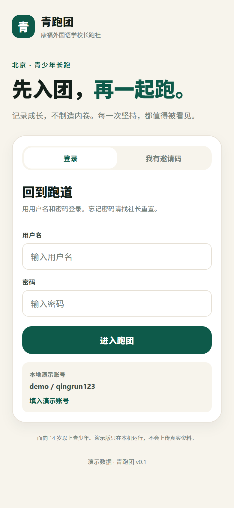
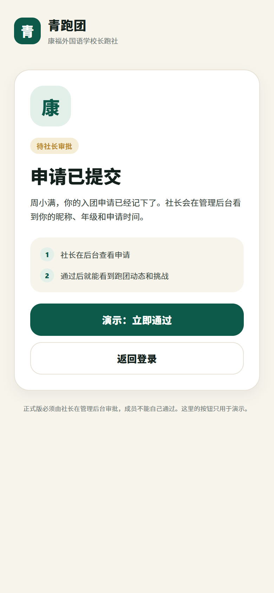
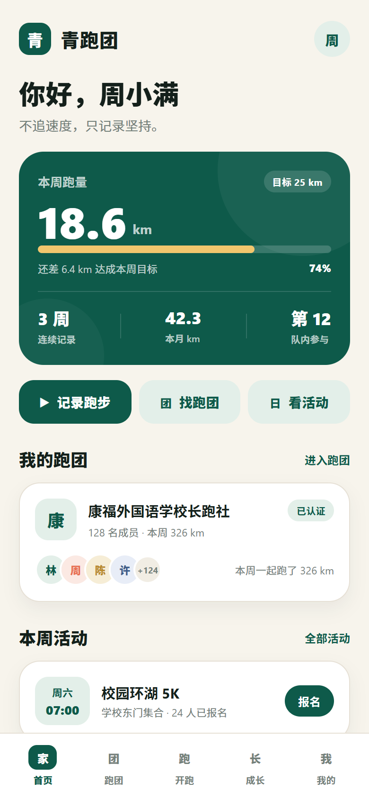

# 青跑团 · 手机端登录与入团 v0.1

- 日期：2026-11-17
- 状态：可点击原型，已通过 Web 导出和浏览器流程测试
- 范围：康福外国语学校长跑社（北京），只覆盖“登录 / 邀请码入团 / 待审批 / 审批后进入首页”
- 数据：全部在本机内存中，不上传服务器

## 1. 这一版解决什么

V0.1 的入口规则是：先有社团，再有成员。

1. 已入团成员用用户名和密码登录。
2. 新成员必须持有社长生成的邀请码，先验证邀请码，再填写昵称、年级、用户名和密码。
3. 提交后进入“待社长审批”，不能直接看社团记录。
4. 社长在管理后台审批；手机端原型用一个“演示：立即通过”按钮模拟审批结果。
5. 审批通过后进入五标签首页，显示自己的昵称和所属社团。

这一版不做身份证实名，也不做全站陌生人注册。邀请码既是入团入口，也是社团边界。

## 2. 演示账号

| 用途 | 值 |
| --- | --- |
| 已有成员登录 | 用户名 demo，密码 qingrun123 |
| 新成员邀请码 | KANGFU-2026 |
| 社团 | 康福外国语学校长跑社 |
| 城市 | 北京 |

登录页提供“填入演示账号”，邀请码页提供“填入演示邀请码”，方便没有键盘的演示场景。

## 3. 页面流程

### 3.1 登录

- 顶部展示“青跑团 / 康福外国语学校长跑社”。
- 两个页签：“登录”和“我有邀请码”。
- 登录失败时显示明确提示，不泄露“用户名是否存在”。
- 页脚写明“面向 14 岁以上青少年。演示版只在本机运行，不会上传真实资料。”

### 3.2 邀请码验证

- 输入邀请码后先校验，不通过则停在当前步骤。
- 校验通过后展示社团预览：康福外国语学校长跑社、北京、128 名成员、已认证。
- 正确邀请码进入资料填写；错误邀请码提示“邀请码不对，请向社长要一个新的邀请码。”

### 3.3 填写入团资料

字段与校验：

| 字段 | 规则 |
| --- | --- |
| 昵称 | 至少 2 个字 |
| 年级 | 初三 / 高一 / 高二 / 高三 / 大学其他 |
| 用户名 | 至少 3 个字符，登录时使用 |
| 密码 | 至少 6 位 |

提交成功后进入待审批页，状态为 pending。此时不展示社团动态、成员记录或挑战。

### 3.4 待审批

- 明确写出“申请已提交”和“社长会在管理后台看到你的昵称、年级和申请时间”。
- 两步说明：社长查看申请；通过后能看到跑团动态和挑战。
- “演示：立即通过”只用于本地演示，页面下方注明正式版必须由社长审批，成员不能自己通过。
- “返回登录”清除本地状态。

### 3.5 审批通过

- 首页问候语使用申请时填写的昵称，例如“你好，周小满”。
- 头像取昵称首字。
- 所属社团仍为康福外国语学校长跑社。
- 首页数据仍是演示数据，不代表真实跑步记录。

### 3.6 退出登录

“我的”页退出后回到登录页，清空内存中的成员资料。刷新页面同样会回到未登录状态。

## 4. 状态机

    guest --登录成功----------------------> active
    guest --邀请码有效 + 提交资料--------> pending
    pending --社长审批通过 / 演示通过----> active
    pending --返回登录--------------------> guest
    active --退出登录---------------------> guest

guest 显示登录/入团页；pending 显示待审批页；active 显示原来的五标签应用。

## 5. 代码位置

| 文件 | 作用 |
| --- | --- |
| mobile/src/features/auth/AuthContext.tsx | 登录、入团、审批、退出的内存状态 |
| mobile/src/features/auth/AuthScreen.tsx | 登录页、邀请码两步表单、待审批页 |
| mobile/src/app/_layout.tsx | 按登录状态切换页面 |
| mobile/src/app/index.tsx | 首页昵称、头像、跑团信息 |
| mobile/src/app/profile.tsx | 我的页昵称、年级、退出登录 |
| mobile/src/app/school.tsx | 北京同城跑团与活动示例 |
| mobile/src/constants/qingrun.ts | 社团名称、城市、演示数据 |
| mobile/scripts/e2e-auth.mjs | 390×844 浏览器流程测试 |

## 6. 已验证

- npm run typecheck：通过。
- npm run web:export：通过，导出到 mobile/dist。
- 预览地址：http://127.0.0.1:8090。
- 浏览器流程测试：登录、退出、错误邀请码、正确邀请码、填写资料、待审批、演示通过、首页昵称、再次退出，全部通过；控制台无错误。
- 截图：登录、待审批、审批后首页、原首页四张，位于 mobile/shots。

## 7. 已知边界

这是交互原型，不是可上线的账号系统：

- 状态只在内存里，刷新或重启即丢失。
- 只有 demo 账号能登录；新申请的账号在退出后不能再次登录。
- 邀请码是前端常量，没有次数、有效期、社团归属校验。
- “演示：立即通过”绕过了后台审批，正式版必须删除。
- 没有密码哈希、登录限流、短信/邮箱验证、设备管理、审计日志。
- 没有真实上传，也没有收集真实姓名、手机号、学校证明或位置。

## 8. 接真实后端时先做什么

1. 在 PocketBase 建 clubs、invites、join_requests、members 四张表，邀请码绑定社团和有效期。
2. 密码交给 PocketBase Auth 处理，客户端不保存明文。
3. 入团申请写入 join_requests，状态为 pending；只有社长或管理员能改成 approved。
4. 登录后从 members 读取社团、昵称、年级和角色，不再使用本地常量。
5. 增加登录失败限流、邀请码使用次数、审批审计和撤回机制。
6. 在真实学校试点前，补齐监护人同意、隐私说明、数据删除入口和线下活动安全规则。

## 9. 下一步

- 方案 A：把手机端登录/入团接到 PocketBase，后台审批真正联动。
- 方案 B：先继续完善手机端的跑步记录、成长档案和活动报名，再统一接后端。

当前建议先做 A 的最小闭环：一个社团、一个邀请码、一次真实审批。这样后面所有页面才有真实身份可用。
