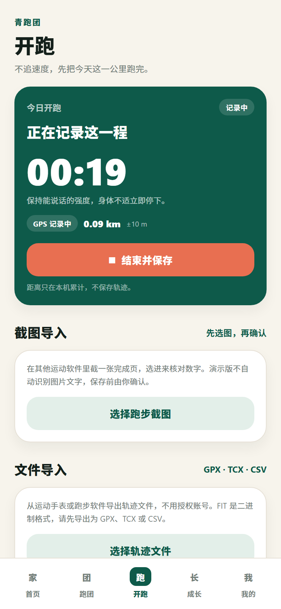
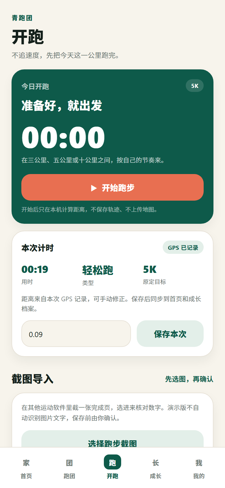
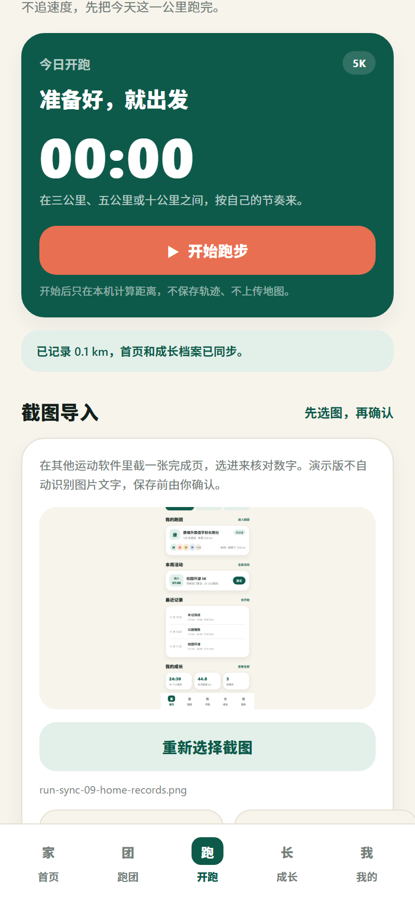
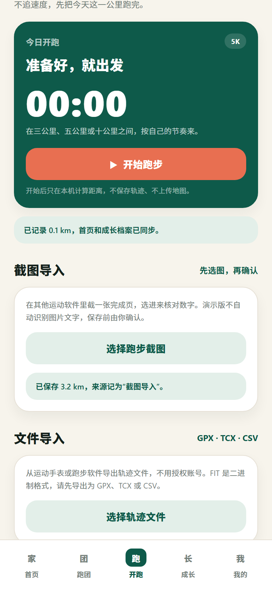
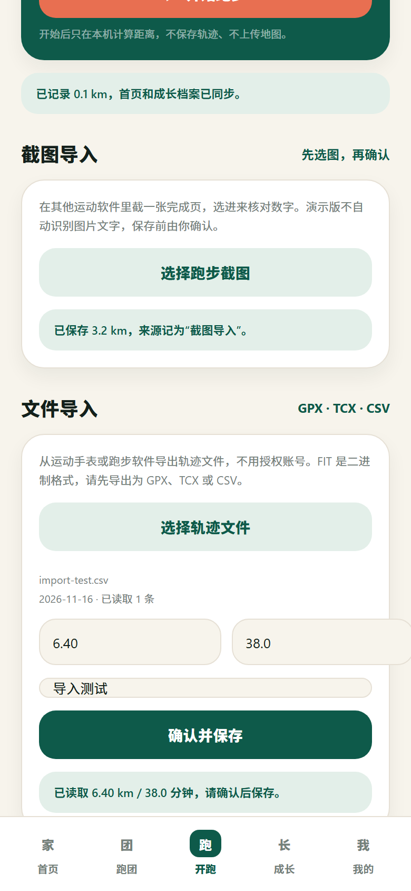
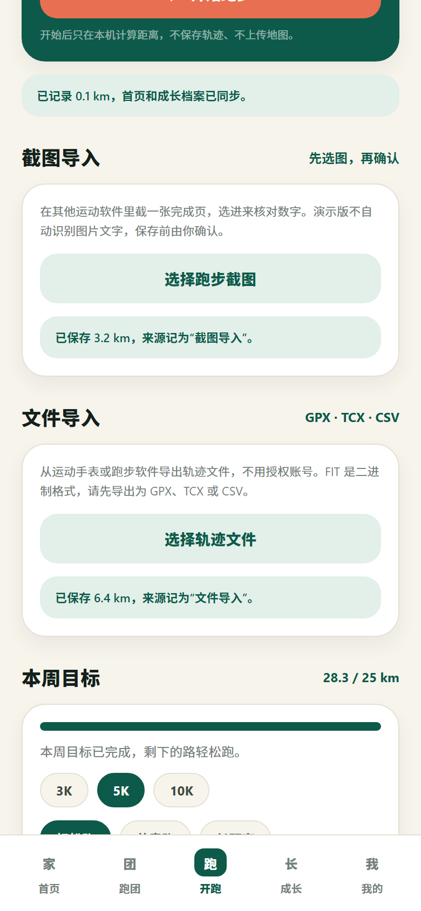
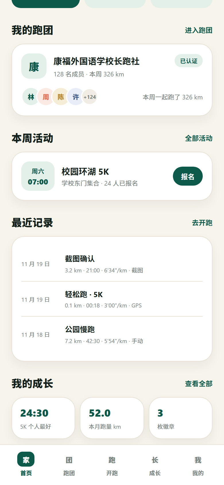
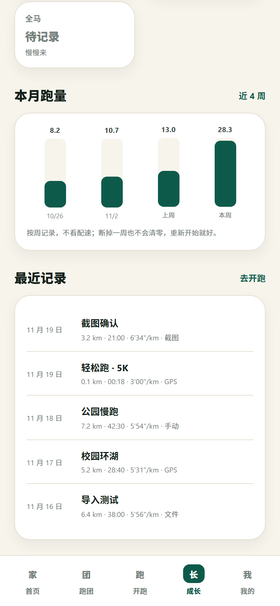

# 青跑团 · 开跑记录与成长同步 v0.2

- 日期：2026-11-19
- 状态：可点击原型，已通过 Web 导出和浏览器流程测试
- 范围：手机端“开跑”页记录 → 首页 / 成长页 / 我的页同步
- 数据：全部在本机内存中，刷新页面恢复演示种子数据
- 上游决策：用户确定“3 个通道：1. GPS；2. 屏幕截图后手动确认和修改；3. 不做其他软件链接，但支持其他软件导入数据”。

> 本文取代 v0.1 中“计时器不采集 GPS、距离必须手动补”的描述。v0.1 的记录闭环仍然有效，v0.2 在此基础上增加了 GPS、截图确认和轨迹文件导入三条通道。

## 1. 这一版解决什么

之前的开跑页可以计时，但不会自动得到距离；首页和成长页也只看静态演示数据。v0.1 先把手动记录写进共享内存；v0.2 让一次跑步可以从三条不同通道进入同一份记录表：

1. **GPS**：开跑时在前台采集位置点，本机累加距离；结束后可核对、修正再保存。
2. **截图确认**：从相册主动选择一张其他运动软件的完成页截图，手工填写距离、时长和备注后保存。
3. **文件导入**：从运动手表或跑步软件导出 GPX、TCX 或 CSV，解析出距离、时长和日期，确认后保存。

三条通道最终都写入同一份 `RunContext` 记录表，因此首页本周/本月跑量、最近记录、成长页近四周柱状图和最近记录会立即同步。手动补记和计时补距离仍然保留，作为没带手机、没信号或权限被拒绝时的兜底。

这一版不接 PocketBase，不把记录、截图或轨迹上传到任何服务器。

## 2. 共享记录模型

文件：`mobile/src/features/runs/RunContext.tsx`

```ts
type RunSource = 'gps' | 'screenshot' | 'file' | 'manual';

type RunRecord = {
  id: string;
  date: string;          // YYYY-MM-DD
  title: string;
  distanceKm: number;
  durationMin: number;
  source: RunSource;
};
```

来源标签统一由 `RUN_SOURCE_LABELS` 提供：GPS / 截图 / 文件 / 手动。首页、开跑页和成长页的最近记录都会显示来源，避免把截图补记误认为 GPS 实测。

`RunProvider` 包住页面树，首页、开跑、成长、我的都通过 `useRuns()` 读取同一份记录。

统计口径：

| 指标 | 口径 |
| --- | --- |
| 本周跑量 | 以周一为一周起点，统计本周一至今 |
| 本月跑量 | 按自然月统计 |
| 周目标 | 固定 25 km，进度按本周跑量 / 25 |
| 近四周 | 本周及之前三周，按周汇总；柱高按四周最大值归一 |
| 最近记录 | 按日期倒序；首页 3 条，开跑页和成长页 5 条 |

格式化工具：

- `formatDuration(minutes)`：`42:30` 或 `1:03:30`
- `formatPace(distanceKm, durationMin)`：`5'54"/km`
- `formatRunDate(iso)`：`11 月 18 日`

## 3. 通道一：GPS

### 3.1 权限与范围

- 依赖：`expo-location ~58.0.22`。
- 只申请**前台**定位权限，不开后台定位，不申请“始终允许”。
- `mobile/app.json` 的权限文案：“青跑团只在开跑时使用定位来计算距离，不保存轨迹。”
- 开始跑步时才请求权限；拒绝后仍可计时，结束后手动补距离。
- 位置点只在本机内存中参与距离计算，不写数据库、不上传、不渲染地图，也不保存轨迹文件。

### 3.2 采集与过滤

文件：`mobile/src/features/runs/geo.ts`

- 使用 `watchPositionAsync`，`Accuracy.High`，约每 1.5 秒或每 2 米回调一次。
- 相邻点用 haversine 公式计算球面距离，单位米。
- 每段先经过 `decideGpsSegment` 过滤，避免静止漂移和异常跳点：

| 规则 | 处理 |
| --- | --- |
| 精度 `accuracy > 50 m` | 丢弃该点，状态显示“GPS 信号弱” |
| 两点间隔 `< 1 秒` | 丢弃该段 |
| 两点距离 `< 1.5 米` | 丢弃该段 |
| 两点间隔 `> 30 秒` | 丢弃该段，避免后台断点被拉成直线 |
| 推算速度 `> 12 m/s` | 丢弃该段，并重置上一个点 |

### 3.3 页面状态

GPS 状态：`idle / requesting / waiting / tracking / weak / denied / unavailable`。

对应文案：GPS 待命、请求定位、正在搜星、GPS 记录中、GPS 信号弱、未开定位、定位不可用。

结束跑步时：

- 如果 GPS 累计距离 `>= 0.05 km`，显示“本次计时 / GPS 已记录”，把距离预填到输入框，并允许手动修正。
- 如果不足 `0.05 km`，显示“待补距离”，由用户填写。
- 保存时，有 GPS 记录的来源写 `gps`；没有 GPS 的计时记录写 `manual`。





### 3.4 现阶段的真实边界

- Web 端测试使用浏览器地理坐标模拟；**尚未在真实 Android/iOS 设备上验证**定位精度、耗电、锁屏和后台切换。
- 只做前台记录；锁屏或切到后台后是否继续取点，取决于系统，不能当作可靠能力。
- 不保存轨迹，所以不能回放路线，也不能用轨迹反推配速。
- GPS 距离是估算值，城市楼宇、树荫、操场绕圈都可能产生偏差；页面允许用户结束前修正。

## 4. 通道二：截图确认

### 4.1 流程

页面组件：`mobile/src/features/runs/ImportCards.tsx` 的 `ScreenshotImportCard`。

1. 用户点“选择跑步截图”。
2. 通过 `expo-image-picker` 只读取用户主动选择的一张图片；不遍历相册。
3. 页面显示本地预览和文件名。
4. 用户手动填写距离、时长、备注；三项都在保存前可见、可改。
5. 保存为 `source: 'screenshot'`，标题默认“截图确认”。

当前是**人工核对**，不是自动 OCR。页面文案明确写着“演示版不自动识别图片文字，保存前由你确认”，避免用户以为数字是自动读出的。

### 4.2 隐私边界

- 图片只在当前页面预览，不上传、不写入记录表、不进入后台。
- 记录表只保存用户确认后的距离、时长、日期和备注。
- 正式版如果做 OCR，需要单独说明图片处理位置（本机或服务器）、保存期限和删除方式。





## 5. 通道三：文件导入

### 5.1 支持格式

文件：`mobile/src/features/runs/importers.ts`

| 格式 | 解析内容 | 说明 |
| --- | --- | --- |
| CSV | 距离、时长、日期、备注 | 支持中英文表头；演示用 4 列 |
| GPX | 轨迹点、时间 | 用点间 haversine 距离和起止时间估算 |
| TCX | Trackpoint、时间、经纬度 | 与 GPX 同一套距离算法 |
| FIT | 不支持 | 二进制格式；提示先导出 GPX、TCX 或 CSV |

解析后不会直接落库：页面显示文件名、读取到的条数、距离、时长、备注，用户点“确认并保存”后才写入，来源为 `file`。解析结果经过 `cleanRun` 限制：0.1–100 km、1–600 分钟。

### 5.2 为什么不做账号授权

按用户决策，不接其他运动软件的账号或 OAuth。用户主动从手表/软件导出文件，再选择文件导入；青跑团不索取第三方账号，也不读取第三方云端数据。

### 5.3 Web 与原生差异

- Web 端使用隐藏的 `input[type=file]`；自动化测试通过 CDP `DOM.setFileInputFiles` 选择文件。
- 原生端使用 `expo-document-picker`。
- 两条路径共用同一个解析器，但原生文件选择器和真实文件 URI 仍需在设备上补测。





## 6. 手动补记与计时兜底

手动记录仍然保留：

- 距离 0.1–100 km；时长 1–600 分钟；备注选填。
- 保存后来源为 `manual`，标题用备注或当前训练类型。
- 适合没带手机、GPS 不可用、截图/文件都没有的情况。

计时器仍然只负责计时；有 GPS 时自动带出距离，没有 GPS 时要求用户补距离。它不再写入 0.0 km 的假记录。

## 7. 首页与成长页同步

首页：

- 本周跑量、周目标进度、剩余公里来自 `stats.weekKm`。
- 本月公里数来自 `stats.monthKm`。
- “最近记录”显示最近 3 条，包含日期、标题、距离、时长、配速和来源。
- 记录后不需要刷新页面，返回首页即可看到变化。



成长页：

- “本月成长”使用 `stats.monthKm`。
- “本月跑量 / 近 4 周”使用 `stats.weeks`。
- “最近记录”显示最近 5 条，文件导入记录也会出现。
- 个人最好、徽章、团队成长榜仍是演示数据，不在本次同步范围内。



我的页：

- “本月 km”使用 `stats.monthKm`。

## 8. 验收记录

测试脚本：`mobile/verify-three-channels.mjs`

环境：Windows + Edge headless CDP + 390×844 @2x，测试账号 `demo / qingrun123`；GPS 通过 CDP 地理坐标模拟，截图选择真实 PNG，文件选择 CSV。

| 场景 | 结果 |
| --- | --- |
| 初始首页 | 本周 18.6 km / 本月 42.3 km |
| GPS 开始 | 状态从“请求定位”到“GPS 记录中”，显示累计 0.09 km、±10 m |
| GPS 结束 | 预填 0.09 km，来源写 GPS |
| 截图选择 | 预览成功，手动填 3.2 km / 21 分钟 / “截图确认”并保存 |
| CSV 导入 | 解析 6.4 km / 38 分钟，确认后保存 |
| 首页同步 | 本周 28.3 / 25 km，本月 52.0 km；最近记录含 GPS、截图、手动 |
| 成长页同步 | 本周柱 28.3 km；最近 5 条含 GPS、截图、手动、文件 |
| 浏览器错误 | 0 console error / 0 exception |

补充：GPX 与 TCX 解析器用 3 个轨迹点单独做过单元测试，均得到 0.22 km / 10 分钟 / 2026-11-15；CSV 已通过浏览器完整流程验证。

构建：

- `npm run typecheck` exit 0。
- `npm run web:export` 成功，Expo Router 822 modules，run bundle 67 KB。
- 截图目录：`mobile/shots/three-*.png`；测试报告：`mobile/shots/three-channels-report.json`。

## 9. 已知边界

- 记录只存在内存里，刷新恢复种子数据。
- 截图通道不自动 OCR；用户必须自己核对数字。
- 文件通道不支持 FIT，也不支持从第三方账号直接拉取。
- GPS 只做前台距离累计；不保存轨迹、不做地图、不做后台记录。
- 未在真实 Android/iOS 设备上验证定位、文件选择器和权限弹窗。
- 记录不能编辑、删除或补传原图；这些留给后续版本。
- 首页“连续记录 3 周”“队内参与第 12”、跑团“本周 326 km”、个人最好、徽章、团队榜仍是静态演示数据。
- 手机端、社团后台、平台后台的数据仍互不相通。

## 10. 下一步

1. 用真实 Android 设备做 GPS 实跑：操场 400 米、直线 1 公里、树荫和楼间各一次，记录偏差和耗电。
2. 截图通道接本机 OCR（或用户可选的云端 OCR），仍然保留“识别结果必须人工确认”。
3. 文件通道补 FIT 解析和更多运动软件的字段兼容。
4. 把 RunContext 的读写抽成 repository，先做本地持久化，再接 PocketBase。
5. 记录详情与编辑；删除采用软删除，保留审计信息。
6. 把“连续记录”“队内参与”“跑团本周里程”改为按记录计算。
7. 正式版增加定位相关的单独同意、未成年人提示和隐私说明；不在公开页面展示精确位置或轨迹。
