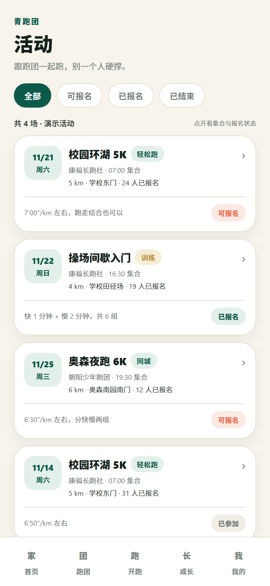
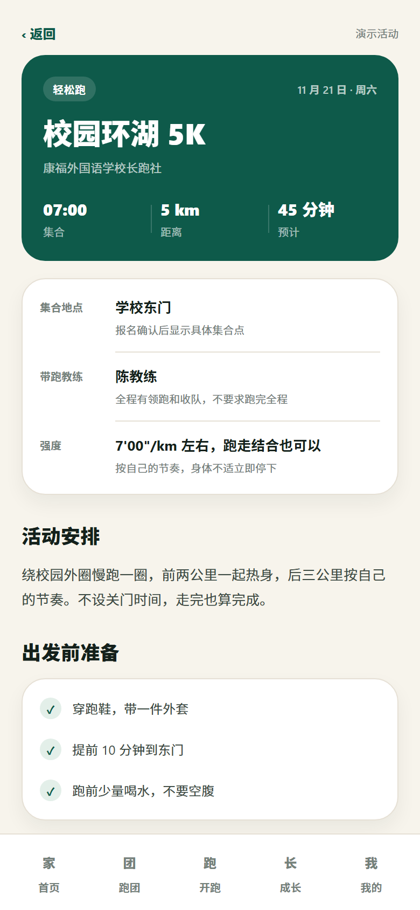
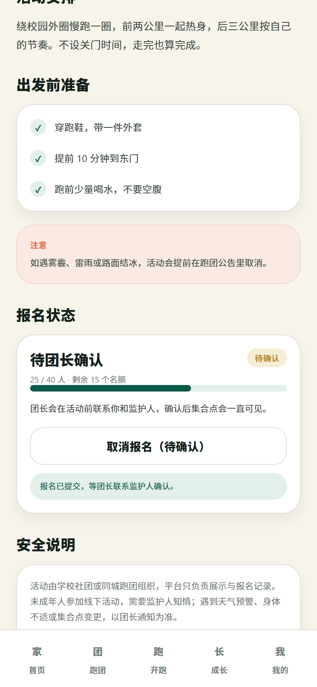
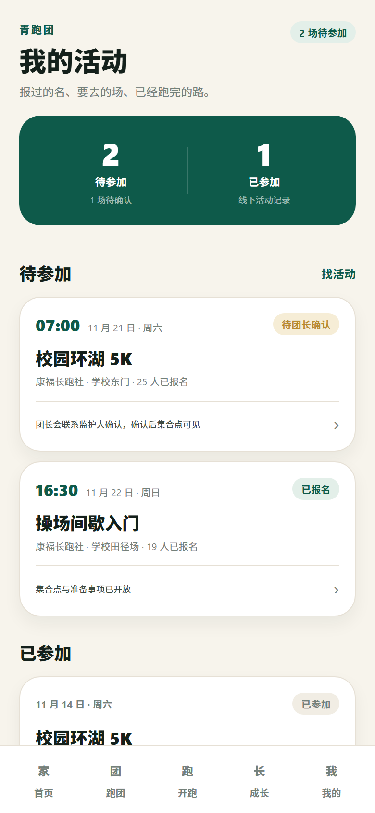

# 手机端活动报名与我的活动 v0.1

> 状态（2026-11-19）：可点击原型已完成并通过 Web 导出和浏览器验收。活动与报名只保存在本次打开的内存里，刷新恢复演示种子。
>
> 相关文档：[开跑记录与成长同步 v0.2](10-开跑记录与成长同步-v0.1.md) · [手机端跑步知识库 v0.1](11-手机端跑步知识库-v0.1.md) · [社团后台活动发布与报名审核 v0.1](13-社团后台活动发布与报名审核-v0.1.md)

## 1. 这一版解决什么

之前“本周活动”在首页和跑团页各用一份局部状态，点“报名”只改当前页面；换一个页面就回到未报名，“我的活动”也还跳回跑团页。这一版把活动从“静态卡片”做成一条完整链路：

1. 首页只显示下一场活动，跑团页显示全部近期活动。
2. 点任意活动卡进入详情，查看安排、教练、准备清单和报名状态。
3. 报名后进入“待团长确认”，首页、跑团页、我的页、我的活动页同时更新。
4. 待确认时可以取消，名额立即释放。
5. 我的活动把“待参加”和“已参加”分开，已确认活动才显示具体集合点。
6. 活动列表支持全部、可报名、已报名、已结束四个筛选。

这是一份**演示用的报名流程**，没有真实团长账号、监护人授权记录或后台审批。

## 2. 演示活动

日期按当前日期动态生成：最近的周六、周日、下周三和上周六。

| id | 活动 | 时间 | 地点 | 距离/预计 | 容量/基础报名 | 标签 | 初始状态 |
| --- | --- | --- | --- | --- | --- | --- | --- |
| a1 | 校园环湖 5K | 本周六 07:00 | 学校东门 | 5 km / 45 分钟 | 40 / 24 | 轻松跑 | 可报名 |
| a2 | 操场间歇入门 | 本周日 16:30 | 学校田径场 | 4 km / 50 分钟 | 24 / 18 | 训练 | 已报名（演示种子） |
| a3 | 奥森夜跑 6K | 下周三 19:30 | 奥森南园南门 | 6 km / 55 分钟 | 30 / 12 | 同城 | 可报名 |
| p1 | 校园环湖 5K | 上周六 07:00 | 学校东门 | 5 km / 42 分钟 | 40 / 31 | 轻松跑 | 已参加（演示种子） |

初始种子：

```ts
const INITIAL_SIGNUPS = {
  a2: 'confirmed',
  p1: 'attended',
};
```

所以第一次打开“我的活动”会看到：2 场待参加（a2 + 报名后的 a1）、1 场已参加（p1）。a1 初始显示 24 / 40 人，报名后 25 / 40。

## 3. 状态模型

文件：`mobile/src/features/activities/ActivityContext.tsx`

```ts
type SignupStatus = 'pending' | 'confirmed' | 'attended';

type SignupResult = 'joined' | 'already' | 'full' | 'closed';
```

| 状态 | 用户看到 | 含义 |
| --- | --- | --- |
| `pending` | 待团长确认 | 报名已提交，等待团长联系监护人确认 |
| `confirmed` | 已报名 | 团长已确认，具体集合点可见 |
| `attended` | 已参加 | 过去活动的参加记录 |

规则：

- 点击“报名参加”写入 `pending`，不是直接 `confirmed`。
- 同一活动只能有一条报名；重复报名返回 `already`。
- 过去活动返回 `closed`，不能再报名。
- 容量按 `signedBase + 自己是否已报名` 计算；满了就不能再报名。
- 取消只允许 `pending` 或 `confirmed`，取消后从报名表移除，名额释放。
- `attended` 是演示种子，当前不提供用户自助“签到”或“标记已参加”。

共享状态由 `ActivityProvider` 管理，挂在 `mobile/src/app/_layout.tsx` 的 `AuthProvider` 内。首页、跑团页、活动列表、活动详情、我的页都读同一份报名表，所以不会出现两个页面状态不一致。

## 4. 页面与入口

### 4.1 首页与跑团页

首页：

- “本周活动”取 `upcomingActivities[0]`，显示下一场的日期、时间、标题、集合区域和报名人数。
- 右侧状态在“报名 / 待确认 / 已报名”之间变化；整张卡进入 `/activity/[id]`。
- “看活动”和“全部活动”进入 `/activities`。

跑团页：

- “近期活动”渲染全部 upcoming 活动，卡片显示日期、时间、标签、集合区域、报名人数和状态。
- 不再使用页面内 `useState`；报名状态由 `ActivityProvider` 提供。
- “全部活动”进入活动列表。

### 4.2 活动列表 `/activities`

- 顶部筛选：全部、可报名、已报名、已结束。
- “可报名”只显示 upcoming 且当前没有报名状态的活动。
- “已报名”只显示 upcoming 且 `pending` 或 `confirmed` 的活动。
- “已结束”只显示 `status === 'past'` 的活动。
- 每张卡显示日期块、标题、标签、俱乐部、时间、距离、集合区域、报名人数、配速提示和状态。
- 空结果有“查看全部活动”重置入口。
- 底部“活动说明”明确：报名不等于被放行；临时不去可以取消。



### 4.3 活动详情 `/activity/[id]`

详情页按顺序展示：

1. 深绿活动 hero：标签、日期、标题、俱乐部、集合时间、距离、预计时长。
2. 集合地点、带跑教练、强度说明。
3. 活动安排、出发前准备清单、天气/安全注意。
4. 报名状态卡：报名状态、人数/容量、进度条、状态说明和操作按钮。
5. 安全说明和“看看其他活动”。

隐私规则：

- 未报名时只显示集合区域（如“学校东门”），具体位置显示“报名确认后显示具体集合点”。
- `pending` 时仍**不显示具体集合点**，文案改为“团长确认后显示具体集合点”。
- 只有 `confirmed` 或 `attended` 才显示 `meetingDetail`（如“东门内侧银杏树下”）。
- 取消后立即重新隐藏具体集合点。
- 列表和详情都不展示其他参与者的联系方式。

按钮状态：

| 情况 | 按钮 |
| --- | --- |
| 未报名且未满 | 报名参加 |
| 待确认 | 取消报名（待确认） |
| 已确认 | 取消报名 |
| 过去且已参加 | 已参加这场活动（禁用） |
| 过去且未参加 | 活动已结束（禁用） |
| 名额满 | 名额已满（禁用） |





### 4.4 我的活动 `/my-activities`

- 深绿汇总卡：待参加数量、已参加数量；待确认数量优先显示在提示里。
- “待参加”显示 `pending` 和 `confirmed` 活动，卡片状态分别为“待团长确认”“已报名”。
- “已参加”显示 `attended` 活动。
- 空态引导去 `/activities`。
- 底部再次解释“取消不需要理由”和“待确认不是已通过”。



### 4.5 我的页

“我的活动”副标题根据共享状态变化：

- 有 pending：`已报名 N 场 · 待确认 M 场`
- 全部 confirmed：`已报名 N 场 · 已参加 M 场`
- 没有报名：`已参加 N 场 · 去看看近期活动`

点击进入 `/my-activities`。

## 5. 未成年人与安全边界

- 报名只是“提交申请”，不是“批准参加”；页面统一使用“待团长确认”。
- 未成年人线下活动需要监护人知情，正式版应由团长向监护人发起授权确认；当前仅展示流程，没有真实授权记录。
- 确认前不显示具体集合点，不向其他参与者展示联系方式。
- 活动页明确提醒天气预警、身体不适、集合点变更以团长通知为准。
- 取消报名不需要理由，避免未成年人因为害怕解释而勉强参加。
- 所有活动文案是演示项目稿；教练、容量、点名等均为 Mock 数据。

## 6. 验收

构建：

```bash
cd mobile
npm run typecheck
npm run web:export
```

结果：TypeScript exit 0；Web 导出 831 modules、15 个 bundle；`activities` 8.3 KB、`my-activities` 8.8 KB、活动详情约 15 KB、entry 1.1 MB。

浏览器验收（390×844，Edge headless + CDP）：

```bash
node verify-activities.mjs
```

| 场景 | 结果 |
| --- | --- |
| 首页下一场活动 | 24/40 人，按钮“报名” |
| 未报名详情 | 具体集合点隐藏，显示“报名确认后显示具体集合点” |
| 报名 a1 | 进入“待团长确认”，25/40；具体集合点仍隐藏，显示“团长确认后显示具体集合点” |
| 首页同步 | 25 人已报名，状态“待确认” |
| 我的页同步 | “已报名 2 场 · 待确认 1 场” |
| 我的活动 | 2 场待参加、1 场已参加；待确认提示可见 |
| 从我的活动进入 a1 并取消 | 显示“已取消报名”，回到“还没报名”，集合点重新隐藏 |
| 活动列表 | 4 场；可报名/已报名/已结束状态齐全 |
| 可报名筛选 | 2 场（a1、a3），不含已报名的 a2 |
| 已结束筛选 | 1 场（p1） |
| 过去活动详情 | “已参加这场活动”、具体集合点、活动已结束 |
| 已报名筛选 | 1 场（a2） |
| 已确认活动详情 | “已报名”、具体集合点可见、“取消报名” |
| Console error / exception | 0 |

截图：

- `mobile/shots/activities-01-home-card.png`
- `mobile/shots/activities-02-detail-locked.png`
- `mobile/shots/activities-03-detail-signup-section.png`
- `mobile/shots/activities-04-detail-pending.png`
- `mobile/shots/activities-05-home-pending.png`
- `mobile/shots/activities-06-profile-summary.png`
- `mobile/shots/activities-07-my-activities.png`
- `mobile/shots/activities-08-detail-cancelled.png`
- `mobile/shots/activities-09-list-all.png`
- `mobile/shots/activities-10-filter-open.png`
- `mobile/shots/activities-11-filter-past.png`
- `mobile/shots/activities-12-detail-past.png`
- `mobile/shots/activities-13-filter-mine.png`
- `mobile/shots/activities-14-detail-confirmed.png`

## 7. 代码位置

| 文件 | 作用 |
| --- | --- |
| `mobile/src/features/activities/activityData.ts` | 活动类型、4 场演示活动、报名状态标签、日期格式化 |
| `mobile/src/features/activities/ActivityContext.tsx` | 共享报名表、初始种子、容量、报名/取消和派生列表 |
| `mobile/src/app/activities.tsx` | 活动列表和四个筛选 |
| `mobile/src/app/activity/[id].tsx` | 活动详情、隐私门控、报名/取消 |
| `mobile/src/app/my-activities.tsx` | 我的活动汇总和分组列表 |
| `mobile/src/app/index.tsx` | 首页下一场活动 |
| `mobile/src/app/school.tsx` | 跑团页近期活动 |
| `mobile/src/app/profile.tsx` | 我的活动副标题和入口 |
| `mobile/src/app/_layout.tsx` | 挂载 `ActivityProvider` |
| `mobile/verify-activities.mjs` | 本轮的浏览器验收脚本 |

可点击组件补充了 `accessibilityRole="button"`；活动筛选还带 `accessibilityState.selected` 和 `testID`，方便键盘、读屏和自动化测试。

## 8. 已知边界

- 活动、报名、确认和取消都只在内存中，刷新恢复演示种子。
- 没有真实团长/社团后台联动；社团后台目前不能审批手机端报名。
- 没有监护人授权记录、签到、请假、候补、通知或日历导出。
- `signedBase`、教练、活动安排和容量都是 Mock 数据；日期只相对当前周生成。
- 没有限制一个用户同时报几场，也没有按年龄/年级过滤活动。
- 没有真实地理位置、天气接口或活动取消推送。
- 未在真实 Android/iOS 上验证点击、滚动和权限行为。

## 9. 下一步

1. 社团后台已增加活动发布、报名审核和结束活动（见 [docs/13](13-社团后台活动发布与报名审核-v0.1.md)，演示数据独立）；还需要接同一套接口，并补签到。
2. 增加监护人授权记录，团长确认前不能进入“已确认”。
3. 增加候补队列、请假、活动提醒和“加入日历”。
4. 把 `ActivityContext` 抽成 repository，先做本地持久化，再接 PocketBase。
5. 用真实学校活动做一次端到端演练：发布 → 报名 → 监护人确认 → 签到 → 记录同步。

## 10. 演示路径

```text
登录 demo / qingrun123
→ 首页“本周活动”点校园环湖 5K
→ 详情页“报名参加”
→ 看到“待团长确认”和人数 25/40，具体集合点仍隐藏
→ 返回首页，状态变为“待确认”
→ 我的 → 我的活动，看到 2 场待参加 / 1 场已参加
→ 点校园环湖 5K，取消报名
→ 返回首页 → 全部活动
→ 切换“可报名 / 已报名 / 已结束”
→ 打开已确认的操场间歇入门，查看集合点与取消按钮
```
