# 社团后台活动发布与报名审核 v0.1

> 状态（2026-11-19）：可点击原型已完成，浏览器端到端验收通过。活动、报名和监护人同意只保存在本次打开的管理后台内存里，刷新恢复演示种子；**后台数据与手机端仍不相通**。
>
> 相关文档：[手机端活动报名与我的活动 v0.1](12-手机端活动报名与我的活动-v0.1.md) · [双后台与平台总后台 v0.1](09-双后台与平台总后台-v0.1.md)

## 1. 这一版解决什么

手机端已经有“报名 → 待团长确认 → 已确认”的演示链路，但社团后台没有活动入口，团长无法发布活动、查看报名、登记监护人同意或确认名额。这一版补齐社团侧闭环：

1. 活动列表按状态筛选，单独筛出“有待确认报名”的活动。
2. 活动详情展示报名人数、待确认、已确认、距离和集合时间。
3. 团长先登记监护人同意，才能通过报名。
4. 拒绝报名必须写一句原因，成员端会看到。
5. 结束活动时，未确认的报名自动关闭，名单转为只读。
6. 草稿可以发布；新活动填写完整后直接进入报名中。

**边界要先说清楚：**这是管理后台自己的演示数据，不是手机端 `ActivityContext` 的真实来源。后台点“通过”不会改变手机端状态，手机端报名也不会出现在后台。接 PocketBase 后才做真正的跨端联动。

## 2. 演示活动

日期相对当前日期生成，避免每次打开都变成过去活动。

| id | 活动 | 时间 | 地点 | 距离/时长 | 容量 | 初始报名 | 状态 |
| --- | --- | --- | --- | --- | --- | --- | --- |
| act-001 | 校园环湖 5K | 周六 07:00 | 学校东门 | 5 km / 45 分钟 | 40 | 7 人（待确认 2、已确认 5） | 报名中 |
| act-002 | 操场间歇入门 | 周日 16:30 | 学校田径场 | 4 km / 50 分钟 | 24 | 5 人（待确认 1、已确认 4） | 报名中 |
| act-003 | 奥森夜跑 6K | 下周三 19:30 | 奥森南园南门 | 6 km / 55 分钟 | 30 | 0 人 | 草稿 |
| act-004 | 校园环湖 5K | 上周六 07:00 | 学校东门 | 5 km / 42 分钟 | 40 | 6 人（已参加） | 已结束 |

初始列表统计：

- 报名中 2 场。
- 待确认 3 条（act-001 两条、act-002 一条）。
- 累计报名 18 人，不含已取消；包含已结束活动的 6 名已参加成员。

act-001 还有一条已取消的演示报名（赵清和），所以“报名名单”tab 显示 8 条，但“报名人数”只算 7 人。这个差异是故意的：取消的人保留在名单里方便追溯，不占名额。

## 3. 状态模型

文件：`admin/src/types/models.ts`、`admin/src/data/mockRepository.ts`

```ts
type ClubActivityStatus = 'draft' | 'published' | 'ended';
type ActivitySignupStatus = 'pending' | 'approved' | 'attended' | 'declined';
```

| 状态 | 后台显示 | 含义 |
| --- | --- | --- |
| `draft` | 草稿 | 不对外，只能发布或继续编辑 |
| `published` | 报名中 | 可以审核报名 |
| `ended` | 已结束 | 名单只读，不能再改报名状态 |
| `pending` | 待确认 | 等团长联系监护人并确认 |
| `approved` | 已确认 | 团长已确认，成员端可看到集合点 |
| `attended` | 已参加 | 过去活动的参加记录 |
| `declined` | 已取消 | 团长拒绝，或活动结束时系统关闭 |

汇总口径：

- `signupCount`：`pending + approved + attended`，不含 `declined`。
- `pendingCount`：只算 `pending`。
- `confirmedCount`：`approved + attended`，已参加也计入“已确认”。
- 报名人数、容量占用、累计报名都用这个口径。

规则：

- 只有 `published` 活动可以审核报名；草稿和已结束活动只读。
- 只有 `pending` 可以同意、拒绝或补登记监护人同意。
- 通过前必须已有 `guardianConsent`，否则拒绝操作并提示先补登记。
- 通过前检查容量；已确认人数达到上限就不能再通过。
- 结束活动时，所有待确认报名自动转为已取消，并写入系统原因。
- 已经确认或已参加的报名不因结束活动而消失。

## 4. 活动列表

路由：`/activities`

页面由三块组成：

1. 顶部三个统计卡：报名中、待确认、累计报名。
2. 状态筛选：全部、待确认、报名中、草稿、已结束。
3. 搜索框：按活动名称、教练、集合地点、标签搜索。

“待确认”筛选比较特殊：它按**活动**筛，不是按单条报名筛。只要这场活动还有待确认报名，就出现在结果里，方便团长一次处理完。tab 上的数字是“有几场活动有待确认”，统计卡上的数字是“一共有几条待确认报名”，两者不要混淆。

列表列：

| 列 | 内容 |
| --- | --- |
| 活动 | 名称、标签、距离、集合区域 |
| 时间 | 日期、星期、集合时间、预计时长 |
| 报名 | 已报名 / 容量；待确认条数或“没有待确认报名” |
| 带跑 | 教练 |
| 状态 | 报名中 / 草稿 / 已结束 |
| 操作 | 查看详情 |

当前只有 4–5 场活动，没有加分页；搜索和筛选在内存里即时完成。空结果会提示换关键词，或直接给“发布活动”入口。

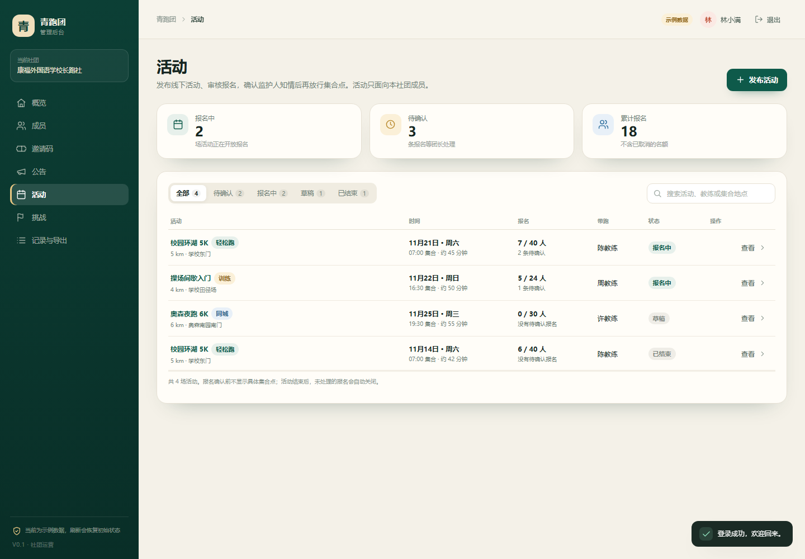

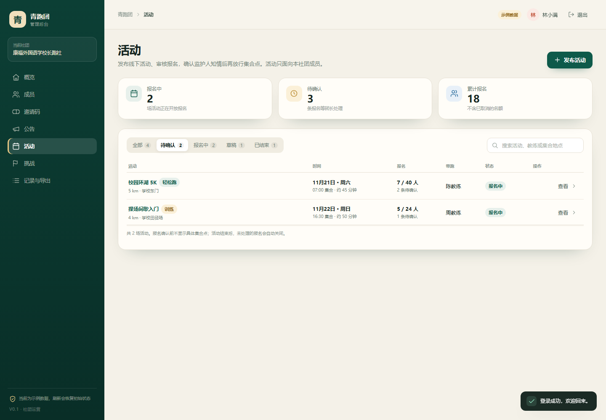

## 5. 活动详情与报名审核

路由：`/activities/:activityId`

详情页从上到下：

1. 返回活动列表。
2. 活动标题、状态、标签、日期、时间、地点、距离、教练。
3. 五张汇总卡：报名人数、待确认、已确认、距离、集合。
4. 两个 tab：报名名单、活动信息。
5. 报名名单：状态筛选、成员搜索、报名表格。
6. 底部：结束活动 / 发布活动等主操作。

报名表格字段：

- 成员：姓名、年级、性别、成员备注。
- 监护人：姓名、电话、同意状态。
- 提交时间：相对时间。
- 状态：待确认 / 已确认 / 已参加 / 已取消。
- 操作：补登记同意、通过、取消。

监护人电话只在社团后台内部可见，不进入手机端公开页面，也不出现在活动列表。当前是演示数据，不能录入真实未成年人信息。

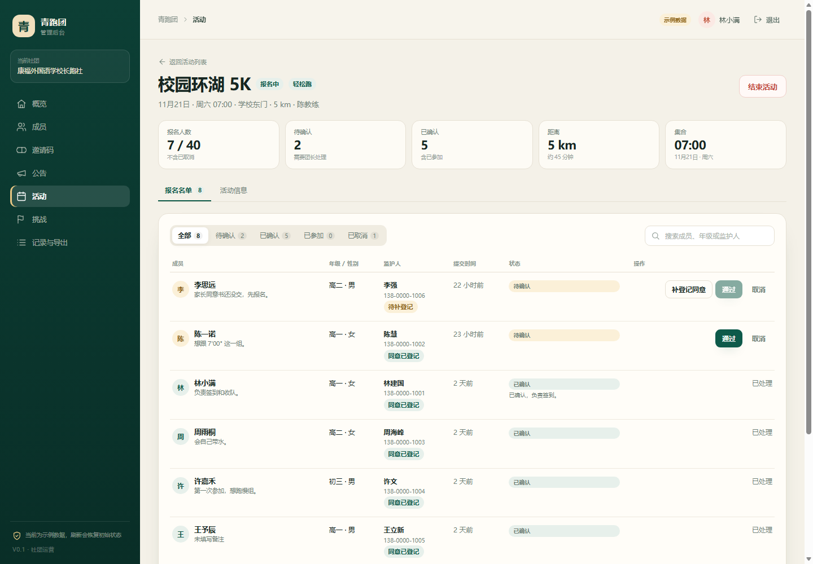

### 5.1 先登记监护人同意

演示数据里，李思远（sg-006）是“家长同意书还没交，先报名”的状态：

- 状态是待确认。
- 监护人同意显示“待补登记”。
- “通过”按钮禁用。
- 多出“补登记同意”按钮。

点击“补登记同意”后弹出确认框，团长确认已经联系监护人，才会把 `guardianConsent` 改为 `true`。操作后：

- 监护人同意变成“同意已登记”。
- “补登记同意”按钮消失。
- “通过”按钮启用。

这不是让团长随手点一下就算授权。正式版需要留下授权时间、授权方式和监护人身份凭证；当前只演示“必须先有同意才能放行”的顺序。

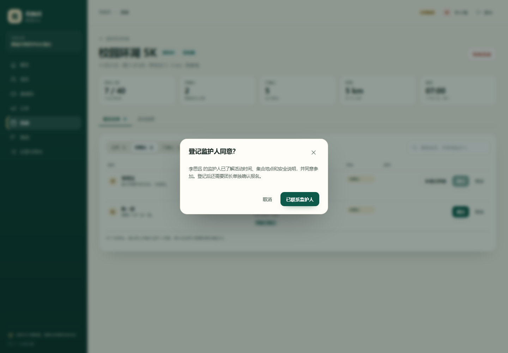

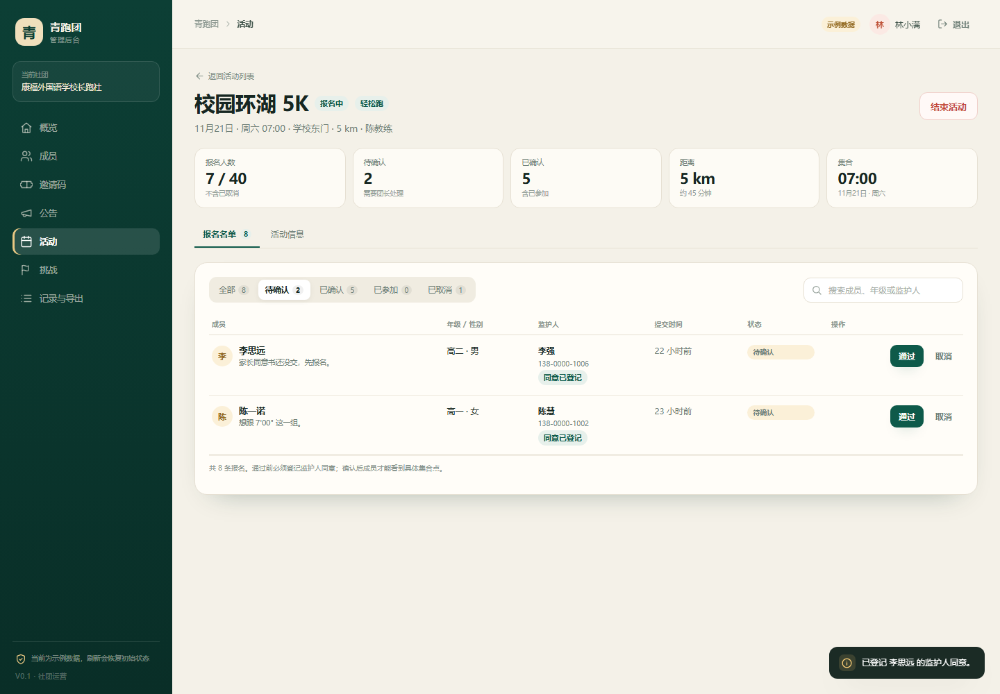

### 5.2 通过报名

点击“通过”进入确认弹窗，显示成员、监护人和活动信息，可以写一句备注。确认后：

- `pending` → `approved`。
- 待确认人数减少，已确认人数增加。
- 报名人数不变，因为这条报名本来就在名额里。
- 写入 `reviewedAt` 和 `reviewNote`。
- 手机端（正式版）此时才开放具体集合点。

当前演示里，act-001 通过李思远后：

```text
报名 7 / 40
待确认 2 → 1
已确认 5 → 6
```

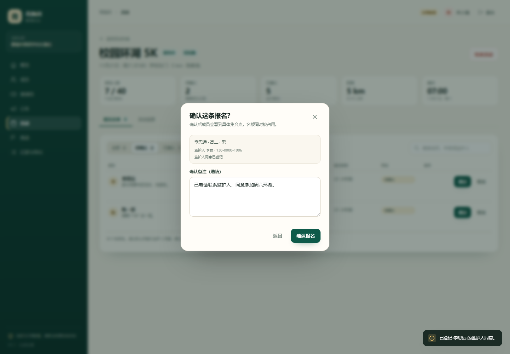

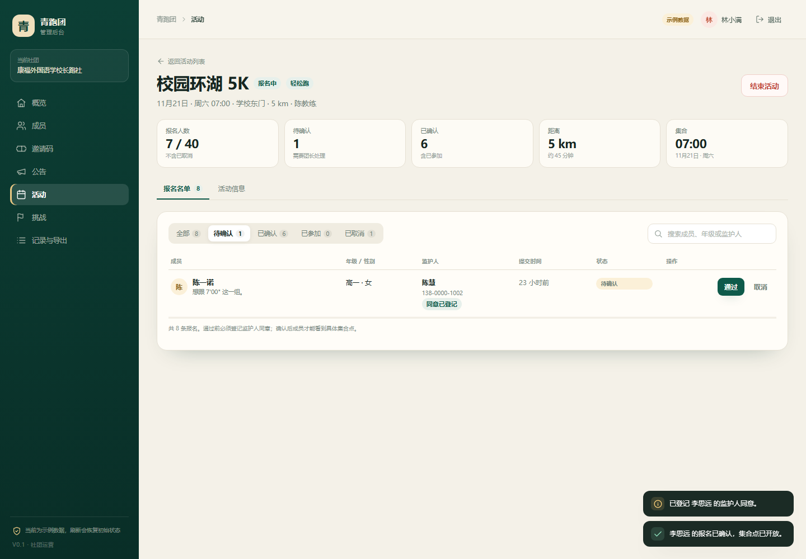

### 5.3 拒绝报名必须写原因

点击“取消”进入拒绝弹窗。成员信息下方是必填的“取消原因”，按钮是“确认取消”。

不写原因直接提交：

- 弹窗内出现错误：`请写一句取消原因，成员端会看到。`
- 不会关闭弹窗，也不会改状态。

填写原因后：

- `pending` → `declined`。
- 待确认减少，报名人数减少，已取消增加。
- 原因写入 `reviewNote`，成员端会看到。
- 腾出的名额立即可用。

演示中拒绝陈一诺后：报名 7→6，待确认 1→0，已确认 6，已取消 2。

拒绝原因不是给后台看的内部备注，而是给家庭看的说明。文案要具体、克制，不写“态度不好”“不合适”这类判断。

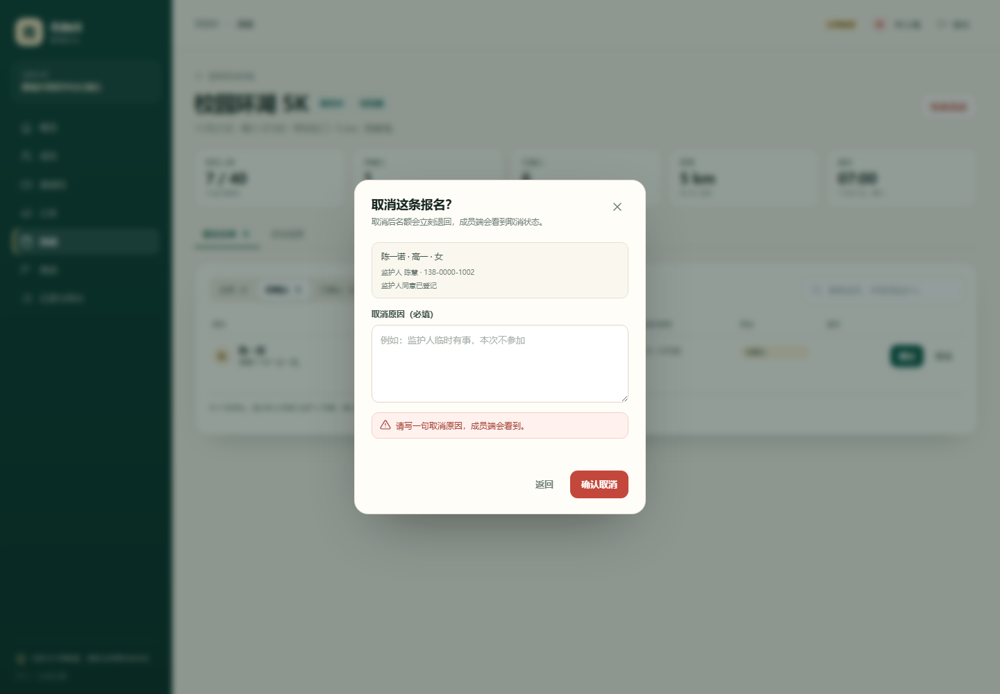

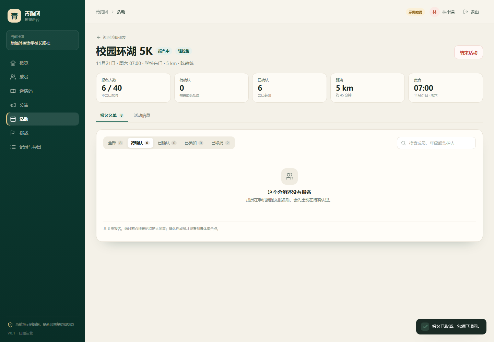

### 5.4 结束活动

“结束活动”是危险操作，需要二次确认。确认框说明：

> 结束后不能再处理报名，所有待确认的报名会自动取消，名单转为只读。

确认后：

- 活动状态 `published` → `ended`。
- 所有 `pending` 报名改为 `declined`，原因写“活动已结束，系统关闭未确认报名。”
- 已确认、已参加记录保留。
- 页面显示“活动已结束，报名只读”。
- 报名 tab 仍可查看历史，但通过/取消按钮消失。

演示中结束 act-002 后：报名 5→4，待确认 1→0，已确认 4，已取消 1。这个“报名 5→4”不是丢数据，而是未确认的名额被系统关闭了。

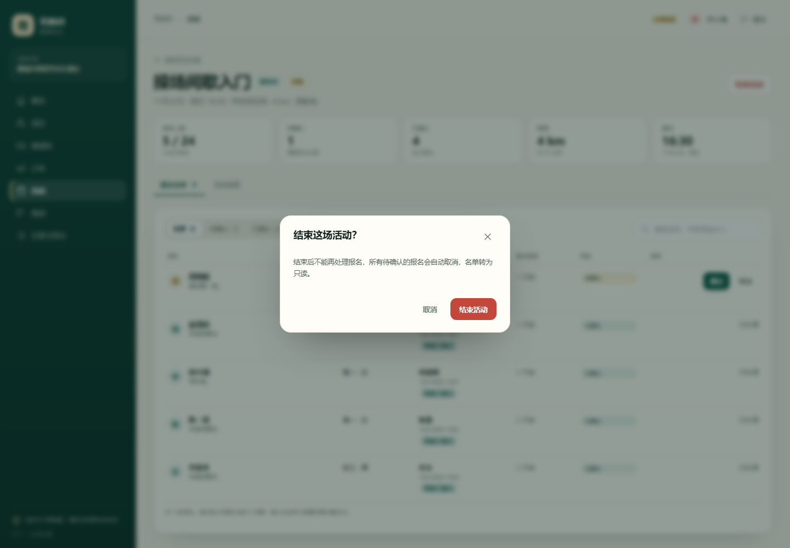

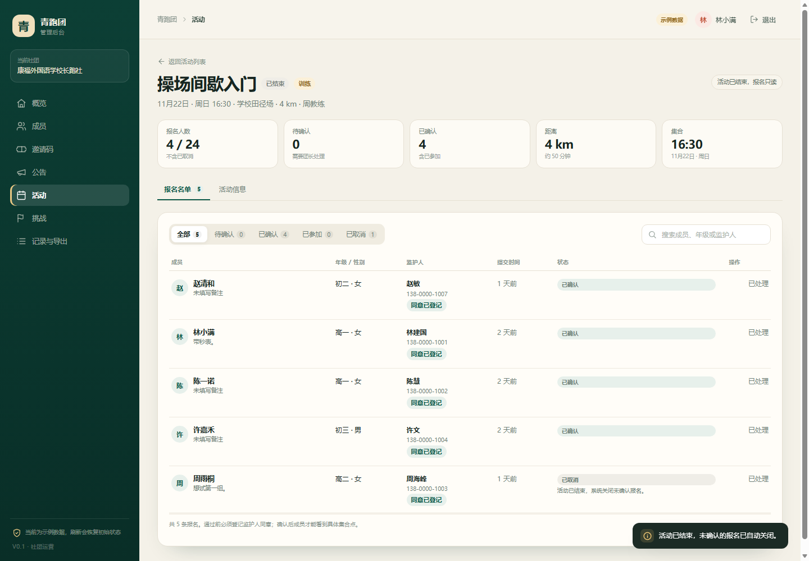

## 6. 发布草稿与新建活动

### 6.1 发布草稿

草稿详情页只提供“发布活动”。点击后确认：

> 发布后，社团成员会在手机端看到活动并可以提交报名。报名仍需要团长确认。

确认后 `draft` → `published`，按钮变成“结束活动”。只有草稿可以发布；日期已过去的草稿不能发布，需要先改日期。

演示中 act-003 从草稿发布为“报名中”，报名人数 0/30。

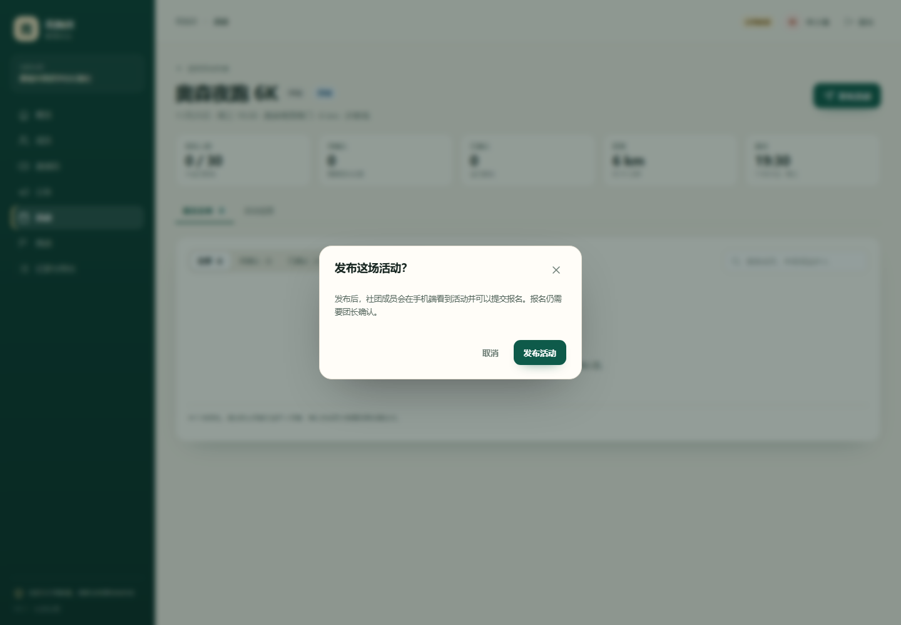

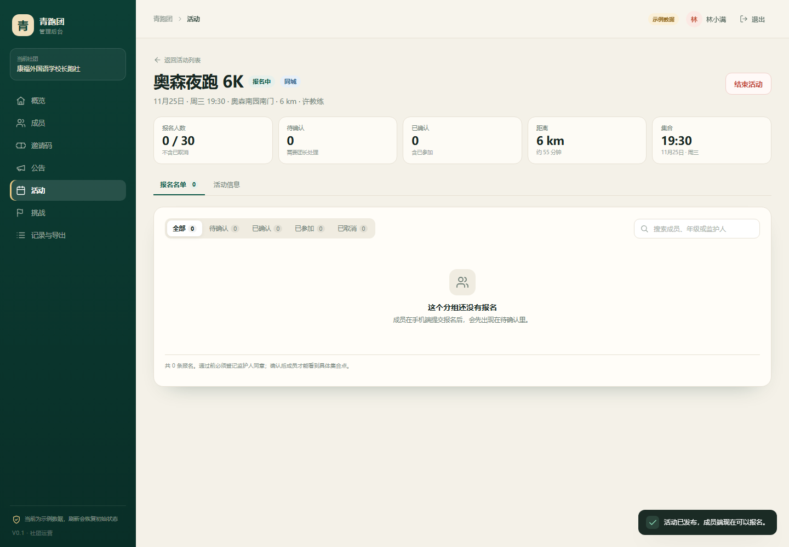

### 6.2 新建活动

“发布活动”按钮打开长表单。默认值：

- 日期：下一个周六。
- 时间：07:00。
- 集合地点：学校东门。
- 距离 / 时长 / 人数上限：5 km / 45 分钟 / 40 人。
- 带跑教练：陈教练。
- 活动类型：轻松跑。

需要自己填写活动名称和活动说明；出发前准备按行拆分，成员端显示为清单。

校验规则：

| 字段 | 规则 |
| --- | --- |
| 活动名称 | 至少 2 个字 |
| 日期 | 不能早于今天 |
| 集合地点 / 教练 | 必填 |
| 距离 | 1–100 km |
| 时长 | 5–600 分钟 |
| 人数上限 | 1–200 人 |
| 活动说明 | 至少 10 个字 |
| 同日同时 | 未结束活动不能撞时间 |

同日同时冲突的提示是：

```text
同一天同一时间已有活动，先调整时间。
```

新建成功后活动直接进入“报名中”，不会先存草稿；列表、统计和待确认筛选立即更新。

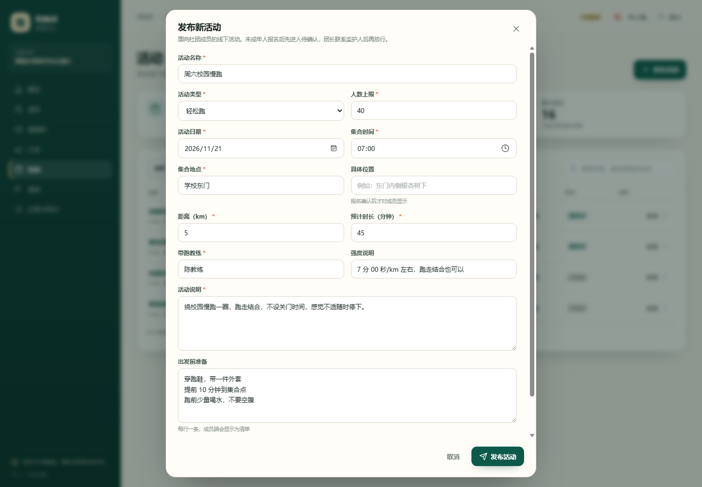

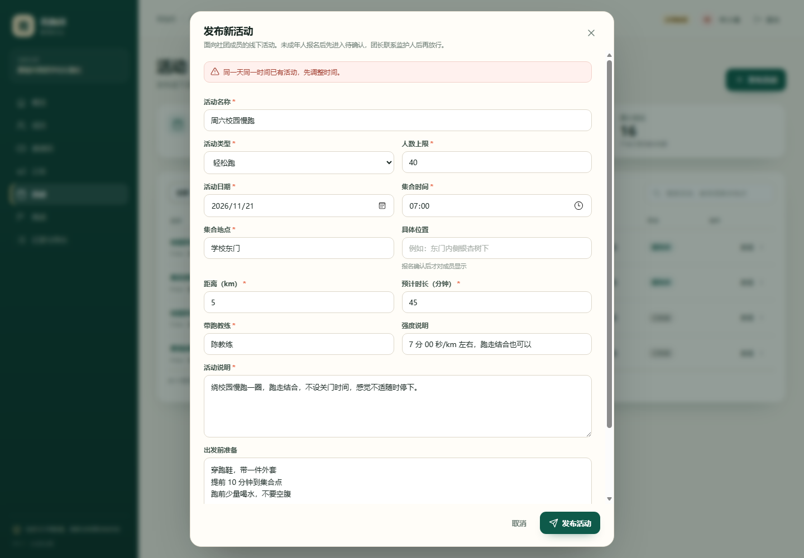

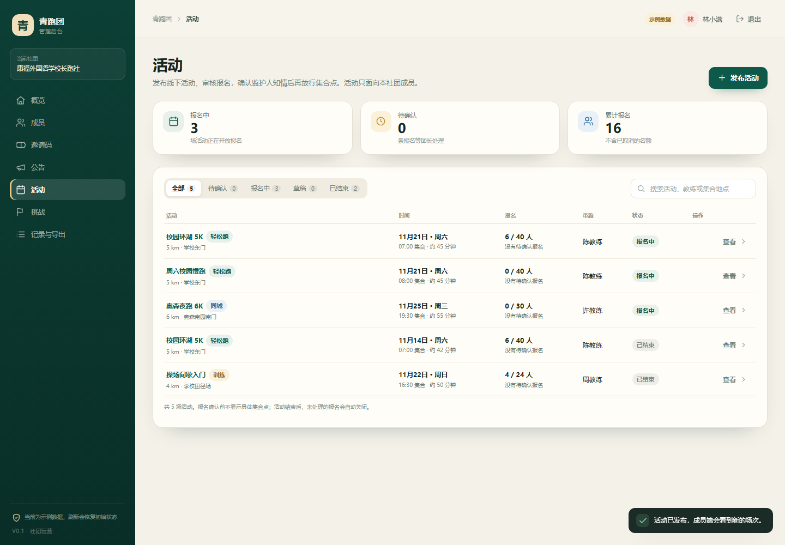

### 6.3 长表单弹窗的修复

首次验收发现：在 1000px 高视口下，长表单的底部按钮和错误提示被推出屏幕，用户看不到“发布活动”，也看不到为什么失败。

修复方式：

- `.modal` 改为纵向 flex，最大高度限制在视口内，`overflow: hidden`。
- `.modal-header`、`.modal-footer` 固定不收缩。
- `.modal-body` 单独滚动，`min-height: 0`，避免把 footer 挤出去。
- 表单错误从表单末尾移到顶部，并在报错时把弹窗内容滚回顶部。

修复后，1440×1000 下 footer 始终可见，冲突提示出现在表单第一行。短确认弹窗的居中布局不受影响。

## 7. 未成年人与安全边界

- 报名不等于被放行。待确认状态不能看到具体集合点，只有已确认/已参加可见。
- 通过前必须有监护人同意；后台把“补登记同意”做成独立动作，避免误点通过。
- 拒绝必须写原因，让家庭知道为什么；不写判断性、羞辱性理由。
- 结束活动会自动关闭所有未确认报名，避免活动结束后还留着“待确认”没人处理。
- 后台能看到监护人电话，但手机端不展示其他参与者联系方式；当前没有导出报名表功能。
- 活动容量、教练、地点和电话都是演示数据；不要录入真实未成年人信息。
- 正式版还需要：监护人授权的可验证记录、活动安全预案、保险、紧急联系人、签到与离场确认。

## 8. 验收

构建：

```bash
cd admin
npm run typecheck
npm run build
```

结果：

- TypeScript exit 0。
- Vite 构建 64 modules。
- CSS 40.42 kB（gzip 8.61 kB）。
- JS 485.09 kB（gzip 131.70 kB）。

浏览器验收：

```bash
node verify-activities-admin.mjs
```

脚本用 Edge headless + CDP，端口 9241，视口 1440×1000，输出到 `admin/shots/activities/`。

| 场景 | 结果 |
| --- | --- |
| 初始列表 | 报名中 2、待确认 3、累计报名 18；4 场活动 |
| 待确认筛选 | 只显示 act-001、act-002 |
| act-001 初始 | 7/40；待确认 2；已确认 5；8 条名单 |
| 未登记监护人同意 | 通过按钮禁用；补登记按钮可见 |
| 补登记同意 | 状态变“同意已登记”；通过按钮启用 |
| 通过 sg-006 | 待确认 2→1；已确认 5→6；报名仍 7/40 |
| 拒绝不写原因 | 错误“请写一句取消原因，成员端会看到。”；状态不变 |
| 填写原因后拒绝 | 待确认 1→0；报名 7→6；已取消 2 |
| 结束 act-002 | 报名 5→4；待确认 0；已确认 4；已取消 1 |
| 发布草稿 act-003 | 0/30，状态变报名中 |
| 新建活动撞时间 | 错误“同一天同一时间已有活动，先调整时间。” |
| 改时间后新建 | 新增“周六校园慢跑”08:00，0/40，报名中 |
| 最终列表 | 报名中 3、待确认 0、累计报名 16；5 场活动 |
| Console error / exception | 0 |

截图共 17 张，均为 1440×1000，文件名从 `01-activity-list.png` 到 `17-final-list.png`，位于 `admin/shots/activities/`。总览拼图是 `contact-sheet.png`。

## 9. 代码位置

| 文件 | 作用 |
| --- | --- |
| `admin/src/features/activities/ActivitiesPage.tsx` | 活动列表、统计、五个筛选、搜索、新建入口 |
| `admin/src/features/activities/ActivityDetailPage.tsx` | 详情、报名名单、同意/通过/拒绝、发布/结束 |
| `admin/src/features/activities/NewActivityModal.tsx` | 新建活动长表单、校验、错误滚动 |
| `admin/src/features/activities/activityUi.tsx` | 活动状态/标签徽章、日期格式化 |
| `admin/src/components/ui/Modal.tsx` | 共享弹窗结构（header/body/footer） |
| `admin/src/data/mockRepository.ts` | 活动与报名规则、容量、监护人同意、结束自动关闭 |
| `admin/src/data/mock/mockData.ts` | 4 场演示活动、19 条报名种子 |
| `admin/src/styles/index.css` | 活动表格、筛选、弹窗 flex 布局、响应式 |
| `admin/verify-activities-admin.mjs` | 本轮浏览器验收脚本 |
| `admin/src/App.tsx` | `/activities`、`/activities/:activityId` 路由 |

## 10. 已知边界

- 后台活动与手机端活动是两套独立 Mock 数据，操作互不相通。
- 刷新页面恢复种子，新增活动、同意、审核、结束都不会持久化。
- 没有真实登录、角色权限、审计日志落库；所有社团管理员权限相同。
- 没有批量通过/拒绝，没有报名导出、签到、请假、候补和通知。
- 没有图片、路线地图、天气接口或活动取消推送。
- 没有编辑已发布活动；新建后只能发布或结束。
- 活动列表没有分页；当前 5 场以内够用。
- 未在真实手机上验证社团后台；后台是电脑网页，手机端适配不在本轮范围。

## 11. 下一步

1. 把手机端 `ActivityContext` 和社团后台接到同一套 PocketBase 表：活动、报名、监护人同意、审核记录。
2. 后台通过/拒绝后，手机端能立即看到状态和集合点变化。
3. 增加监护人授权记录：授权时间、方式、撤回和到期。
4. 增加签到、请假、候补、活动提醒和导出报名表。
5. 给社团管理员和平台运营拆分活动权限，所有审核动作写审计日志。
6. 用一次真实学校活动走完：发布 → 报名 → 监护人确认 → 签到 → 记录同步。

## 12. 演示路径

```text
社团账号登录 admin@qingrun.local
→ 活动
→ 看“待确认 3”，点“待确认”筛选
→ 打开校园环湖 5K
→ 李思远“补登记同意”，确认已联系监护人
→ 通过李思远，写备注
→ 陈一诺“取消”，先不写原因，看到错误
→ 写原因后确认取消
→ 返回活动列表，打开操场间歇入门
→ 结束活动，确认待确认报名被自动关闭
→ 返回列表，打开奥森夜跑 6K（草稿）
→ 发布活动
→ 新建活动，先用 07:00 撞时间，看到错误
→ 改 08:00 后发布，回到列表看新增场次
```
