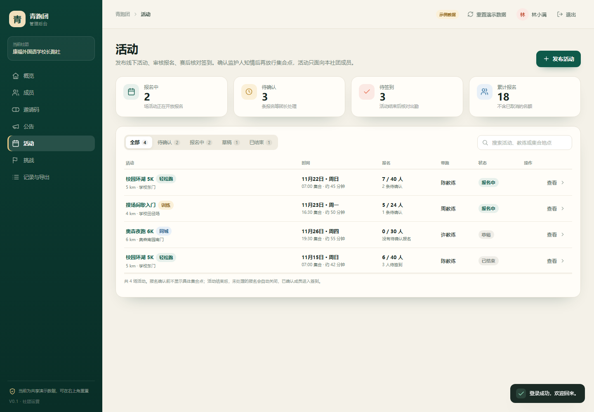
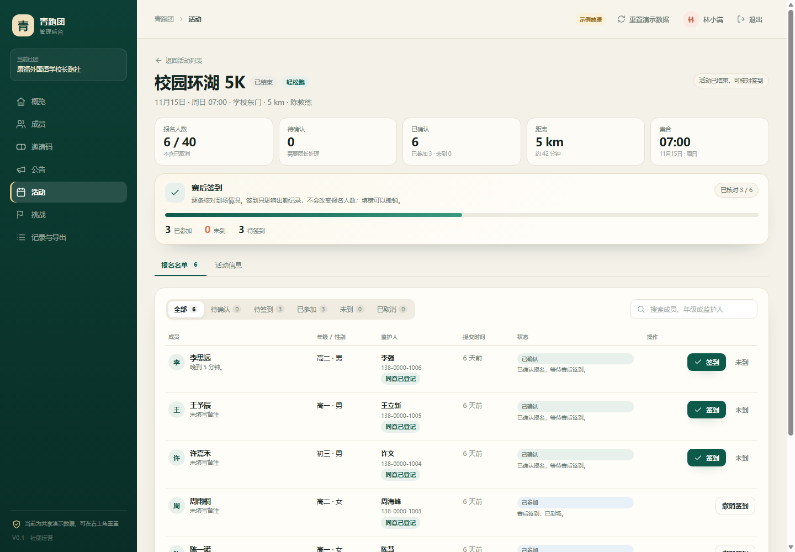
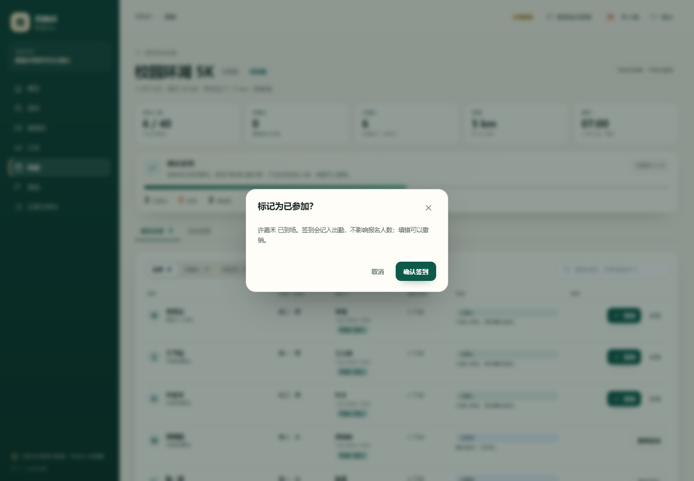
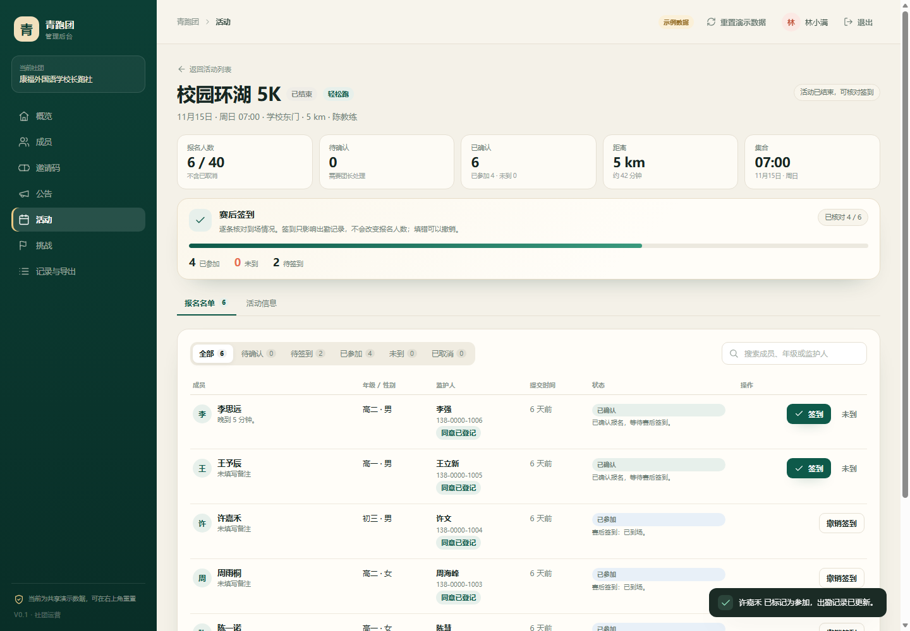
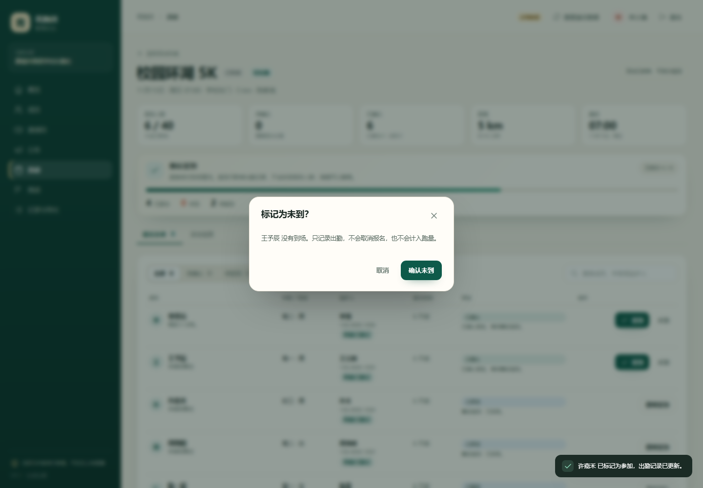
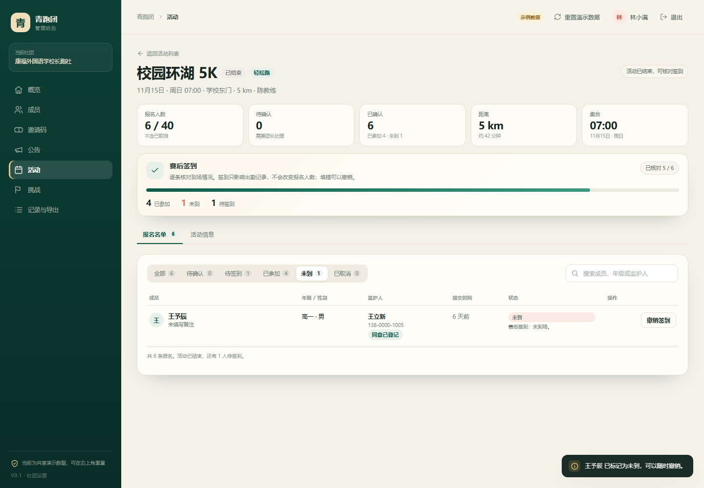
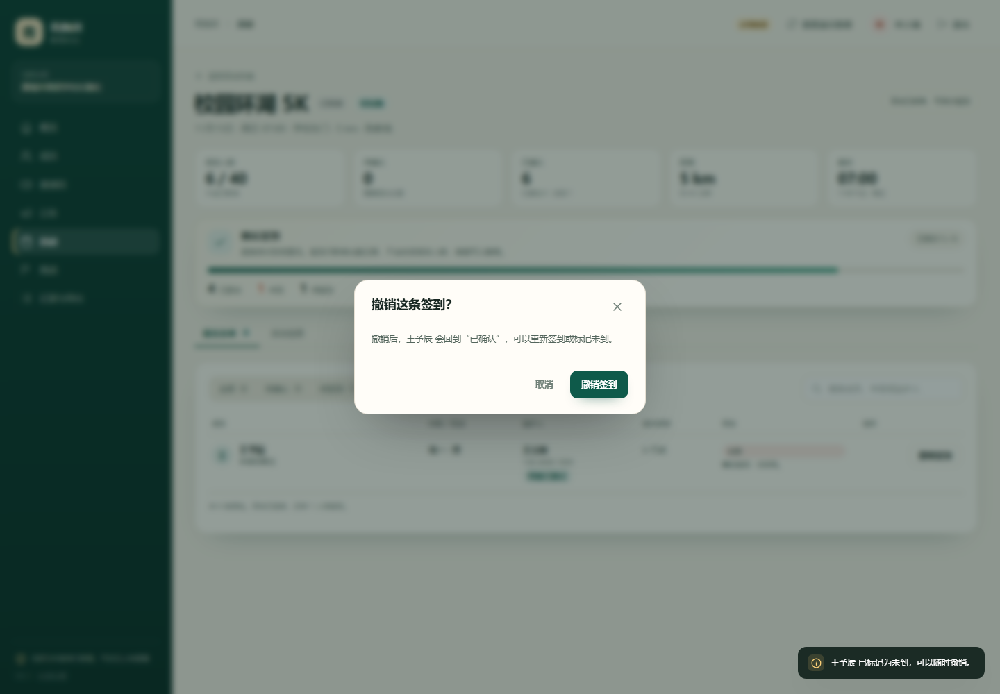
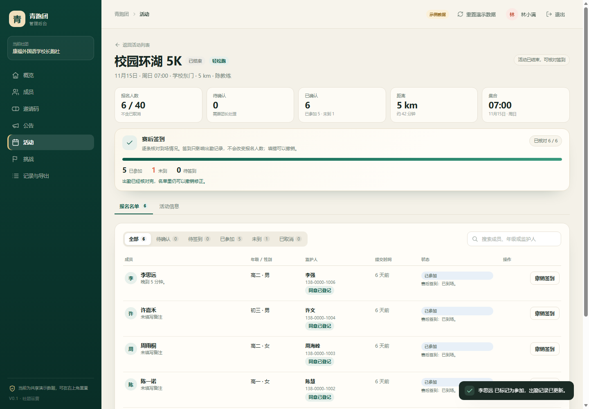
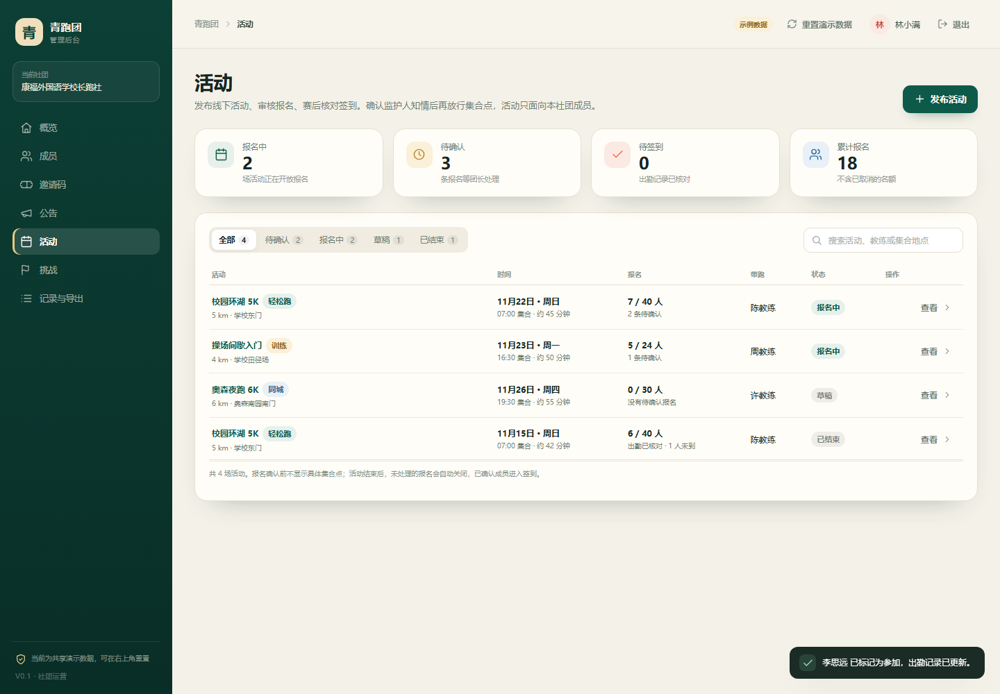
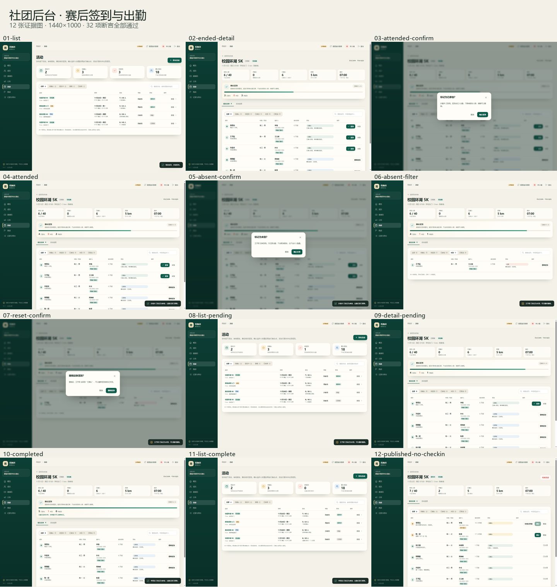

# 社团后台赛后签到与出勤 v0.1

本文记录活动结束后的“赛后签到”闭环：团长逐条把已确认报名的成员标记为已参加或未到，填错可以撤销。它接在[社团后台活动发布与报名审核](13-社团后台活动发布与报名审核-v0.1.md)之后；手机端的报名流程见[手机端活动报名与我的活动](12-手机端活动报名与我的活动-v0.1.md)。

2026-11-20 起，签到结果已通过共享 Mock API 同步到手机端：成员在“我的活动”里能看到已参加、未到或待核对。最新跨端架构见[活动出勤跨端闭环 v0.1](15-活动出勤跨端闭环-v0.1.md)。

- 日期：2026-11-19（2026-11-20 补跨端同步）
- 范围：`admin/` 社团后台活动详情页 + 手机端“我的活动”
- 数据：本地 Mock API 进程内存，可手动重置
- 状态：可点击原型，未接真实后端

## 1. 这一版解决什么

活动结束以后，原来的名单只能看，不能记录谁来了、谁没来。团长仍然要在微信群里点名，再把结果抄到表格里，报名和出勤是两套账。

这一版补上最基础的一步：

- 已结束的活动出现“赛后签到”卡，直接看到已参加、未到、待签到人数。
- 已确认的成员可以逐条标记“签到”或“未到”。
- 标错可以撤销，报名回到“已确认”，再重新标。
- 签到只改出勤，不改报名人数，也不把未到的人从名单里删掉。

它仍然不是“到了现场自动证明”。当前是团长在后台手工核对，适合演示和讨论流程，不适合作为真实活动的唯一出勤凭证。

## 2. 演示活动与初始数据

演示活动是 `act-004`“校园环湖 5K”：

- 日期：11 月 14 日，周六 07:00
- 地点：学校东门，5 km，约 42 分钟，陈教练
- 状态：已结束
- 报名：6 / 40，已取消 0

6 条报名分成两组：

| 成员 | 初始状态 | 说明 |
| --- | --- | --- |
| 林小满 | 已参加 | 种子出勤，带签到时间 |
| 陈一诺 | 已参加 | 种子出勤，带签到时间 |
| 周雨桐 | 已参加 | 种子出勤，带签到时间 |
| 李思远 | 已确认 | 等待赛后签到 |
| 王予辰 | 已确认 | 等待赛后签到 |
| 许嘉禾 | 已确认 | 等待赛后签到 |

所以详情页初始是：

- 已核对 3 / 6
- 已参加 3
- 未到 0
- 待签到 3





## 3. 状态模型

文件：`admin/src/types/models.ts`、`admin/src/data/mockRepository.ts`

```ts
type ActivitySignupStatus =
  | 'pending'
  | 'approved'
  | 'attended'
  | 'absent'
  | 'declined';
```

| 状态 | 后台显示 | 含义 | 能否签到 |
| --- | --- | --- | --- |
| `pending` | 待确认 | 等团长联系监护人并确认 | 不能 |
| `approved` | 已确认 / 已结束活动显示“待签到” | 团长已确认，等待赛后核对 | 能 |
| `attended` | 已参加 | 团长确认到场 | 已签到，只能撤销 |
| `absent` | 未到 | 团长确认没有到场 | 已签到，只能撤销 |
| `declined` | 已取消 | 团长拒绝，或活动结束时系统关闭 | 不能 |

汇总口径：

- `signupCount`：`pending + approved + attended + absent`，不含 `declined`。
- `pendingCount`：只算 `pending`。
- `confirmedCount`：`approved + attended + absent`。未到也算“已确认过报名”，只是没有到场。
- `pendingCheckinCount`：只算 `approved`。
- `attendedCount`：只算 `attended`。
- `absentCount`：只算 `absent`。
- `checked`：`attended + absent`，用于“已核对 N / 6”。

关键区别：

- “报名人数 6 / 40”从头到尾不变，签到不会把未到的人从报名名单里删掉。
- “已确认 6”也不变；卡片小字单独显示“已参加 5 · 未到 1”。
- 签到状态是报名记录上的一个结果，不是另一张出勤表。第一版这样最简单，也避免报名和出勤两份数据对不上。

## 4. 活动列表

文件：`admin/src/features/activities/ActivitiesPage.tsx`

列表顶部从 3 张统计卡改成 4 张：

| 卡片 | 数字口径 | 小字 |
| --- | --- | --- |
| 报名中 | `status === 'published'` 的场次数 | 场活动正在开放报名 |
| 待确认 | 所有活动的 `pendingCount` 之和 | 条报名等团长处理 |
| 待签到 | **只算已结束活动**的 `pendingCheckinCount` 之和 | 有剩余时“活动结束后核对出勤”，为 0 时“出勤记录已核对” |
| 累计报名 | 所有活动的 `signupCount` 之和 | 不含已取消的名额 |

这里修过一个统计 bug：最初“待签到”把所有活动的 `approved` 都加了起来，结果把报名中的 act-001（5 条已确认）也算了进去，显示 12，实际已结束活动只有 3 人待签到。现在先筛 `status === 'ended'` 再求和。

活动行的报名副标题按优先级显示：

1. 有 `pendingCount`：`N 条待确认`。
2. 已结束且有 `pendingCheckinCount`：`N 人待签到`。
3. 已结束且有 `absentCount`：`出勤已核对 · N 人未到`。
4. 已结束且没有未到：`出勤已核对`。
5. 报名中且没有待确认：`没有待确认报名`。

## 5. 详情页签到卡

文件：`admin/src/features/activities/ActivityDetailPage.tsx`

只有 `status === 'ended'` 的活动显示签到卡。卡里从上到下是：

- 标题“赛后签到”，说明“逐条核对到场情况。签到只影响出勤记录，不会改变报名人数；填错可以撤销。”
- 右侧软标签“已核对 N / 6”。
- 一条进度条，进度是 `checked / active`。
- 三个数字：已参加、未到、待签到。
- 全部核对完后多一行：“出勤已经核对完，名单里仍可以撤销修正。”

已经结束但还有待签到时，报名名单底部写“活动已结束，还有 N 人待签到。”；全部核对完则写“活动已结束，出勤已核对完，仍可撤销修正。”

## 6. 签到操作

### 6.1 标记已参加

已结束活动里，`approved` 成员的操作列显示两个按钮：

- 绿色“签到”
- 文字按钮“未到”

点“签到”弹确认框：

> 标记为已参加？
>
> 许嘉禾 已到场。签到会记入出勤，不影响报名人数；填错可以撤销。
>
> 取消 / 确认签到

确认后：

- 报名状态 `approved` → `attended`。
- 写入 `checkinAt` 和 `checkinNote: '赛后签到：已到场。'`。
- 签到卡从 3 / 0 / 3 变成 4 / 0 / 2，进度条前进。
- 状态列变“已参加”，说明变“赛后签到：已到场。”。
- toast：“许嘉禾 已标记为参加，出勤记录已更新。”

报名人数仍是 6 / 40，已确认仍是 6。





### 6.2 标记未到

点“未到”弹确认框：

> 标记为未到？
>
> 王予辰 没有到场。只记录出勤，不会取消报名，也不会计入跑量。
>
> 取消 / 确认未到

确认后：

- 报名状态 `approved` → `absent`。
- 写入 `checkinAt` 和 `checkinNote: '赛后签到：未到场。'`。
- 签到卡变成 4 已参加 / 1 未到 / 1 待签到。
- toast：“王予辰 已标记为未到，可以随时撤销。”用提示色，不用成功色。

“未到”不会取消报名，不会释放名额，也不会影响手机端的跑量。它只是出勤记录。



### 6.3 筛选未到

已结束活动的筛选从 5 个变成 6 个：

`全部 / 待确认 / 待签到 / 已参加 / 未到 / 已取消`

其中：

- “待签到”对应 `approved`，只在已结束活动出现。
- “未到”对应 `absent`，数量为 1 时只显示这一条。
- 筛选只影响名单显示，不影响签到卡和统计卡。



### 6.4 撤销签到

`attended` 或 `absent` 的成员显示“撤销签到”。点开确认框：

> 撤销这条签到？
>
> 撤销后，王予辰 会回到“已确认”，可以重新签到或标记未到。
>
> 取消 / 撤销签到

确认后：

- 状态回到 `approved`。
- 清空 `checkinAt` 和 `checkinNote`。
- 签到卡从 4 / 1 / 1 回到 4 / 0 / 2。
- toast：“已撤销 王予辰 的签到，报名回到已确认。”

撤销只针对出勤结果，不会重新打开活动，也不会改动报名审核记录。



### 6.5 全部核对完

给最后一位待签到成员签到后：

- 签到卡：5 已参加 / 1 未到 / 0 待签到。
- 右侧“已核对 6 / 6”，进度条满。
- 出现“出勤已经核对完，名单里仍可以撤销修正。”
- 活动列表“待签到”变 0，副标题“出勤记录已核对”。
- 已结束活动行显示“出勤已核对 · 1 人未到”。





## 7. 规则与防误操作

文件：`admin/src/data/mockRepository.ts`

`checkinActivitySignup(id, result)`：

1. 报名记录和活动必须存在。
2. 活动必须是 `ended`，否则报“活动结束后才能签到。”。
3. `pending` / `declined` 不能签到，报“只有已确认报名的成员可以签到。”。
4. 重复标同一结果会被拦住：已参加再点签到报“这位成员已经签到。”；未到再点未到报“这位成员已经标记为未到。”。
5. 允许 `attended` 直接改 `absent`，或反过来；改完覆盖签到时间和备注。

`resetActivityCheckin(id)`：

1. 活动必须是 `ended`，否则报“只有已结束的活动可以撤销签到。”。
2. 只有 `attended` / `absent` 能撤销，否则报“这条报名还没有签到记录。”。
3. 回到 `approved`，清空签到字段。

界面层只给已结束活动的 `approved` 行显示“签到 / 未到”，给 `attended` / `absent` 行显示“撤销签到”。报名中的活动不显示签到卡，也没有签到按钮；这是有意的，避免活动还没结束就提前记出勤。

## 8. 未成年人与安全边界

- 签到是团长手工核对，不是未成年人到场证明；没有刷脸、身份证、二维码或定位围栏。
- “未到”不会取消报名、不会释放名额，也不会通知监护人；当前没有真实通知通道。
- 后台能看到监护人电话，签到页不新增展示，也不提供导出。
- 报名、签到、撤销都只在内存里，刷新恢复种子；不能当真实活动记录。
- 活动结束后仍保留完整报名名单，未到和已参加都可撤销，避免一次误点造成不可逆结果。
- 正式使用前还需要：到场验证方式、代签/补签规则、监护人知情、活动保险、紧急联系人和离场确认。

## 9. 验收

### 9.1 构建

```bash
cd admin
npm run typecheck
npm run build
```

结果：

- TypeScript exit 0。
- Vite 构建 64 modules。
- CSS 41.70 kB（gzip 8.84 kB）。
- JS 491.73 kB（gzip 133.18 kB）。

### 9.2 浏览器验收

```bash
node verify-checkin-admin.mjs
```

脚本用 Edge headless + CDP，端口 9243，视口 1440×1000，输出到 `admin/shots/checkin/`。共 32 项断言，全部通过，exit 0，console error / exception 为 0。

| 场景 | 结果 |
| --- | --- |
| 活动列表初始 | 4 张统计卡；待签到 3；累计报名 18；4 场活动 |
| act-004 初始 | 报名 6/40；已参加 3；未到 0；待签到 3；已核对 3/6 |
| 许嘉禾签到 | 4 已参加 / 0 未到 / 2 待签到；报名仍 6/40 |
| 王予辰未到 | 4 已参加 / 1 未到 / 1 待签到；出现“未到”筛选 |
| 未到筛选 | 只剩王予辰 1 条；状态“未到”；备注“赛后签到：未到场。” |
| 撤销王予辰 | 回到已确认；4 已参加 / 0 未到 / 2 待签到 |
| 再标未到 | 回到 4 / 1 / 1 |
| 返回列表 | 待签到 1；act-004 行“1 人待签到” |
| 李思远签到 | 5 已参加 / 1 未到 / 0 待签到；已核对 6/6 |
| 核对完提示 | “出勤已经核对完，名单里仍可以撤销修正。” |
| 列表归零 | 待签到 0，小字“出勤记录已核对” |
| 列表未到行 | “出勤已核对 · 1 人未到” |
| 报名中的 act-001 | 没有签到卡，也没有签到按钮；仍只有补登记/通过/取消 |
| Console error / exception | 0 |

截图共 12 张，均为 1440×1000，从 `01-list.png` 到 `12-published-no-checkin.png`。总览拼图是 `contact-sheet.png`。



## 10. 代码位置

| 文件 | 作用 |
| --- | --- |
| `admin/src/types/models.ts` | 报名状态加 `absent`；活动汇总加待签到/已参加/未到；报名加签到时间和备注 |
| `admin/src/data/repository.ts` | 新增 `checkinActivitySignup`、`resetActivityCheckin` 接口 |
| `mock-api/server.mjs` | 共享签到/撤销规则、状态流转、签到时间与备注、汇总口径 |
| `admin/src/data/activityApi.ts` | 后台调用共享签到与撤销接口 |
| `admin/src/data/mock/mockData.ts` | 后台旧内存种子；共享种子已迁到 `mock-api/server.mjs` |
| `admin/src/features/activities/ActivitiesPage.tsx` | 4 张统计卡、待签到汇总、活动行出勤提示 |
| `admin/src/features/activities/ActivityDetailPage.tsx` | 签到卡、进度、待签到/未到筛选、签到/未到/撤销确认框 |
| `admin/src/features/activities/activityUi.tsx` | `absent` 的状态徽章与标签 |
| `admin/src/styles/index.css` | 签到卡、进度、人数排布和响应式 |
| `admin/verify-checkin-admin.mjs` | 本轮 32 项 CDP 验收脚本 |
| `admin/shots/checkin/` | 12 张证据图和总览拼图 |

## 11. 已知边界

- 后台签到已通过共享 Mock API 同步到手机端；手机端刷新或重新进入页面后可见。
- 数据只在 Mock API 进程内存，重启服务或手动重置回种子；签到、撤销、活动状态都不落盘。
- 没有批量签到、按名单快速点名、签到截止时间或补签申请。
- 没有到场验证：二维码、定位围栏、现场照片、设备指纹都没有做。
- 没有请假、迟到、早退、中途离开、候补转正；只有“已参加 / 未到”两种结果。
- 签到时间写入了记录，但当前界面不展示具体时间，只展示“赛后签到：已到场/未到场”。
- 没有出勤导出、月度出勤率、成员出勤历史或家长端通知。
- 没有操作审计：谁在什么时候改了签到，当前没有独立日志。
- 所有姓名、电话、教练和活动信息都是演示数据，不要录入真实未成年人信息。

## 12. 下一步

1. 签到结果已和手机端打通：成员在“我的活动”里看到已参加/未到/待核对，团长在后台看到同一份状态；下一步换成真实数据库和多成员身份。
2. 增加签到时间窗和补签流程，避免活动结束很久以后还能随意改。
3. 增加批量点名、请假、迟到/早退和候补转正。
4. 增加出勤导出和成员出勤历史；导出前先做监护人权限与隐私评估。
5. 增加操作审计：签到、撤销、批量操作都记录操作人、时间和原因。
6. 用一次真实学校活动演练：发布 → 报名 → 监护人确认 → 现场点名 → 赛后核对 → 记录同步。

## 13. 演示路径

```text
社团账号登录 admin@qingrun.local / Qingrun-Dev-2026
→ 活动
→ 看顶部“待签到 3”
→ 打开已结束的“校园环湖 5K”
→ 签到卡显示 已参加 3 / 未到 0 / 待签到 3
→ 许嘉禾点“签到”，确认“确认签到”
→ 看到 4 已参加 / 0 未到 / 2 待签到
→ 王予辰点“未到”，确认“确认未到”
→ 看到 4 / 1 / 1
→ 切“未到”筛选，只剩王予辰
→ 点“撤销签到”，确认
→ 王予辰回到“已确认”，再标一次“未到”
→ 返回活动列表，待签到变成 1
→ 再进“校园环湖 5K”，给李思远签到
→ 看到 5 已参加 / 1 未到 / 0 待签到，已核对 6/6
→ 返回列表，待签到 0，行内显示“出勤已核对 · 1 人未到”
→ 打开报名中的“校园环湖 5K”（11 月 21 日），确认没有签到按钮
```
