# 活动出勤跨端闭环 v0.1

这一版把手机端和社团后台的活动数据接到同一份本地 Mock API：后台发布、审核、签到，手机端能看到同一场活动、同一个名额和同一条出勤结果。它接在[社团后台赛后签到与出勤](14-赛后签到与出勤-v0.1.md)之后，是[手机端活动报名与我的活动](12-手机端活动报名与我的活动-v0.1.md)和[社团后台活动发布与报名审核](13-社团后台活动发布与报名审核-v0.1.md)的共同升级。

- 日期：2026-11-20
- 范围：`mock-api/`、`mobile/` 活动模块、`admin/` 活动模块
- 数据：本地 Mock API，进程内存；可手动重置
- 状态：可点击原型，未接真实后端

## 1. 这一版解决什么

前两版各自能跑，但后台和手机端是两套数据：

- 后台显示 6 / 40，手机端可能显示 7 / 40。
- 后台把某人标成“未到”，手机端的“我的活动”仍显示“已参加”。
- 手机端取消报名，后台名额不会释放。
- 刷新后两边各回各的种子，没法演示同一场活动的前后变化。

这一版把“活动、报名、出勤”抽成一套共享数据，解决三件事：

1. 后台和手机端读同一份活动与报名，名额、审核状态、签到结果一致。
2. 后台的“通过 / 拒绝 / 签到 / 未到 / 撤销”会改变手机端看到的状态。
3. 手机端的“报名 / 取消”会改变后台的报名人数和待确认数量。

它仍然不是真实后端：没有账号体系、数据库、通知和并发控制，只适合本地演示流程。

## 2. 共享数据怎么跑

新增本地服务：

```text
mock-api/
└─ server.mjs        活动 API + 静态文件服务
```

默认监听 `127.0.0.1:8090`：

- `/api/*` 提供活动与报名接口。
- 其余路径静态托管 `mobile/dist`，带 SPA fallback。
- 手机端开发模式（Metro）只调用 `http://127.0.0.1:8090/api`，页面仍由 Expo 提供。
- 后台 Vite 开发服务器同样直接调用 `http://127.0.0.1:8090/api`，通过 CORS 放行。

启动：

```bash
# 在项目根
node mock-api/server.mjs
```

启动日志：

```text
Qingrun prototype: http://127.0.0.1:8090
Mock API: http://127.0.0.1:8090/api/health
Static root: .../mobile/dist
```

数据只存在 Node 进程内存里。刷新页面不会丢；重启服务会回到种子。`POST /api/reset` 也可以随时回到种子。

## 3. 接口

| 方法 | 路径 | 作用 |
| --- | --- | --- |
| GET | `/api/health` | 返回活动数、报名数和静态目录，用于冒烟 |
| POST | `/api/reset` | 重置为种子数据 |
| GET | `/api/member/activities?memberId=m-001` | 手机端活动列表，附带当前成员报名 |
| GET | `/api/activities` | 后台活动列表，带汇总 |
| POST | `/api/activities` | 新建活动 |
| GET | `/api/activities/:id` | 活动详情 |
| GET | `/api/activities/:id/signups` | 报名名单 |
| POST | `/api/activities/:id/signup` | 手机端报名 |
| POST | `/api/activities/:id/publish` | 发布草稿 |
| POST | `/api/activities/:id/end` | 结束活动，自动关闭待确认报名 |
| POST | `/api/signups/:id/cancel` | 取消报名，释放名额 |
| POST | `/api/signups/:id/consent` | 补登记监护人同意 |
| POST | `/api/signups/:id/review` | 通过或拒绝报名 |
| POST | `/api/signups/:id/checkin` | 赛后标记已参加 / 未到 |
| POST | `/api/signups/:id/reset-checkin` | 撤销签到，回到已确认 |

所有错误返回 `{ error, code }`，前端直接把 `error` 显示在表单或弹窗里。

## 4. 演示种子

种子有 4 场活动、19 条报名。

| id | 活动 | 时间 | 状态 | 报名 | 手机端是否显示 |
| --- | --- | --- | --- | --- | --- |
| `act-001` | 校园环湖 5K | 11 月 22 日周日 07:00 | 报名中 | 7 / 40 | 显示 |
| `act-002` | 操场间歇入门 | 11 月 23 日周一 16:30 | 报名中 | 5 / 24 | 显示 |
| `act-003` | 奥森夜跑 6K | 11 月 25 日周三 19:30 | 草稿 | 0 / 30 | 不显示 |
| `act-004` | 校园环湖 5K | 11 月 15 日周日 07:00 | 已结束 | 6 / 40 | 显示 |

日期按启动当天动态生成，保证演示时“本周 / 已结束”始终成立。上表是 2026-11-20 启动时的日期。

演示成员 `m-001` 林小满：

- `act-001`：已确认，显示具体集合点。
- `act-002`：已确认，显示具体集合点。
- `act-003`：草稿，手机端列表不出现。
- `act-004`：已参加，作为赛后出勤种子。

`act-004` 的 6 条报名是 3 条已参加、3 条待签到。后台初始显示“已核对 3 / 6”。

## 5. 一套状态，两种说法

状态字段沿用后台：

```ts
type ActivitySignupStatus =
  | 'pending'
  | 'approved'
  | 'attended'
  | 'absent'
  | 'declined';
```

| 状态 | 后台说法 | 手机端说法 | 名额 |
| --- | --- | --- | --- |
| `pending` | 待确认 | 待团长确认 | 占名额 |
| `approved` | 已确认；已结束活动显示待签到 | 已报名；已结束活动显示待核对 | 占名额 |
| `attended` | 已参加 | 已参加 | 占名额 |
| `absent` | 未到 | 未到 | 占名额 |
| `declined` | 已取消 | 已取消 | 释放名额 |

要点：

- “报名人数”只排除 `declined`，未到仍算报过名。
- 只有 `approved / attended / absent` 算“已确认”。
- 只有 `approved` 算“待签到”。
- 手机端“我的活动”把 `pending / approved` 放在“待参加”，`attended / absent` 放在“已结束”。
- 未到不会删报名，也不会释放名额；它只在出勤里留一条结果。

## 6. 手机端

### 6.1 首页

首页“本周活动”读共享接口，显示下一场可报名活动的报名人数和当前成员状态。种子里是 7 人已报名、林小满已报名。

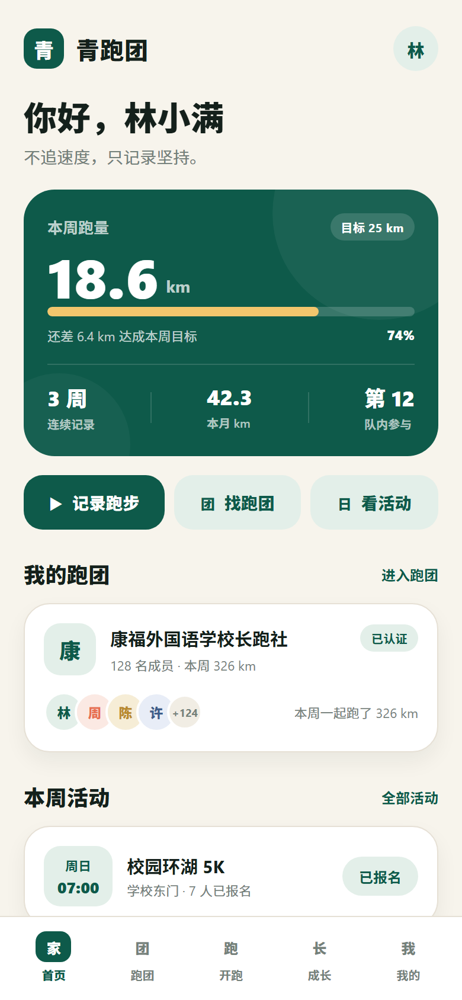

### 6.2 活动列表

列表只显示已发布和已结束活动，草稿不出现。顶部显示“共 3 场 · 共享演示数据”。

四个筛选：

- 全部：3 场。
- 可报名：当前成员没有有效报名的已发布活动；取消后活动会重新回到这里。
- 已报名：当前成员 `pending / approved / attended / absent` 的活动。
- 已结束：`ended` 活动。

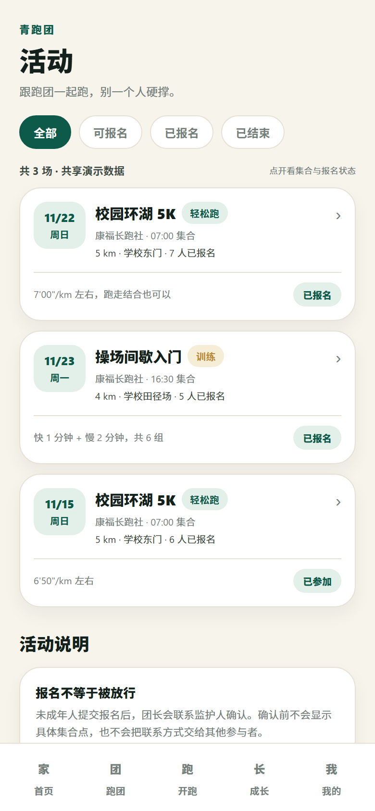

没有可报名活动时显示空态和“查看全部活动”，不会只剩一片空白：

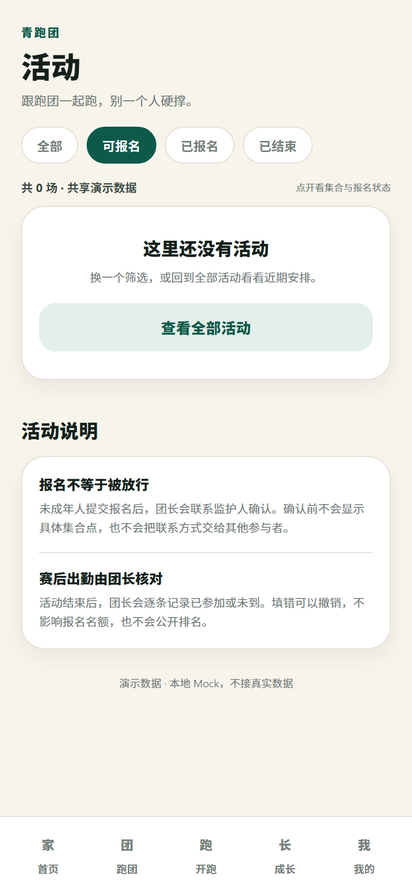

### 6.3 活动详情

详情按当前成员状态显示“报名与出勤”卡：

- 未报名：显示剩余名额和“报名”按钮。
- `pending`：待团长确认，不显示具体集合点。
- `approved`：已报名，显示集合点、准备事项和“取消报名”。
- `attended`：已参加，显示“团长已核对出勤”。
- `absent`：未到，说明“不会取消报名，也不会释放名额；记录有误请联系团长”。
- `declined`：已取消，名额已释放，可以重新报名。

已结束但还没核对的活动显示“待团长核对出勤”，按钮不可点：

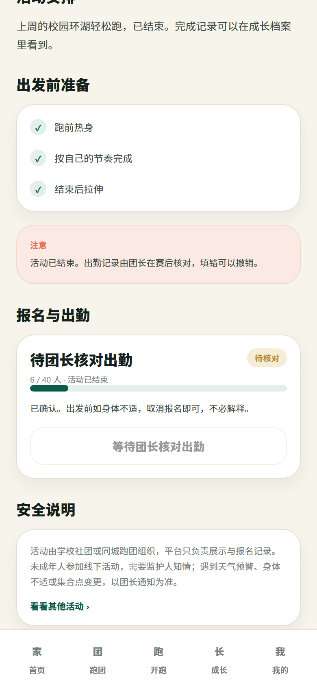

后台标成未到后，手机端详情变成：

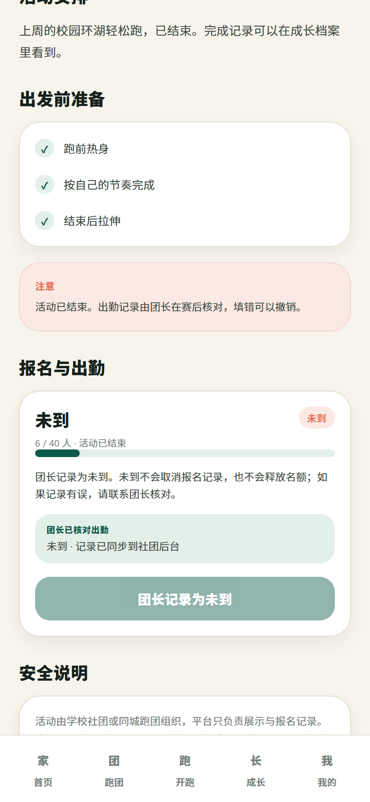

### 6.4 我的活动

顶部三张数字：

- 待参加：`pending / approved` 且活动未结束。
- 已参加：`attended`。
- 待核对：`approved` 且活动已结束。

种子里是 2 场待参加、1 场已参加、0 场待核对。后台把 `act-004` 标成未到后，变成 0 已参加、1 场未到；撤销签到后回到 1 场待核对。

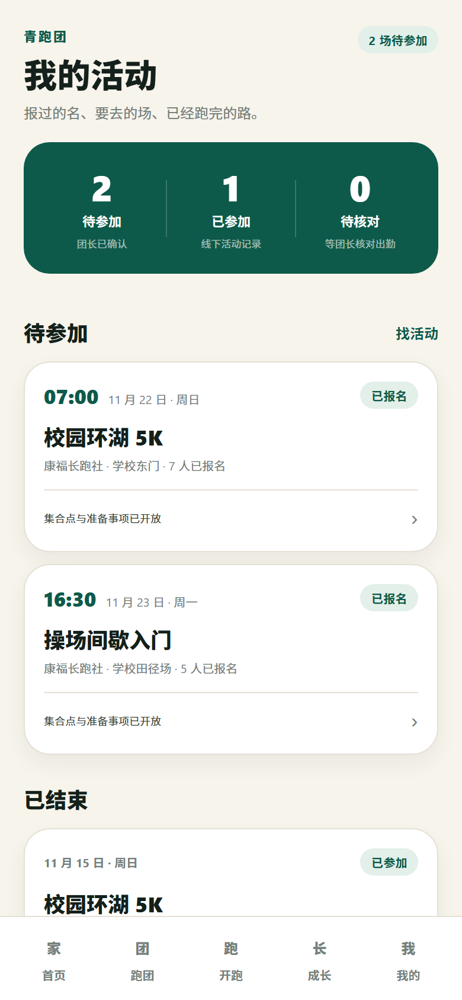

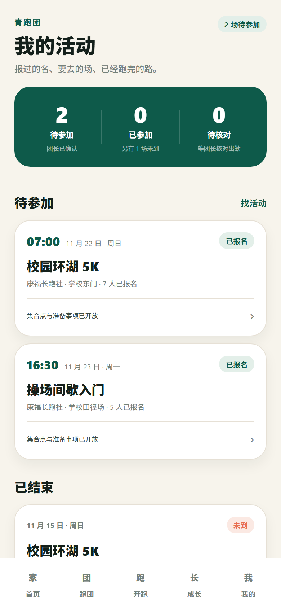

### 6.5 取消与重新报名

手机端取消 `act-001` 后：

- 详情显示“已取消”、6 / 40、剩余 34 个名额。
- 后台刷新后看到 6 / 40。
- “可报名”筛选重新出现这场活动。
- 再点“重新报名”会创建一条新的 `pending` 记录。

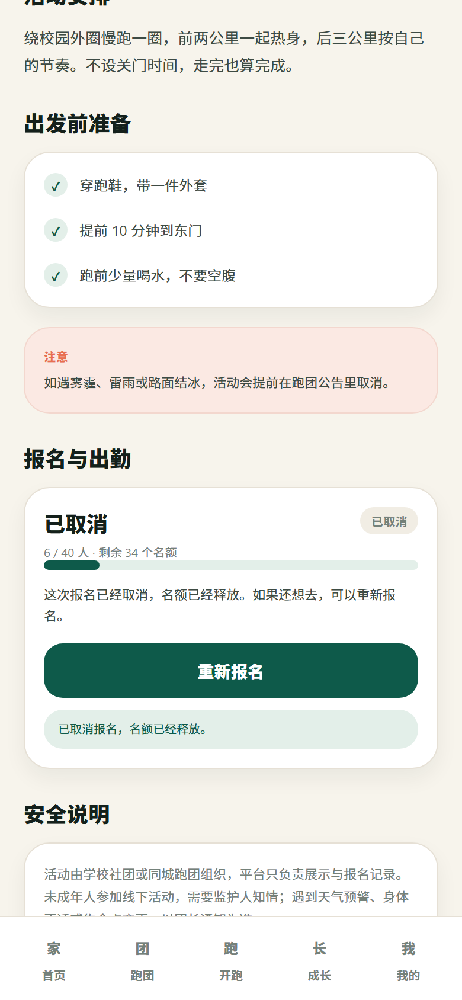

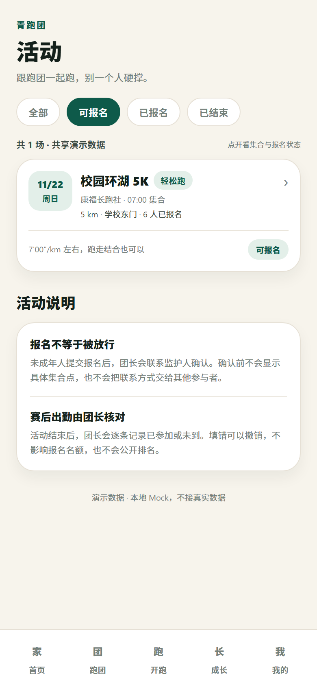

### 6.6 重置入口

“我的 → 演示数据”提供“重置活动演示数据”。重置成功后按钮下方直接显示结果，不依赖页面顶部 toast。

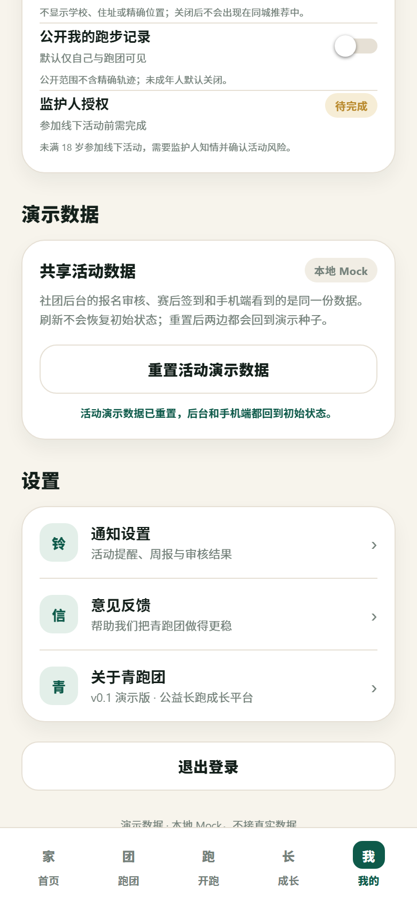

## 7. 社团后台联动

后台活动页改用同一个 `activityApi`：

- 列表四张统计卡：报名中、待确认、待签到、累计报名。
- 已结束活动详情显示签到卡：已核对 N / active、已参加、未到、待签到。
- 报名名单按状态筛选；`approved` 在已结束活动里显示“待签到”。
- “签到 / 未到 / 撤销签到”直接写共享接口。
- 顶部“重置演示数据”调用 `POST /api/reset`。
- 侧边栏底部说明改为“当前为共享演示数据，可在右上角重置”。

后台列表和手机端看到同一场活动。刷新会保留当前状态；只有手动重置或重启 Mock API 才回到种子。

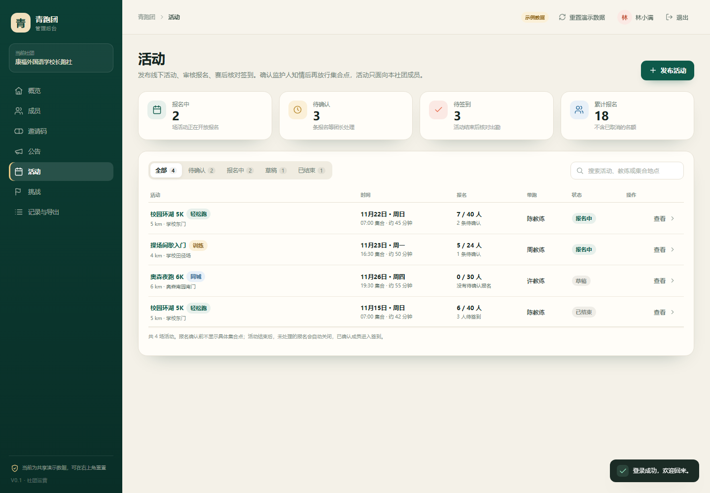

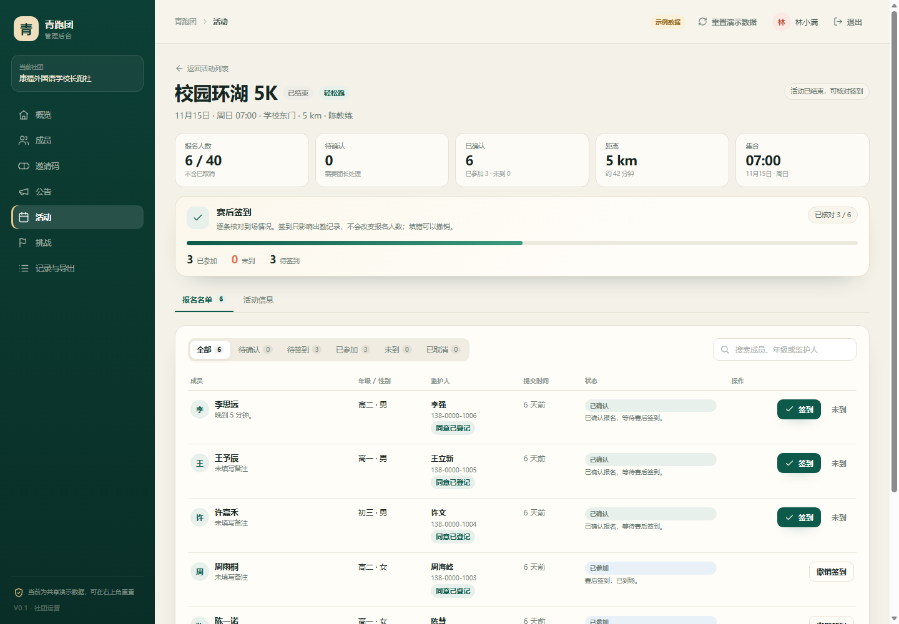

## 8. 验收

脚本：`mobile/verify-activities.mjs`

结果：

```text
SUMMARY 64/64 passed; events=0
```

覆盖的关键链路：

1. `POST /api/reset` 后 `/api/health` 为 4 场活动、19 条报名。
2. 手机端登录后首页显示“7 人已报名”，活动列表 3 场。
3. 详情显示 7 / 40、剩余 33 个名额、集合点。
4. “我的活动”为 2 场待参加、1 场已参加、0 场待核对。
5. 通过接口把 `m-001` 在 `act-004` 的报名改成 `absent`，刷新后手机端显示未到、已参加 0、另有 1 场未到。
6. 撤销签到后，手机端回到“待团长核对出勤”、待核对 1。
7. 手机端取消 `act-001`，后台接口读到 6 / 40；详情显示“已取消”、剩余 34。
8. 取消后“可报名”筛选出现 `act-001`；列表状态用绿色，不再与“未到”的 coral 混淆。
9. 重置后回到 4 / 19、7 / 40、2 场待参加 + 1 场已参加。
10. 全程无 console error；17 张 390×844 证据图。

证据图：`mobile/shots/activities-shared/01-home.png` … `17-home-after-reset.png`，总览见 `contact-sheet.png`。

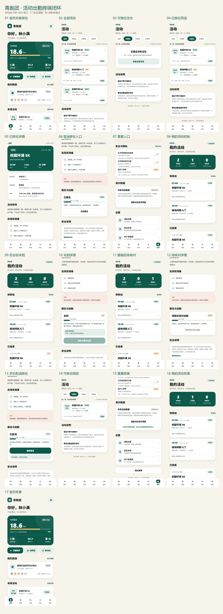

## 9. 代码位置

| 文件 | 作用 |
| --- | --- |
| `mock-api/server.mjs` | 共享活动 API、种子、校验、静态托管 |
| `mobile/src/features/activities/activityApi.ts` | 手机端接口封装 |
| `mobile/src/features/activities/activityContext.tsx` | 活动列表、我的报名、报名/取消/重置 |
| `mobile/src/app/activities.tsx` | 列表、四筛选、空态、状态色 |
| `mobile/src/app/activity/[id].tsx` | 详情、报名/取消、出勤状态 |
| `mobile/src/app/my-activities.tsx` | 待参加、已结束、三张统计 |
| `mobile/src/app/profile.tsx` | 重置入口与内联结果 |
| `mobile/verify-activities.mjs` | 64 项共享/跨端 CDP 验收 |
| `mobile/scripts/preview-shared.mjs` | 静态预览时同时启动 Mock API |
| `admin/src/data/activityApi.ts` | 后台接口封装 |
| `admin/src/features/activities/*` | 列表、详情、审核、签到、新建 |
| `admin/src/data/mockRepository.ts` | 旧内存实现，保留给未迁移页面和回退参考 |

## 10. 安全与隐私边界

- 手机端只展示自己的报名；后台才看得到完整名单、监护人和电话。
- 待确认报名不显示具体集合点；通过后才显示。
- 未到只记录出勤，不公开排名、不扣跑量、不影响名额。
- 后台与手机端都没有真实登录鉴权；账号、角色和审计仍是演示。
- 所有姓名、电话、学校、教练都是虚构数据，不要录入真实未成年人信息。
- 没有定位围栏、二维码、人脸或照片验证；“已参加”是团长手工记录，不是到场证明。

## 11. 已知边界

- 数据只在 Node 进程内存，重启服务即回种子；没有数据库和事务。
- 只有一名演示成员 `m-001`，不能在同一浏览器切换多个成员看不同视角。
- 手机端不会自动轮询；后台改完后，手机端需要刷新或重新进入页面。
- 后台改完也需要刷新列表；没有 WebSocket 实时推送。
- 没有通知、监护人短信、候补、请假、批量签到和出勤导出。
- 没有并发控制；两个窗口同时改同一条报名时，后写入覆盖先写入。
- 活动日期按服务启动日生成，跨天演示需要重启服务。
- 没有在真实手机上验证 8090 局域网访问；当前按 Web 和本机调试设计。

## 12. 演示路径

先启动共享服务：

```bash
cd E:\QPTapp
node mock-api/server.mjs
```

再开手机端和后台：

```bash
# 终端 2
cd E:\QPTapp\mobile
npm run web

# 终端 3
cd E:\QPTapp\admin
npm run dev
```

演示顺序：

```text
手机端登录 demo / qingrun123
→ 活动：共 3 场，校园环湖 5K 显示 7 人已报名
→ 打开校园环湖 5K：已报名，7 / 40，集合点可见
→ 我的活动：2 场待参加、1 场已参加
→ 取消校园环湖 5K
→ 详情：已取消，6 / 40，剩余 34
→ 后台登录 admin@qingrun.local / Qingrun-Dev-2026
→ 活动：校园环湖 5K 变成 6 / 40
→ 打开已结束的校园环湖 5K
→ 把王予辰标成未到
→ 手机端刷新“我的活动”：已参加 0，另有 1 场未到
→ 打开详情：未到，说明记录有误请联系团长
→ 后台撤销签到
→ 手机端刷新：回到“待团长核对出勤”
→ 我的 → 重置活动演示数据
→ 两边回到 4 场活动 / 19 条报名
```

## 13. 下一步

1. 把进程内存换成真正的数据库，加事务和并发控制。
2. 增加真实登录、成员身份和多成员切换，手机端只返回当前成员可见的数据。
3. 加活动变更通知：审核结果、集合点变更、活动取消。
4. 加签到时间窗、请假、候补转正、批量点名和出勤导出。
5. 给后台补操作审计：谁在什么时候通过、拒绝、签到或撤销。
6. 用真实学校的小规模活动走一遍完整链路，再评估监护人授权和隐私合规。
