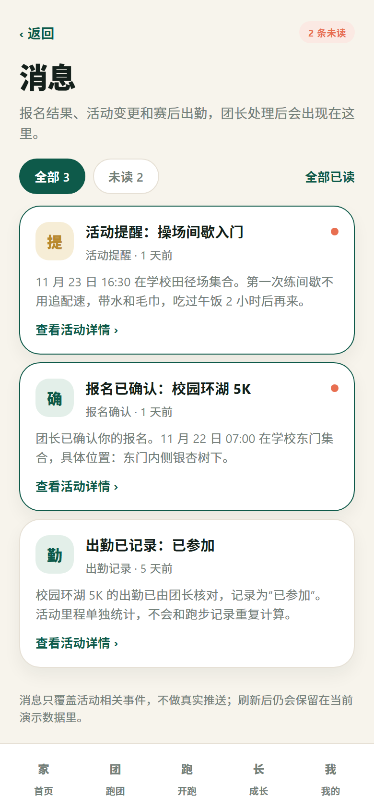
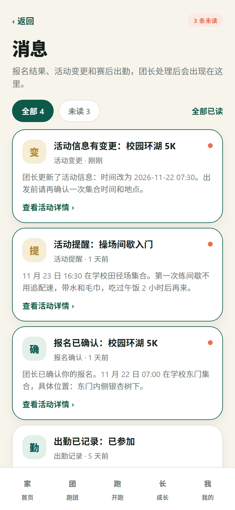
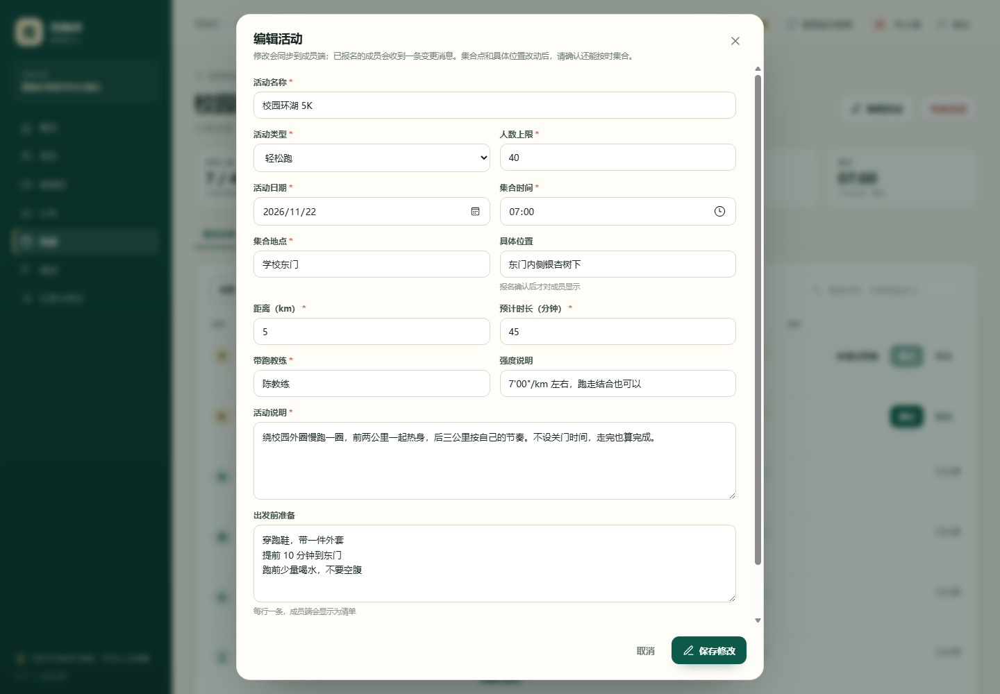
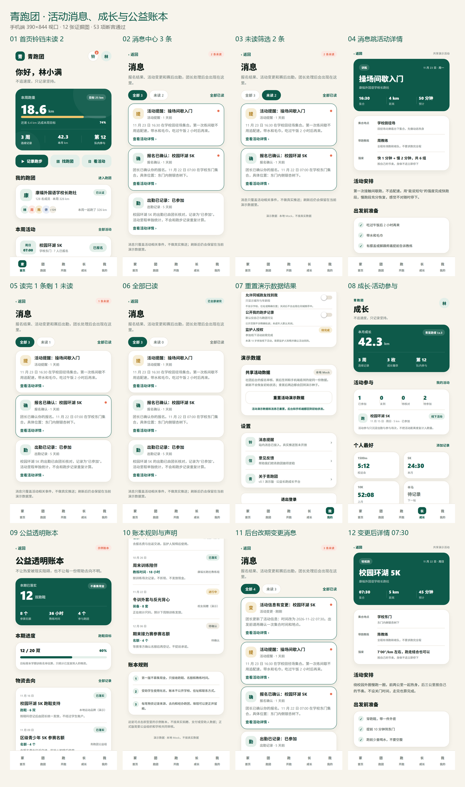
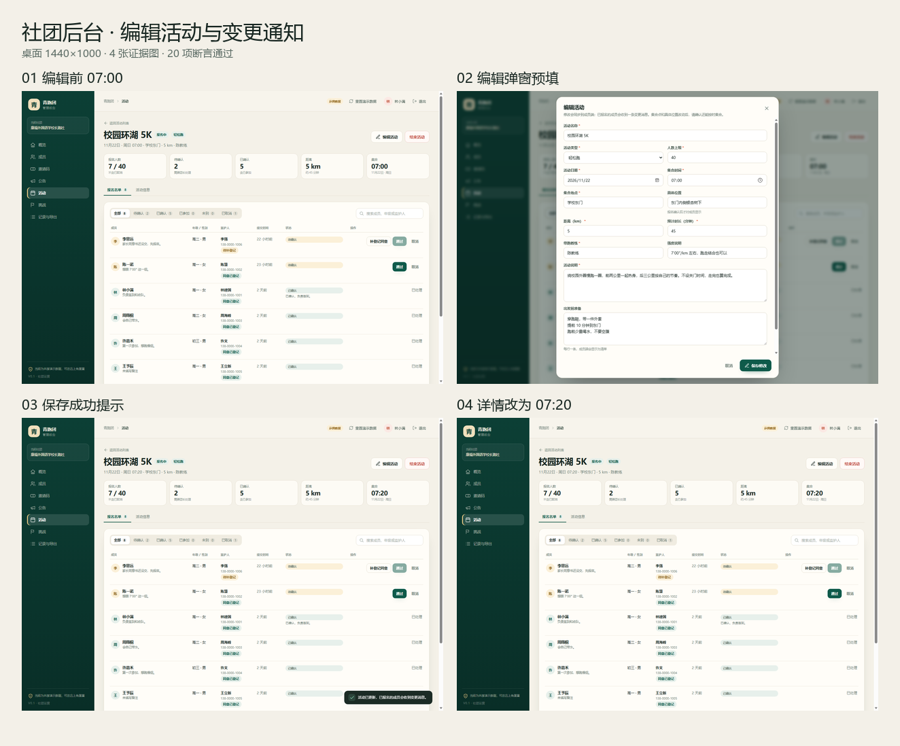

# 活动消息、成长沉淀与公益账本 v0.1

这一版把[活动出勤跨端闭环](15-活动出勤跨端闭环-v0.1.md)之后仍然断开的三段补上：后台处理报名、改期、结束活动、签到后，成员能在手机端收到站内消息；线下活动的参与结果进入成长档案；公益助跑从入口变成一份可查看的透明账本。

- 日期：2026-11-20
- 范围：`mock-api/`、`mobile/` 消息与成长/公益页面、`admin/` 活动编辑
- 数据：消息与活动仍在本地 Mock API 进程内存；公益账本是手机端本地示例
- 状态：可点击原型，未接真实后端、真实推送或真实捐赠

## 1. 这一版解决什么

跨端闭环解决了“同一场活动、同一个名额、同一条出勤”，但成员仍然只能靠手动刷新感知变化：

- 团长通过报名，成员不知道，只能再进详情看一次。
- 活动改期，已报名的人没有提示，容易按旧时间到场。
- 活动结束、出勤核对完，成员看不到“已参加 / 未到”的结果。
- 成长页只统计跑步，线下活动参加了也没有沉淀。
- “公益助跑”只有一个入口和一句说明，看不到物资去了哪里。

这一版做四件事：

1. 后台的关键动作写入站内消息，手机端首页铃铛显示未读数。
2. 后台可以编辑活动；改期、改集合点后，已报名成员收到变更消息。
3. 成长页增加“活动参与”，只沉淀出勤和场次，不重复计算跑量。
4. 公益助跑增加“公益透明账本”，展示本期物资、去向、状态和规则。

仍然不做：真实推送、短信、监护人通知、未成年人监护人知情确认、支付、真实捐赠和受助人数据。

## 2. 消息数据模型

通知存在 Mock API 的 `state.notifications` 里，字段：

```ts
interface MemberNotification {
  id: string;
  memberId: string;
  type:
    | 'activity_confirmed'
    | 'activity_declined'
    | 'activity_reminder'
    | 'activity_changed'
    | 'activity_ended'
    | 'attendance';
  title: string;
  body: string;
  activityId?: string;
  createdAt: string;
  readAt?: string;
}
```

种子有 3 条消息：

| id | 类型 | 关联活动 | 初始状态 |
| --- | --- | --- | --- |
| `ntf-001` | 报名确认 | `act-001` | 未读 |
| `ntf-002` | 活动提醒 | `act-002` | 未读 |
| `ntf-003` | 出勤记录 | `act-004` | 已读 |

触发规则：

| 后台动作 | 消息类型 | 收件人 |
| --- | --- | --- |
| 通过报名 | `activity_confirmed` | 该报名成员 |
| 拒绝报名 | `activity_declined` | 该报名成员 |
| 编辑已发布活动 | `activity_changed` | 该活动 `pending / approved` 成员 |
| 结束活动 | `activity_ended` | 未处理的 `pending / approved` 成员 |
| 标记已参加 / 未到 | `attendance` | 该报名成员 |
| 撤销签到 | `attendance` | 该报名成员 |

变更消息只写真正改动的字段，最多列 3 项，例如“时间改为 2026-11-22 07:30”。没有改动就不发消息。

### 2.1 接口

| 方法 | 路径 | 作用 |
| --- | --- | --- |
| GET | `/api/member/notifications?memberId=m-001` | 成员消息列表，返回 `{ items, unread }` |
| POST | `/api/notifications/:id/read` | 单条已读，返回更新后的消息 |
| POST | `/api/member/notifications/read-all` | 全部已读，body `{ memberId }`，返回 `{ ok, changed }` |
| PATCH | `/api/activities/:id` | 编辑活动，校验后返回汇总 |

消息按 `createdAt` 倒序返回。`unread` 只统计 `readAt` 为空的记录。

## 3. 后台：编辑活动

活动详情页在“报名中 / 草稿”状态显示“编辑活动”，与“发布”“结束活动”并排；已结束活动不显示编辑。

编辑弹窗复用新建活动的表单，打开时预填：

- 活动名称、类型、人数上限。
- 日期、集合时间、集合地点、具体位置。
- 距离、预计时长、带跑教练、强度说明。
- 活动说明、出发前准备（每行一条）、安全备注。

保存规则：

1. 字段校验与新建一致：名称至少 2 个字、日期不早于今天、距离 1–100 km、时长 5–600 分钟、人数 1–200。
2. 人数上限不能小于当前有效报名数，否则提示“人数上限不能小于当前报名人数（N 人）”。
3. 同一天同一时间不能与其他未结束活动冲突。
4. 已结束活动不能编辑。
5. 保存成功后弹窗关闭，列表与详情刷新，顶部 toast：“活动已更新，已报名的成员会收到变更消息。”

编辑已发布活动时，会按字段差异生成变更消息；草稿编辑不通知，因为还没有成员报名。

## 4. 手机端：消息中心

### 4.1 入口与未读数

首页右上角新增铃铛按钮，显示未读数；大于 9 显示 `9+`。未读为 0 时不显示红点。

“我的”页“我的服务”里也有“消息中心”入口，副标题显示“N 条未读”。

### 4.2 消息列表

路径 `/notifications`，标题“消息”，副标题“报名结果、活动变更和赛后出勤，团长处理后会出现在这里。”

- 顶部两个筛选：“全部 N”“未读 N”，默认全部。
- 右侧“全部已读”把当前成员的所有消息标为已读。
- 每条消息显示类型图标、标题、类型与相对时间、正文和“查看活动详情”。
- 未读消息带圆点和描边；已读消息回到普通卡片。
- 没有消息时显示空态；请求失败显示错误和“重试”。

类型图标与说法：

| 类型 | 图标字 | 标签 |
| --- | --- | --- |
| `activity_confirmed` | 确 | 报名确认 |
| `activity_declined` | 拒 | 报名未通过 |
| `activity_reminder` | 提 | 活动提醒 |
| `activity_changed` | 变 | 活动变更 |
| `activity_ended` | 结 | 活动结束 |
| `attendance` | 勤 | 出勤记录 |

出勤消息正文包含“未到”时，标签使用 coral，与“已参加”区分。

### 4.3 已读与跳转

- 点击单条消息先标记已读，再跳转 `/activity/:activityId`。
- 如果消息没有关联活动，只标记已读，不跳转。
- 从消息跳到详情后，返回键回到消息列表。
- 详情页与消息页在获得焦点时会刷新消息，后台刚改完也能看到新消息，不需要手动刷新页面。

### 4.4 重置

“我的 → 演示数据 → 重置活动演示数据”会同时重置活动、报名和消息，并刷新消息上下文。成功后按钮下方显示：

> 活动演示数据和消息已重置，后台和手机端都回到初始状态。

## 5. 成长：活动参与

成长页在“本月成长”摘要后新增“活动参与”卡，数据来自共享活动接口，不再单独维护一份活动统计。

四个数字：

- 已参加：`attended` 数量。
- 未到：`absent` 数量。
- 待核对：已结束活动里仍为 `approved` 的数量。
- 待参加：未结束活动里 `pending / approved` 的数量。

种子状态是 1 已参加、0 未到、0 待核对、2 待参加。

卡片下方显示最近一场线下活动：日期、距离、出勤结果；没有已结束活动时显示引导文案。卡片底部说明：

> 活动参与只沉淀出勤与参与场次，不把活动距离重复计入跑量。

这是刻意的边界：活动距离属于活动记录，跑量只来自跑步记录，避免同一次 5 公里既算活动又算跑量。

## 6. 公益透明账本

“我的”页公益助跑卡从静态说明改为入口“查看透明账本”，路径 `/charity`。

### 6.1 本期摘要

- 本期已落实：12 双跑鞋。
- 参赛名额：8 个。
- 教练时间：36 小时。
- 参与跑团：4 个。
- 标签：不募集现金。

### 6.2 本期进度

12 / 20 双，60%。说明“目标按本学期训练名单估算，只统计已发放到人的物资”。

### 6.3 物资去向

| 日期 | 项目 | 物资 | 状态 | 来源 / 经办 |
| --- | --- | --- | --- | --- |
| 11 月 16 日 | 校园环湖 5K 跑鞋支持 | 跑鞋 · 6 双 | 已落实 | 本地运动品牌（演示） |
| 11 月 09 日 | 区级青少年 5K 参赛名额 | 名额 · 4 个 | 已落实 | 青跑团公益组 |
| 10 月 26 日 | 周末训练陪伴 | 教练时间 · 18 小时 | 已落实 | 康福长跑社教练组 |
| 11 月 22 日 | 冬训外套与反光背心 | 装备 · 8 套 | 进行中 | 校友捐赠（演示） |
| 12 月 06 日 | 期末接力赛参赛名额 | 名额 · 4 个 | 待确认 | 待确认 |

每条都写明“按鞋码登记后由团长统一发放，不经过学生账户”“按训练场次记录，不折现、不发放现金”等去向说明。

### 6.4 账本规则

1. 第一版不募集现金，只接收跑鞋、名额和教练时间。
2. 受助学生使用化名，账本不公开学校、住址和联系方式。
3. 每笔物资记录来源、去向和经办跑团，填错可以更正并留痕。

页面底部明确标注：这是可点击原型里的示例账本，不接真实捐赠、支付或受助人数据；正式版需要公益组织和学校共同审核。

## 7. 验收

### 7.1 手机端

脚本：`mobile/verify-messages.mjs`

```text
SUMMARY 53/53 passed; events=0
```

覆盖：

1. `POST /api/reset` 后为 4 场活动、19 条报名、3 条消息、2 条未读。
2. 首页铃铛显示 2；进入消息中心看到 3 条、2 条未读和三类消息。
3. 未读筛选只显示 2 条；打开活动提醒后跳到 `act-002` 详情。
4. 返回首页铃铛变 1；再次进入消息中心未读数一致；“全部已读”后未读归零。
5. 我的页重置后消息恢复 3 条 / 2 条未读。
6. 成长页显示四类活动数字和不重复计算跑量的说明。
7. 公益账本显示 12 双跑鞋、8 个名额、36 小时、4 个跑团、60% 进度、物资去向和 3 条规则。
8. 通过接口把 `act-001` 改到 07:30 后，消息变为 4 条 / 3 条未读，变更消息显示新时间。
9. 点击变更消息跳到 `act-001`，详情显示 07:30。
10. 测试结束恢复种子消息，全程无 console error。

证据图：`mobile/shots/messages-growth-charity/01-home-bell.png` … `12-change-detail.png`，总览见同目录 `contact-sheet.png`。





### 7.2 社团后台

脚本：`admin/verify-edit-activity.mjs`

```text
SUMMARY 20/20 passed; events=0
```

覆盖：活动详情初始 07:00、编辑按钮、弹窗预填标题/时间/地点、变更说明、改成 07:20、保存 toast、详情与接口同步、生成变更消息、消息正文包含新时间、林小满消息变为 4 条 / 3 条未读。

证据图：`admin/shots/edit-activity/01-before-edit.png` … `04-detail-changed.png`，总览见同目录 `contact-sheet.png`。







### 7.3 构建

- 手机端：`npm run typecheck`、`npm run web:export` 通过，导出 17 个 web bundle（notifications 10 KB、charity 11 KB、growth 19 KB）。
- 后台：`npm run typecheck`、`npm run build` 通过，65 modules，JS 494.85 kB / CSS 41.70 kB。

## 8. 代码位置

| 文件 | 作用 |
| --- | --- |
| `mock-api/server.mjs` | 通知种子、通知接口、编辑活动、变更摘要、事件通知 |
| `admin/src/data/activityApi.ts` | `updateActivity` |
| `admin/src/features/activities/NewActivityModal.tsx` | 新建 / 编辑共用表单 |
| `admin/src/features/activities/ActivityDetailPage.tsx` | 编辑入口、编辑弹窗、刷新 |
| `mobile/src/features/notifications/notificationData.ts` | 消息类型、图标、文案、时间格式 |
| `mobile/src/features/notifications/notificationApi.ts` | 消息接口封装 |
| `mobile/src/features/notifications/NotificationContext.tsx` | 消息列表、未读数、已读、全部已读 |
| `mobile/src/app/notifications.tsx` | 消息中心页面、筛选、跳转、焦点刷新 |
| `mobile/src/app/index.tsx` | 首页铃铛与未读数、焦点刷新 |
| `mobile/src/app/profile.tsx` | 消息中心入口、重置消息、公益账本入口 |
| `mobile/src/app/growth.tsx` | 活动参与卡 |
| `mobile/src/features/charity/charityData.ts` | 公益摘要、物资、规则 |
| `mobile/src/app/charity.tsx` | 公益透明账本页面 |
| `mobile/verify-messages.mjs` | 53 项消息、成长、公益 CDP 验收 |
| `admin/verify-edit-activity.mjs` | 20 项编辑活动与变更消息验收 |

## 9. 边界

- 消息只存在 Mock API 进程内存；重启服务回种子，没有数据库和消息队列。
- 没有真实推送、短信、邮件、微信通知或系统通知；只有打开应用时拉取的站内消息。
- 只有一名演示成员 `m-001`，不能在同一浏览器切换多个成员看不同收件箱。
- 手机端不轮询；进入页面或页面重新获得焦点时刷新，长时间停留在同一页不会自动出现新消息。
- 编辑活动没有历史版本、操作审计和并发控制；两个窗口同时保存时后写入覆盖先写入。
- 变更消息只发 `pending / approved` 成员，已取消、已参加、未到的人不会收到改期消息。
- 成长页只沉淀活动出勤，不计算活动距离、不生成活动徽章、不影响跑量或排名。
- 公益账本是写死的示例数据，不接捐赠、支付、库存或受助人档案，也没有后台维护界面。
- 不做未成年人监护人知情确认；报名审核仍由团长手工处理。
- 所有姓名、电话、学校、教练和公益记录都是虚构演示数据。

## 10. 演示路径

先启动共享服务：

```bash
cd E:\QPTapp
node mock-api/server.mjs
```

再启动后台和手机端（分别开终端）：

```bash
cd E:\QPTapp\admin
npm run dev

cd E:\QPTapp\mobile
npm run web
```

推荐顺序：

1. 手机端登录，首页看到铃铛未读 2；进入消息中心，看到报名确认、活动提醒、出勤记录。
2. 点开活动提醒，跳到 `act-002` 详情；返回后点“全部已读”，铃铛红点消失。
3. 后台登录，打开 `act-001`，点“编辑活动”，把集合时间改成 07:30 并保存。
4. 回到手机端首页，重新进入消息中心，看到“活动信息有变更”；点进去，详情显示 07:30。
5. 手机端“我的 → 成长”，看到活动参与 1 已参加、2 待参加；点“我的活动”可回到活动列表。
6. “我的 → 公益助跑 → 查看透明账本”，查看本期摘要、物资去向和账本规则。
7. 需要恢复初始状态时，在“我的 → 演示数据”点“重置活动演示数据”，活动、报名和消息一起回到种子。

