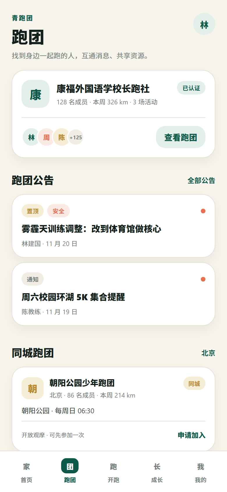
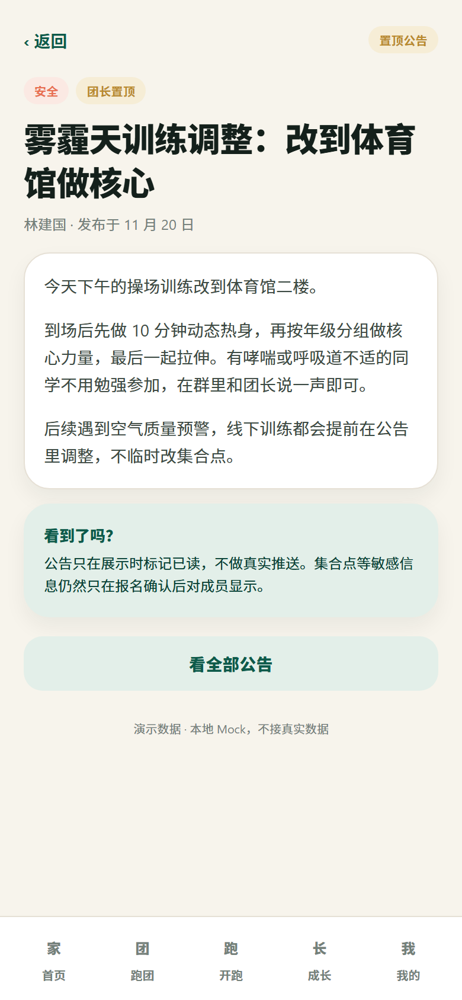
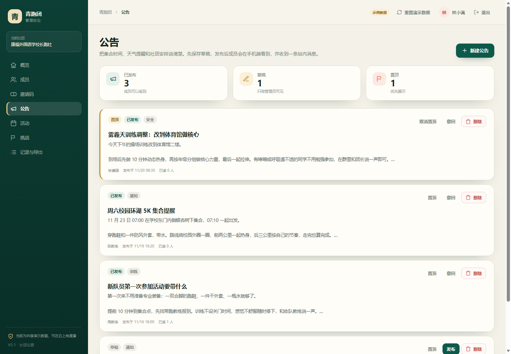
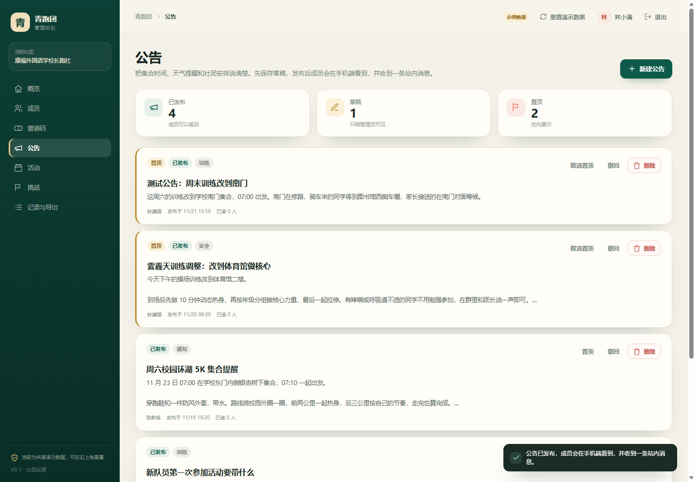

# 跑团公告与跑团主页 v0.1

这一版把[活动消息、成长沉淀与公益账本](16-活动消息与成长公益账本-v0.1.md)之后仍然断开的两块补上：手机端“查看跑团”终于有落点，后台公告也从本地示例数据迁到共享 Mock API，发布后成员能在跑团页、公告列表和消息中心看到。

- 日期：2026-11-21
- 范围：`mock-api/`、`mobile/` 跑团主页与公告页面、`admin/` 公告管理
- 数据：公告、已读状态和公告消息都在本地 Mock API 进程内存
- 状态：可点击原型，未接真实后端、真实推送或内容审核

## 1. 这一版解决什么

活动跨端闭环之后，跑团本身还有三个断点：

- 手机端跑团页的“查看跑团”按钮没有跳转，跑团主页不存在。
- 社团后台公告页只读写前台内存 repository，手机端看不到；刷新后台就回到示例数据。
- 公告发布后没有提醒，成员只能自己发现；公告也不进入站内消息。

这一版做四件事：

1. 新增手机端跑团主页 `/club`，展示跑团资料、公告、近期活动和安全约定。
2. 社团后台公告页改接共享 Mock API，支持新建草稿、发布、撤回、置顶和删除。
3. 手机端新增公告列表 `/announcements` 和公告详情 `/announcements/[id]`，支持全部 / 未读筛选与已读状态。
4. 公告发布时给有报名记录的成员写一条站内消息，消息中心可跳到公告详情。

仍然不做：真实推送、短信、公告附件、评论、定时发布、多人协同编辑、内容审核流和操作审计。

## 2. 公告数据模型

公告存在 Mock API 的 `state.announcements` 里：

```ts
type AnnouncementCategory = 'notice' | 'training' | 'safety';

interface Announcement {
  id: string;
  title: string;
  content: string;
  category: AnnouncementCategory;
  pinned: boolean;
  author: string;
  status: 'draft' | 'published';
  createdAt: string;
  publishedAt?: string;
  readBy: string[];
  readCount: number;
}
```

`readCount` 由 `readBy.length` 汇总，不单独存储。

种子有 4 条公告：

| id | 分类 | 标题 | 状态 | 置顶 | 已读 |
| --- | --- | --- | --- | --- | --- |
| `ann-001` | 安全 | 雾霾天训练调整：改到体育馆做核心 | 已发布 | 是 | 0 |
| `ann-002` | 通知 | 周六校园环湖 5K 集合提醒 | 已发布 | 否 | 0 |
| `ann-003` | 训练 | 新队员第一次参加活动要带什么 | 已发布 | 否 | `m-001` |
| `ann-004` | 通知 | 期末接力赛报名安排（草稿） | 草稿 | 否 | 0 |

初始状态是 3 条已发布、1 条草稿；演示成员 `m-001` 有 2 条公告未读。

排序规则：

- 后台列表：已发布优先，其次置顶优先，再按发布时间 / 创建时间倒序。
- 成员列表：只返回已发布，置顶优先，再按发布时间倒序。
- 分类只影响标签和颜色，不影响排序。

## 3. 接口

| 方法 | 路径 | 作用 |
| --- | --- | --- |
| GET | `/api/announcements` | 后台公告列表，含草稿与已读数 |
| POST | `/api/announcements` | 新建公告，默认存草稿 |
| PATCH | `/api/announcements/:id` | 改标题 / 正文 / 分类 / 置顶 / 状态 |
| DELETE | `/api/announcements/:id` | 删除公告，同时清理它的站内消息 |
| GET | `/api/member/announcements?memberId=m-001` | 成员可见的已发布公告，带 `read` |
| POST | `/api/announcements/:id/read` | 标记某个成员已读，body `{ memberId }` |

### 3.1 发布与撤回

- 草稿改 `published`：写入 `publishedAt`，对 `state.signups` 里去重后的成员发一条 `announcement` 消息。
- 已发布改回 `draft`：清空 `publishedAt`，删除这条公告产生的所有站内消息。
- 删除公告：删除公告本身和它的站内消息。
- 修改已发布公告的标题或正文不会重复发消息，避免每次改错字都打扰成员。

公告消息的字段：

```ts
{
  type: 'announcement',
  title: '跑团公告：' + 公告标题,
  body: 正文截取前 64 个字,
  announcementId: 公告 id
}
```

### 3.2 校验

- 标题 2–60 个字。
- 正文 10–1000 个字。
- 分类只允许 `notice / training / safety`，非法值回退到 `notice`。
- 已读接口按 `memberId` 去重，重复调用不会增加已读数。

## 4. 社团后台：公告管理

路径 `/announcements`，顶部三张统计卡：

- 已发布：成员可以看到的公告数。
- 草稿：只有管理员可见。
- 置顶：优先展示的公告数。

列表每张卡片显示：

- 状态、分类、置顶标签。
- 标题与正文摘要。
- 作者、发布时间、已读 N 人。
- 行内操作：置顶 / 取消置顶、发布 / 撤回、删除。

新建公告时填写标题、正文、分类，可选“创建后置顶”；保存后先成为草稿，不通知成员。发布后 toast：

> 公告已发布，成员会在手机端看到，并收到一条站内消息。

撤回后 toast：

> 公告已撤回，成员端不再展示。

删除需要二次确认，确认后公告和对应消息一起消失。已读人数只统计打开过详情的演示成员，不做已读回执推送。

## 5. 手机端

### 5.1 跑团页

`/school` 的跑团卡增加“查看跑团”跳转，下方新增“跑团公告”：

- 显示最新 2 条已发布公告。
- 置顶公告带“置顶”标签，未读带圆点。
- “全部公告”进入 `/announcements`。
- 页面重新获得焦点时刷新公告，后台撤回后返回不会看到旧数据。

### 5.2 跑团主页

新增 `/club`，包含：

- 跑团 hero：康福外国语学校长跑社、已认证、成员数、本周公里数、活动数。
- 三个数字：在册成员 128、本周公里 326、公告数（来自接口）。
- 跑团公告：显示全部已发布公告，置顶优先。
- 近期活动：最多 3 场已发布活动，报名状态与活动模块共用。
- 跑团信息：每周六 07:00、校园操场、5–10 km、配速分组。
- 安全约定：不适立即停、夜跑结伴、未成年人活动需监护人知情。

### 5.3 公告列表

路径 `/announcements`，标题“跑团公告”，副标题“集合提醒、训练调整和安全约定，团长发布后会保留在这里。”

- 顶部“全部 N”“未读 N”筛选。
- 右上角显示“N 条未读”或“已全部读完”。
- 每条显示置顶 / 分类标签、标题、两行摘要、作者与日期、未读圆点。
- 空态区分“没有公告”和“没有未读公告”。
- 底部声明公告和站内消息都来自本地 Mock 数据，不做真实推送。

### 5.4 公告详情

路径 `/announcements/[id]`：

- 顶部显示置顶状态、分类、标题、作者与发布日期。
- 正文按空行分段，保留原文换行，不渲染 HTML。
- 进入页面即标记已读，返回列表后未读数和圆点同步减少。
- “看到了吗？”提示说明：公告只在展示时标记已读，不做真实推送；集合点等敏感信息仍然只在报名确认后对成员显示。
- 底部“看全部公告”回到列表。

### 5.5 消息中心联动

通知类型新增 `announcement`：

| 字段 | 值 |
| --- | --- |
| 图标字 | 公 |
| 标签 | 跑团公告 |
| 跳转 | `/announcements/:announcementId` |
| 链接文案 | 查看公告详情 |

消息页、公告列表和公告详情在获得焦点时会刷新，后台刚发布或撤回也能看到变化。

## 6. 日期一致性

活动种子按“今天 + N 天”生成，公告和消息正文如果写死日期，过一天就会和活动详情对不上。这一版把种子里的日期改成从活动数据计算：

- 公告 `ann-002` 的集合时间取 `activities[0].date` 与 `startTime`。
- 消息 `ntf-001` 取 `act-001` 的日期、时间和集合点。
- 消息 `ntf-002` 取 `act-002` 的日期、时间和集合点。

这样重置后公告、消息和活动详情说的是同一天，不会出现“公告写 11 月 22 日、详情显示 11 月 23 日”的漂移。

## 7. 验收

### 7.1 手机端

脚本：`mobile/verify-announcements.mjs`

```text
49/49 checks passed; events=0
```

覆盖：

1. `POST /api/reset` 后为 4 场活动、19 条报名、3 条消息、4 条公告（3 发布 / 1 草稿）。
2. 成员端只看到 3 条已发布公告，置顶排在最前，初始 2 条未读。
3. 跑团页显示置顶和最新公告，“查看跑团”进入 `/club`。
4. 跑团主页显示 128 成员、326 km、公告和近期活动。
5. 打开置顶公告后，详情显示分类、作者、安全提示，并标记已读。
6. 全部公告页显示 3 条、1 条未读；未读筛选只剩周六集合提醒。
7. 打开第二条公告后，两条都已读。
8. 后台接口发布一条公告后，消息变为 4 条 / 3 条未读，类型为 `announcement`。
9. 首页铃铛显示 3；消息中心显示公告消息，点击跳到公告详情。
10. 后台撤回后，公告消息被清理，成员端只剩 3 条；返回跑团页不再显示撤回公告。
11. 测试结束恢复 3 条发布 + 1 条草稿，全程无 console error。

证据图：`mobile/shots/announcements/01-school-announcements.png` … `09-after-withdraw.png`，总览见同目录 `contact-sheet.png`。





### 7.2 社团后台

脚本：`admin/verify-announcements.mjs`

```text
40/40 checks passed; events=0
```

覆盖：

1. 初始 3 条已发布、1 条草稿、1 条置顶；成员初始 3 条消息 / 2 条未读。
2. 后台登录后进入公告页，统计卡和 4 条公告正常。
3. 新建一条训练分类、置顶的公告，保存后为草稿，成员端不可见。
4. 发布后置顶排在最前，记录发布时间，成员收到一条公告消息，未读增至 3。
5. 取消置顶、重新置顶，接口状态同步。
6. 撤回后回到草稿，公告消息被清理，成员端回到 3 条。
7. 删除确认后公告消失，列表恢复 4 条。
8. 测试结束恢复种子，全程无 console error。

证据图：`admin/shots/announcements/01-announcement-list.png` … `05-announcement-deleted.png`，总览见同目录 `contact-sheet.png`。





### 7.3 构建

- 手机端：`npm run typecheck`、`npm run web:export` 通过，导出 19 个 web bundle（announcements 7.3 KB、club 12 KB、school 15 KB）。
- 后台：`npm run typecheck`、`npm run build` 通过，66 modules，JS 496.89 kB / CSS 41.70 kB。

## 8. 代码位置

| 文件 | 作用 |
| --- | --- |
| `mock-api/server.mjs` | 公告种子、公告接口、已读、发布通知、撤回清理、日期格式化 |
| `admin/src/data/announcementApi.ts` | 后台公告接口封装 |
| `admin/src/features/announcements/AnnouncementsPage.tsx` | 公告列表、新建、发布、撤回、置顶、删除 |
| `mobile/src/features/announcements/announcementData.ts` | 公告类型、标签、日期格式、摘要 |
| `mobile/src/features/announcements/announcementApi.ts` | 成员公告接口与已读接口 |
| `mobile/src/features/announcements/AnnouncementContext.tsx` | 公告列表、未读数、已读、刷新 |
| `mobile/src/app/announcements.tsx` | 公告列表页、筛选、空态 |
| `mobile/src/app/announcements/[id].tsx` | 公告详情、进入即已读 |
| `mobile/src/app/club.tsx` | 跑团主页 |
| `mobile/src/app/school.tsx` | 跑团页公告区与跑团入口 |
| `mobile/src/features/notifications/notificationData.ts` | `announcement` 类型、图标、文案 |
| `mobile/src/app/notifications.tsx` | 公告消息跳转公告详情 |
| `mobile/verify-announcements.mjs` | 49 项公告与跑团主页 CDP 验收 |
| `admin/verify-announcements.mjs` | 40 项公告管理 CDP 验收 |

## 9. 边界

- 公告只在 Mock API 进程内存；重启服务回种子，没有数据库、草稿版本或操作审计。
- 没有真实推送、短信、邮件或系统通知；只有进入页面或重新获得焦点时拉取。
- 已读数只来自演示成员打开详情；没有已读回执、阅读时长或成员级明细。
- 公告不能带图片、附件、链接卡片或富文本；正文按纯文本分段展示。
- 没有定时发布、审批流、多人协同和敏感词审核；发布权限等同于社团后台登录账号。
- 公告消息发给所有有报名记录的成员，而不是“关注跑团”的成员；重复报名会去重。
- 跑团主页的 128 名成员、326 km、训练安排和安全约定仍是静态演示数据；公告、活动和报名状态来自共享接口。
- 所有姓名、学校、教练和公告内容都是虚构演示数据。

## 10. 演示路径

先启动共享服务：

```bash
cd E:\QPTapp
node mock-api/server.mjs
```

再启动后台和手机端（分别开终端）：

```bash
cd E:\QPTapp\admin
npm run dev

cd E:\QPTapp\mobile
npm run web
```

推荐顺序：

1. 手机端登录，进入“跑团”，看到置顶公告和“查看跑团”。
2. 点“查看跑团”进入跑团主页，再点置顶公告查看详情，返回后未读减少。
3. 进入“全部公告”，切到“未读”，只看到周六集合提醒；打开后全部读完。
4. 后台登录，进入“公告”，新建一条置顶公告并保存为草稿。
5. 点“发布”，手机端首页铃铛未读增加；消息中心出现“跑团公告”，点进去跳到公告详情。
6. 后台点“撤回”，手机端消息被清理，跑团页不再显示这条公告。
7. 需要恢复初始状态时，在手机端“我的 → 演示数据”点“重置活动演示数据”，公告、已读和消息一起回到种子，或直接 `POST /api/reset`。
