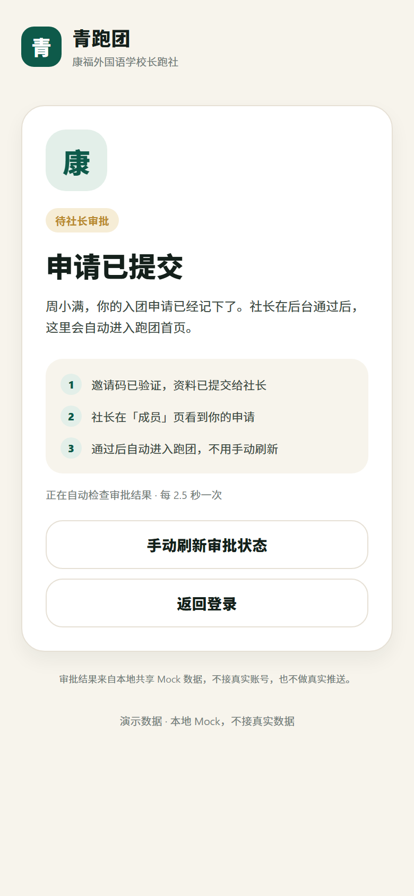
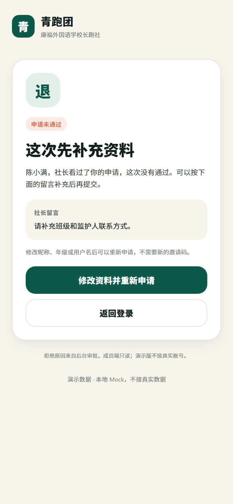
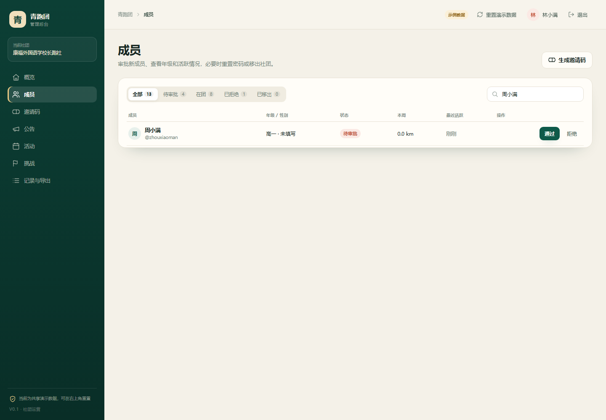
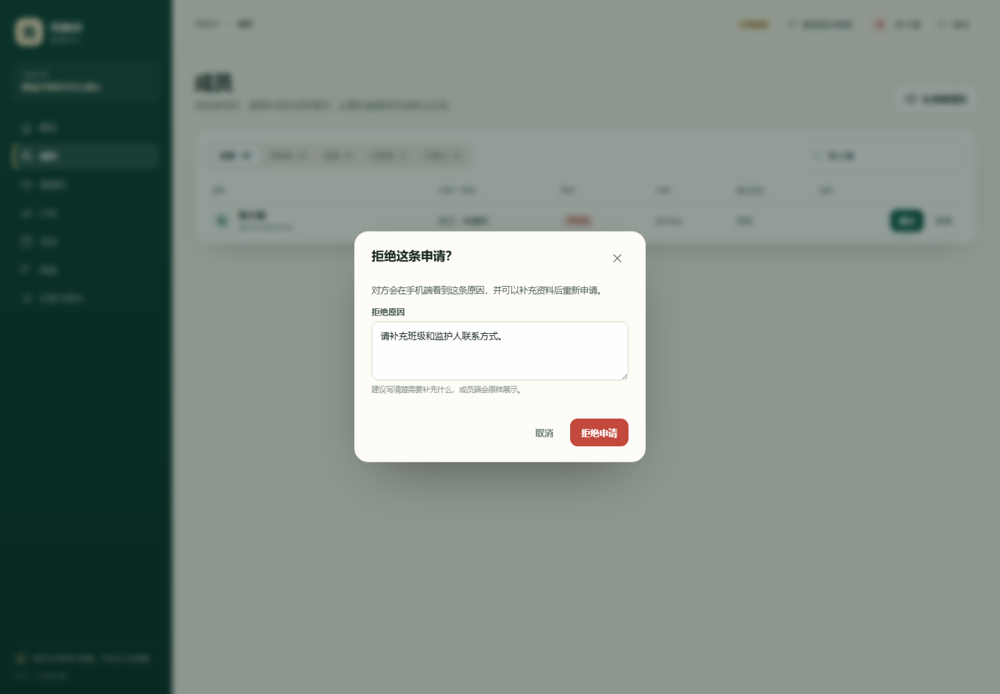

# 入团申请与成员审批 v0.1

这一版把[跑团公告与跑团主页](17-跑团公告与跑团主页-v0.1.md)之后最关键的断点补上：新成员从邀请码到进团，终于走的是同一条共享数据链路。手机端提交的申请会出现在社团后台，社长通过或拒绝后，手机端会自动收到结果；被拒绝的人能看到社长留言、预填资料并重新申请。

- 日期：2026-11-21
- 范围：`mock-api/`、`mobile/` 登录与入团、`admin/` 成员与概览
- 数据：成员名册、申请状态和审批留言都在本地 Mock API 进程内存
- 状态：可点击原型，未接真实账号、密码、短信或未成年人监护人确认

## 1. 这一版解决什么

在公告跨端之后，入团仍然是演示流程：

- 手机端填完邀请码和资料后，申请只存在手机端内存，后台看不到。
- “待审批”页有一个“演示：立即通过”按钮，等于自己批准自己。
- 社团后台成员页读写的是另一份前端示例数据，通过/拒绝不会影响手机端。
- 被拒绝后没有真正的拒绝原因，也不能带着原资料重新申请。

这一版做四件事：

1. Mock API 新增 12 名成员和入团申请接口，手机端与社团后台共用同一份名册。
2. 手机端提交申请后进入待审批页，每 2.5 秒自动查询一次结果；通过后进入欢迎页，拒绝后展示社长留言。
3. 社团后台成员页改接共享接口，可搜索、通过、填写原因拒绝、重置临时密码和移出成员；列表每 5 秒自动刷新。
4. 被拒绝的人可以回到入团表单，昵称、年级、用户名自动预填，重新提交会复用原申请记录，不新增成员。

仍然不做：真实账号体系、密码登录、短信/邮件邀请、实名认证、未成年人监护人知情确认、批量审批和审批操作审计。

## 2. 成员与申请模型

成员存在 Mock API 的 `state.members` 里：

```ts
type MemberStatus = 'pending' | 'active' | 'rejected' | 'removed';

interface Member {
  id: string;
  name: string;
  username: string;
  grade: string;
  gender: '男' | '女' | '未填写';
  status: MemberStatus;
  role: 'owner' | 'member';
  joinedAt: string;
  lastActiveAt: string;
  weeklyKm: number;
  totalKm: number;
  note?: string;
  reviewedAt?: string;
  reviewNote?: string;
}
```

手机端只读取申请视图，字段更少：

```ts
type ApplicationStatus = 'pending' | 'active' | 'rejected';

interface MemberApplication {
  id: string;
  nickname: string;
  username: string;
  grade: string;
  status: ApplicationStatus;
  submittedAt: string;
  reviewedAt: string | null;
  reviewNote: string;
}
```

状态映射：

| 成员状态 | 手机端状态 | 含义 |
| --- | --- | --- |
| `pending` | `pending` | 等社长审批 |
| `active` | `active` | 已通过，可以进团 |
| `rejected` | `rejected` | 本次未通过，可补充后重提 |
| `removed` | 不暴露 | 已移出社团，不能再用原用户名申请 |

种子有 12 名成员：

| 状态 | 人数 | 说明 |
| --- | --- | --- |
| 在团 `active` | 8 | 含社长 `m-001` 林小满 |
| 待审批 `pending` | 3 | `m-002` 陈予安、`m-003` 周子墨、`m-004` 许知远 |
| 已拒绝 `rejected` | 1 | `m-012` 吴亦然，留言“信息填写不完整，已请对方补充学校信息。” |
| 已移出 `removed` | 0 | 初始没有 |

## 3. 接口

| 方法 | 路径 | 作用 |
| --- | --- | --- |
| GET | `/api/members` | 后台成员列表，待审批优先，再按加入时间 |
| POST | `/api/member-applications` | 提交入团申请，body `{ inviteCode, nickname, username, grade }` |
| GET | `/api/member-applications/:id` | 查询申请状态，手机端轮询用 |
| PATCH | `/api/members/:id` | 审批，body `{ status, reviewNote? }` |
| POST | `/api/members/:id/reset-password` | 生成一次性临时密码，不保存 |

### 3.1 提交申请

邀请码只接受 `KANGFU-2026`，比较前会去掉首尾空格并转大写。字段校验：

- 昵称 2–20 个字。
- 用户名 3–20 位小写字母、数字或下划线，提交前自动转小写。
- 年级只允许 `初三 / 高一 / 高二 / 高三 / 大学/其他`。

用户名在“未移出”的成员里全局唯一。重复时返回 409：

> 这个用户名已经被占用了，换一个再试。

如果同名用户名的成员上一次是 `rejected`，不会新建记录，而是把原记录改回 `pending`：

- 更新昵称、年级、`joinedAt` 和 `lastActiveAt`。
- 清空 `reviewedAt` 与 `reviewNote`。
- 备注改为“通过邀请码 KANGFU-2026 重新提交申请。”
- 成员总数不变，手机端拿到的还是同一个申请 id。

新申请返回 201 和 `{ application, member }`，成员状态为 `pending`，性别先记为“未填写”。

### 3.2 审批

后台只能把成员改成 `active / rejected / removed`：

- 社长 `owner` 不能被拒绝或移出。
- 提交和当前状态相同时返回 400“这条申请已经处理过了。”，避免重复点击。
- 已移出的成员不能再被拒绝。
- 通过时写入 `reviewedAt` 和审批留言，默认“已通过审批，成员端会同步看到结果。”，并刷新 `lastActiveAt`。
- 拒绝时默认留言“资料还不完整，请补充后重新申请。”，后台可以改成更具体的内容。
- 移出时默认留言“已由社长移出社团。”。

### 3.3 临时密码

`POST /api/members/:id/reset-password` 每次返回一个 `QR-` 开头的随机密码。它只用于演示后台的“重置密码”提示，服务端不保存，也不能用来登录。

## 4. 手机端

### 4.1 邀请码

登录页保留两种入口：

- `登录`：演示账号 `demo / qingrun123`，进入林小满的首页。
- `我有邀请码`：输入 `KANGFU-2026`，验证后进入入团资料。

邀请码页底部仍提示“面向 14 岁以上青少年。演示版只在本机运行，不会上传真实资料。”实际提交只到本地 8090，不经过外部服务。

### 4.2 入团资料

这一版删掉了密码输入，表单只收：

| 字段 | 规则 |
| --- | --- |
| 昵称 | 2–20 个字，社团里显示这个名字 |
| 年级 | 五选一 |
| 用户名 | 3–20 位小写字母、数字或下划线，提交前转小写 |

提交按钮在请求期间显示“正在提交申请…”，避免重复提交。表单下方说明：

> 提交后由社长在后台审批，审批结果会自动同步到这里。演示版不保存密码。

如果请求失败，错误直接显示在表单里；Mock API 没启动时会提示“连不上演示数据服务，请确认 Mock API 已启动。”。

### 4.3 待审批

提交成功后进入“申请已提交”页：

- 显示申请人昵称和“待社长审批”标签。
- 三步说明：邀请码已验证、社长会在成员页看到申请、通过后自动进入跑团。
- 每 2.5 秒自动查询一次申请状态，页面写明“正在自动检查审批结果 · 每 2.5 秒一次”。
- 有“手动刷新审批状态”和“返回登录”两个按钮，不再有“一键通过”。

查询失败时保持当前页，下一次自动重试，不弹错误打断等待。

### 4.4 审批通过

状态变成 `active` 后进入欢迎页：

- 标签“已通过审批”，标题“欢迎加入跑团”。
- 显示社团、年级、用户名。
- 按钮“进入跑团”，进入后首页使用申请人昵称，例如“你好，周小满”。

手机端不会要求重新登录，也不会把申请人改回林小满；首页顶部头像显示申请人姓氏。

### 4.5 拒绝与重新申请

状态变成 `rejected` 后进入拒绝页：

- 标签“申请未通过”，标题“这次先补充资料”。
- “社长留言”原样显示后台填写的原因。
- 说明“修改昵称、年级或用户名后可以重新申请，不需要新的邀请码。”
- 按钮“修改资料并重新申请”和“返回登录”。

点“修改资料并重新申请”回到入团资料步骤，邀请码、昵称、年级、用户名自动预填；密码已经不再收集。重新提交成功后回到待审批页，成员总数不变。

### 4.6 身份边界

这一版只替换“入团身份”，没有把活动、消息和成长数据按新成员重新分账：

- 新成员进团后，首页昵称和头像使用申请人资料。
- 活动报名、站内消息、成长和公益账本仍使用演示成员 `m-001` 的共享数据。
- 通过页底部明确写“进团后仍使用社团演示数据。”
- 刷新网页会回到登录页，不做会话持久化；这是可点击原型的限制，不是登录失效。

## 5. 社团后台

### 5.1 成员页

路径 `/members`，数据改为 `GET /api/members`：

- 统计：全部、待审批、在团、已拒绝、已移出。
- 搜索：昵称和用户名，输入“周小满”或“zhouxiaoman”都能找到。
- 待审批行显示“通过”“拒绝”。
- 在团行显示“重置”“移出”。
- 已拒绝和已移出行不显示操作。

通过后 toast：

> 周小满 已通过审批，成员端会自动看到结果。

拒绝弹窗有“拒绝原因”多行输入：

- 默认“资料还不完整，请补充后重新申请。”
- 最多 120 字。
- 提示“建议写清楚需要补充什么，成员端会原样展示。”
- 说明“拒绝后，对方会在手机端看到原因，可以补充资料后重新申请。”

拒绝成功 toast：

> 申请已拒绝，拒绝原因会显示在成员端。

### 5.2 概览

概览的待审批列表本来只读前端示例数据，这一版也改成并行读取共享成员：

- 待审批数和在团人数取共享名册。
- 概览里的通过/拒绝直接调 `PATCH /api/members/:id`。
- 概览拒绝使用默认原因，和成员页保持同一套状态变化。

### 5.3 自动刷新

成员页每 5 秒重新拉一次列表，手机端刚提交的申请不需要手动刷新后台：

- 搜索词和筛选状态保留。
- 审批弹窗打开时也可能刷新，但操作对象使用当前行 id，不会串行。
- 概览不做轮询，进入页面时读取一次；从概览跳到成员页会拿到最新数据。

## 6. 跨端时序

| 步骤 | 手机端 | 后台 | 共享数据 |
| --- | --- | --- | --- |
| 1 | 输入邀请码、昵称、年级、用户名 | — | `pending` 成员 `m-...` |
| 2 | 待审批页每 2.5 秒查询 | 成员页 5 秒内出现新申请 | `GET /member-applications/:id` |
| 3 | — | 点“通过” | `status: active`，写审批留言 |
| 4 | 2.5 秒内出现欢迎页 | — | 手机端读到 `active` |
| 5 | 进入首页，显示申请人昵称 | 成员状态“在团” | 同一份名册 |
| 6 | 第二条申请待审批 | 点“拒绝”，填写原因 | `status: rejected`，写留言 |
| 7 | 拒绝页显示社长留言 | — | 手机端读到 `rejected` |
| 8 | 预填资料重新提交 | 5 秒内重新出现待审批 | 复用原 id，成员数不变 |

## 7. 验收

### 7.1 跨端脚本

脚本：`verify-membership.mjs`（项目根）

```text
58/58 checks passed; events=[]
```

脚本同时启动两个无头 Edge：

- 手机端：390×844、deviceScaleFactor 2、端口 9267、访问 `http://127.0.0.1:8090`。
- 社团后台：1440×1000、端口 9249、访问 `http://127.0.0.1:5173`。
- 两边共用 8090 的 Mock API，测试开始和结束都 `POST /api/reset`。

覆盖：

1. 重置后为 12 名成员、3 条待审批，种子活动/报名/消息/公告数量不变。
2. 手机端进入邀请码、验证成功、填写昵称/年级/用户名；表单没有密码输入。
3. 提交后 API 新增 `pending` 成员，总数 13；待审批页没有自助通过按钮。
4. 后台搜索到周小满，统计变为待审批 4，点通过后 API 变 `active`，写入审批留言。
5. 手机端在轮询周期内自动出现欢迎页，显示昵称、年级、用户名；进入首页后仍显示“你好，周小满”。
6. 退出登录后提交第二条申请（陈小满），后台 5 秒内自动刷新，待审批数回到 4。
7. 后台填写“请补充班级和监护人联系方式。”并拒绝，API 变为 `rejected`，留言保留。
8. 手机端自动出现拒绝页，社长留言原样显示。
9. 点“修改资料并重新申请”，邀请码、昵称、年级、用户名预填；重新提交后复用原记录，成员数保持 14，待审批数回到 4。
10. 测试结束重置，成员回到 12；全程没有 console error 或未捕获异常。

### 7.2 证据图

手机端：`mobile/shots/membership/01-invite-code.png` … `09-pending-again.png`，共 9 张 390×844 视口图；总览见同目录 `contact-sheet.png`。

| 图 | 内容 |
| --- | --- |
| `01-invite-code.png` | 邀请码步骤，填入 KANGFU-2026 |
| `02-join-form.png` | 入团资料，只有昵称、年级、用户名 |
| `03-pending.png` | 申请已提交，自动检查审批结果 |
| `04-approved.png` | 已通过审批、欢迎加入跑团 |
| `05-home-after-approval.png` | 进团后首页显示“你好，周小满” |
| `06-second-pending.png` | 第二条申请待审批 |
| `07-rejected.png` | 拒绝页与社长留言 |
| `08-reapply-form.png` | 重新申请表单已预填 |
| `09-pending-again.png` | 重提后回到待审批 |





后台：`admin/shots/membership/01-member-pending.png` … `04-reapplied.png`，共 4 张 1440×1000 图；总览见同目录 `contact-sheet.png`。

| 图 | 内容 |
| --- | --- |
| `01-member-pending.png` | 后台搜索到待审批的周小满 |
| `02-member-approved.png` | 通过后状态“在团”与 toast |
| `03-reject-dialog.png` | 填写拒绝原因 |
| `04-reapplied.png` | 陈小满重提后重新待审批 |





### 7.3 构建

- 手机端：`npm run typecheck`、`npm run web:export` 通过，导出 20 个 web bundle（auth 在 entry 内，entry 约 1.1 MB）。
- 后台：`npm run typecheck`、`npm run build` 通过，67 modules，JS 499.01 kB / CSS 41.76 kB。

## 8. 代码位置

| 文件 | 作用 |
| --- | --- |
| `mock-api/server.mjs` | 成员种子、申请与审批接口、用户名复用、临时密码、重置 |
| `mock-api/smoke-members.mjs` | 仅 API 的成员申请/审批冒烟，运行前会重置共享数据 |
| `admin/src/data/memberApi.ts` | 后台成员接口封装 |
| `admin/src/features/members/MembersPage.tsx` | 成员列表、搜索、通过、拒绝原因、重置、移出、5 秒刷新 |
| `admin/src/features/overview/OverviewPage.tsx` | 概览待审批合并共享成员 |
| `admin/src/types/models.ts` | `Member` 增加审批时间、留言和“未填写”性别 |
| `mobile/src/features/auth/memberApi.ts` | 手机端提交与查询申请 |
| `mobile/src/features/auth/AuthContext.tsx` | `guest / pending / approved / rejected / active` 状态机 |
| `mobile/src/features/auth/AuthScreen.tsx` | 邀请码、资料、待审批、通过、拒绝、重新申请 |
| `mobile/src/app/_layout.tsx` | 按状态切换登录、待审批、通过、拒绝和主应用 |
| `verify-membership.mjs` | 58 项手机 + 后台跨端 CDP 验收 |
| `mobile/scripts/e2e-auth.mjs` | 13 项登录、邀请码与提交待审批的 CDP 冒烟 |
| `mobile/scripts/make-membership-sheet.py` | 手机端 9 图拼图 |
| `admin/make-membership-sheet.py` | 后台 4 图拼图 |

## 9. 边界

- 成员和申请只在 Mock API 进程内存；重启服务回 12 人种子，没有数据库、迁移或备份。
- 没有真实账号、密码、短信或邮件。手机端只做演示登录和邀请码入团，刷新网页回登录页。
- 按用户要求，不做未成年人监护人知情确认；后台活动页原有的监护人同意字段仍是旧演示数据，和入团审批不是同一条流程。
- 待审批页只在打开时每 2.5 秒轮询；关闭页面或退出后不会收到任何通知，也没有真实推送。
- 后台成员页每 5 秒刷新；概览只在进入时读取一次。
- 新成员进团后仍使用演示成员 `m-001` 的活动、消息、成长和公益数据；这不是多租户账号体系，不能用于真实验收。
- 用户名在未移出成员里全局唯一；被拒绝可复用，被移出不能复用原用户名，也不能找回旧记录。
- 审批只有社团负责人一个角色，没有多级审批、批量审批、审批时限或操作审计。
- 后台拒绝原因最多 120 字，不做敏感词过滤；留言会原样显示给申请人。
- 临时密码只是随机字符串提示，服务端不保存，也不能登录；重置密码不会通知成员。
- 性别在申请时没有采集，后台显示“未填写”，不是真实资料。
- 所有姓名、学校、年级和留言都是虚构演示数据。

## 10. 演示路径

先启动共享服务：

```bash
cd E:\QPTapp
node mock-api/server.mjs
```

再启动后台和手机端（分别开终端）：

```bash
cd E:\QPTapp\admin
npm run dev

cd E:\QPTapp\mobile
npm run web
```

推荐顺序：

1. 手机端打开登录页，切到“我有邀请码”，填 `KANGFU-2026`。
2. 填写昵称“周小满”、年级“高一”、用户名“zhouxiaoman”，提交。
3. 停在待审批页，看“每 2.5 秒一次”的提示。
4. 后台登录，进入“成员”，搜索“周小满”，点“通过”。
5. 手机端几秒内自动进入“欢迎加入跑团”，点“进入跑团”，首页显示“你好，周小满”。
6. 退出登录，再提交一条“陈小满”的申请；后台在 5 秒内出现。
7. 后台点“拒绝”，填写“请补充班级和监护人联系方式。”，确认。
8. 手机端自动进入拒绝页，看到社长留言；点“修改资料并重新申请”，确认预填后重新提交。
9. 后台重新出现待审批；需要恢复时，在手机端“我的 → 演示数据”重置，或 `POST /api/reset`。


