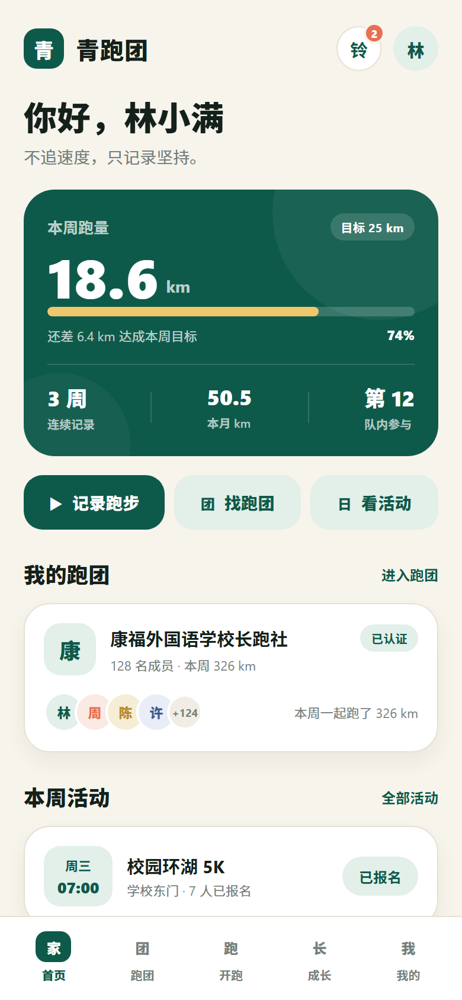
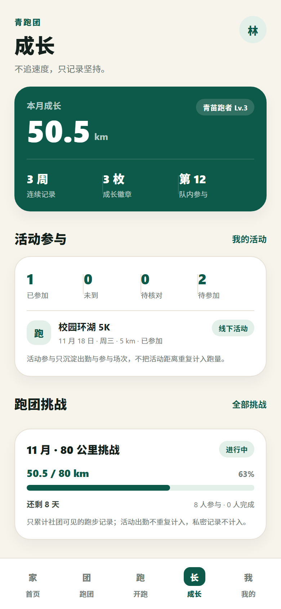
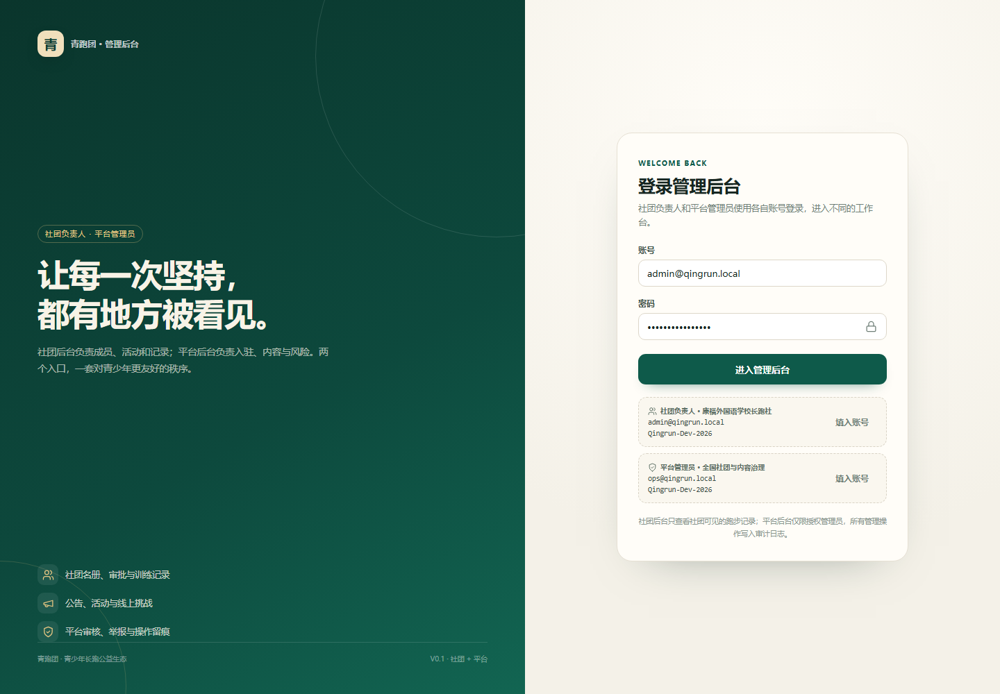
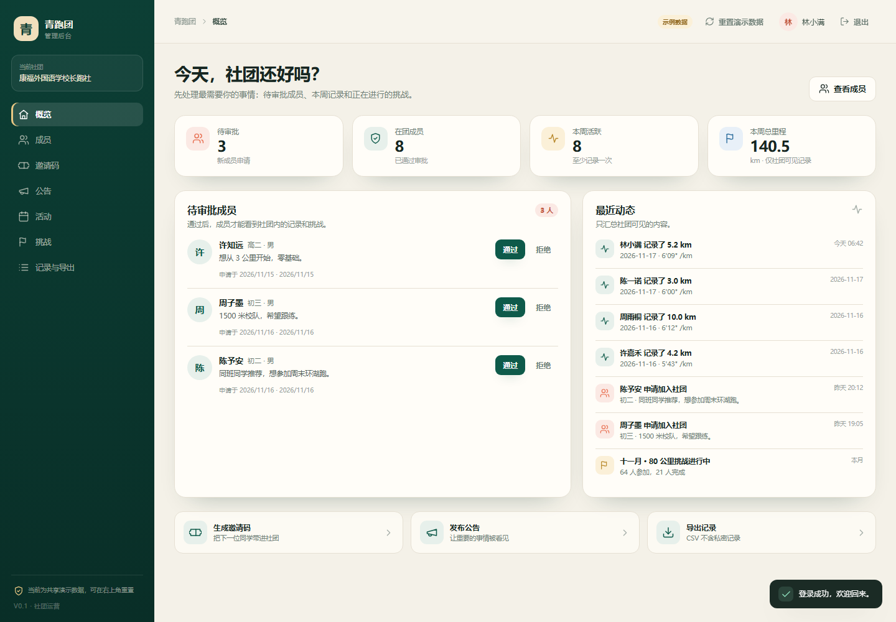

# 青跑团 · 功能手册

版本：v0.2 空白数据  
更新日期：2026-11-27  
适用对象：社团社长、教练、平台管理员、演示体验者

这是一份可直接照着操作的说明书。青跑团当前是**可点击原型**，使用本地 Mock 数据，不是已经上线的正式产品。下文第 3–5 章的操作示例以演示模式为例。

---

## 1. 一分钟认识青跑团

**当前部署状态（2026-11-27 起）：空白数据模式。** 后台账号可以登录，但成员、活动、公告、挑战、记录均为 0；手机端没有成员账号，暂时无法登录体验。要恢复演示数据，按 6.2 节把 data-mode.txt 改回 demo 并重启 API。

青跑团是面向 10–20 岁青少年长跑社团的公益型长跑生态平台。它把社团日常最常用的几件事放在一个手机端和一个管理后台里：

- 新成员用邀请码申请入团，社长在后台审批；
- 社长发布活动、审核报名、赛后核对出勤；
- 成员报名、取消、看集合点、收到变更消息；
- 成员记录跑步，首页、成长页和挑战进度同步更新；
- 社长发布公告、创建挑战、导出跑步记录；
- 平台管理员查看社团、用户、内容、记录和举报。

当前版本的重点不是“功能越多越好”，而是把**入团 → 活动 → 记录 → 成长 → 消息**这条主线走通，并且让手机端和后台使用同一份共享数据。

### 1.1 三个入口

| 入口 | 地址 | 谁能用 | 说明 |
| --- | --- | --- | --- |
| 手机端 | http://rununion.club | 成员、体验者 | 当前是 HTTP 网页，手机浏览器直接打开 |
| 社团后台 | http://127.0.0.1:8081 | 社长、教练 | 只在服务器本机可打开，需在服务器桌面上访问 |
| 平台总后台 | http://127.0.0.1:8081（用平台账号登录） | 平台管理员 | 与社团后台同一入口，登录后进入平台工作区 |

> 后台默认只监听服务器本机，这是为了避免演示账号直接暴露在公网。需要远程看后台时，请通过远程桌面进入服务器后再打开。

### 1.2 演示账号

| 身份 | 账号 | 密码 | 用途 |
| --- | --- | --- | --- |
| 手机端成员 | demo | qingrun123 | 体验成员首页、活动、记录、成长（仅演示模式） |
| 社团后台 | admin@qingrun.local | Qingrun-Dev-2026 | 审批、公告、活动、挑战、记录 |
| 平台总后台 | ops@qingrun.local | Qingrun-Dev-2026 | 社团、用户、内容、举报、系统 |

邀请码：**KANGFU-2026**（仅演示模式；后台也可以生成新邀请码）。

> 这些账号只用于演示，不能当作正式账号使用。空白模式下手机端没有可登录成员，后台账号不受影响。

### 1.3 界面预览

#### 手机端




<!-- pagebreak -->

#### 管理后台




---

## 2. 手机端功能

### 2.1 登录

1. 手机浏览器打开 http://rununion.club。
2. 输入用户名 demo、密码 qingrun123。
3. 点击登录，进入首页。

如果页面自动跳到了 https 但打不开，请手动把地址改回 **http://rununion.club**。当前服务器只配置了 80 端口的 HTTP，443 的 HTTPS 还没有配置。

### 2.2 入团申请

演示版支持两条路径：

- 已有成员：直接用 demo 登录。
- 新成员：在登录页选择入团，填写邀请码、昵称、年级和用户名，提交后等待社长审批。

邀请码规则：

- 邀请码由社团后台「邀请码」页生成；
- 手机端会先向共享 API 验证，停用、过期、名额用完都会直接说明原因；
- 提交申请时占用一个名额；被拒绝不会自动返还名额；
- 社长在后台通过后，手机端待审批页会自动检查并进入欢迎页；
- 被拒绝时会显示社长留言，可以预填资料重新申请。

### 2.3 五个主页面

底部导航固定为：**首页、跑团、开跑、成长、我的**。

#### 首页

- 显示问候语、本周跑量、周目标、完成百分比；
- 显示连续记录周数、本月跑量、队内参与；
- 三个快捷入口：记录跑步、找跑团、看活动；
- 「我的跑团」卡片可进入跑团主页；
- 「本周活动」显示最近一场活动和报名状态；
- 右上角铃铛显示未读消息数，点进去是消息中心。

#### 跑团

- 展示跑团名称、成员数、本周总公里数、活动数；
- 展示跑团公告，按置顶和时间排序；
- 展示近期活动，可进入活动列表；
- 「查看跑团」进入跑团主页，能看到公告、近期活动、跑团信息和运动安全卡。

#### 开跑

提供四种记录方式：

1. **GPS 记录**：前台记录跑步，适合在操场或安全路线使用；
2. **截图导入**：选择跑步 App 的截图，人工确认距离和时长；
3. **文件导入**：支持 GPX / TCX / CSV；
4. **手动补记**：没有轨迹时的兜底，填写距离、时长和备注。

保存后：

- 记录先写入共享 Mock API；
- 首页本周 / 本月跑量、最近记录、成长页和挑战进度同步更新；
- 如果同步失败，会保留本地记录并提示未同步，不会假装成功。

> 当前是演示版，不接手机系统健康数据，也不做后台定位。GPS 记录只在前台运行。

#### 成长

- 本月成长公里数、连续记录周数、成长徽章、队内参与；
- 「活动参与」把活动出勤沉淀为已参加、未到、待核对、待参加，不把活动距离重复计入跑量；
- 「跑团挑战」显示进行中挑战、个人进度、剩余天数和参与人数；
- 「全部挑战」可以看到未开始和已结束的挑战；已结束的挑战进度只读。

#### 我的

- 消息中心：显示未读条数；
- 公益助跑：进入公益透明账本；
- 个人资料与设置：同城推荐、公开跑步记录、监护人授权状态等；
- 演示数据卡：可以重置活动、消息和挑战；
- 设置：消息提醒、意见反馈、关于青跑团；
- 退出登录。

> 「监护人授权」当前只做展示，按产品决定**不做未成年人监护人知情确认流程**；正式上线前需要重新评估。

### 2.4 活动报名

活动状态包括：待确认、已报名、已参加、未到、已取消、可重新报名。

- 在首页、跑团页、活动列表、活动详情、我的活动里，报名状态是同一份数据；
- 待确认时看不到具体集合点，社长通过后才显示；
- 报名成功后可在活动详情里取消，名额会回到活动；
- 活动结束后，社长在后台标记已参加或未到；
- 未到只记录出勤，不会自动移出跑团，也不会释放名额；
- 后台修改时间、地点、教练等信息后，成员会收到一条「活动信息有变更」的消息。

### 2.5 消息中心

消息中心覆盖五类内容：

- 报名确认；
- 活动提醒；
- 赛后出勤；
- 跑团公告；
- 跑团挑战。

支持：

- 全部 / 未读筛选；
- 未读条数显示；
- 全部已读；
- 点击消息跳到对应活动、公告或挑战；
- 重新进入页面时自动刷新。

> 消息只覆盖活动相关事件，不做真实推送；当前是站内消息。

### 2.6 跑团公告

- 跑团页显示最新公告；
- 点「全部公告」进入公告列表；
- 公告有分类：通知、训练、安全；
- 置顶公告排在最前；
- 有未读圆点，进入详情后标记已读；
- 后台发布公告会给在团成员写一条站内消息；
- 后台撤回公告后，成员端不再展示，相关消息也会清理。

### 2.7 挑战

- 成长页显示进行中的挑战和个人进度；
- 「全部挑战」按进行中、未开始、已结束展示；
- 挑战只累计社团可见的跑步记录，私密记录不计入；
- 活动出勤不会重复计入挑战；
- 后台创建挑战会给成员发站内消息；
- 挑战结束后进度只读。

### 2.8 公益透明账本

从「我的」页进入，展示：

- 本期已落实的跑鞋、参赛名额、教练时间、参与跑团；
- 本期目标进度；
- 物资去向：日期、项目、数量、来源、状态、说明；
- 账本规则：不募集现金、受助人化名、物资留痕。

当前账本是**手机端示例数据**，用于说明透明账本的产品形态，不代表真实捐赠或真实财务数据。

### 2.9 安装到手机桌面（PWA）

青跑团网页已经带 PWA manifest、Service Worker 和图标。配置 HTTPS 后可以“添加到主屏幕”：

- Android Chrome：右上角菜单 → 添加到主屏幕 / 安装应用；
- iPhone Safari：分享按钮 → 添加到主屏幕。

注意：

- PWA 安装通常要求 HTTPS；
- 当前服务器只有 HTTP，所以先用浏览器访问；
- 这不是 APK，也不是 App Store 应用；
- 后续如果需要安卓安装包，可以单独打 APK；iPhone 只能走 TestFlight / App Store，或先用网页版。

---

## 3. 社团后台

### 3.1 登录与概览

1. 在服务器本机打开 http://127.0.0.1:8081。
2. 输入 admin@qingrun.local / Qingrun-Dev-2026。
3. 进入「概览」。

概览会显示：

- 待审批成员数；
- 在团成员数；
- 本周活跃人数；
- 本周总里程；
- 待审批成员列表，可直接通过或拒绝；
- 最近动态：跑步记录和入团申请；
- 「生成邀请码」「发布公告」「导出记录」快捷入口。

### 3.2 成员审批

- 成员页读共享名册，5 秒自动刷新；
- 支持搜索；
- 可以通过、填写原因拒绝、重置临时密码、移出社团；
- 审批结果同步到手机端；
- 拒绝原因会显示在手机端，成员可以预填资料重新申请。

### 3.3 邀请码

- 生成邀请码，设置可用次数和有效期；
- 复制邀请码给新成员；
- 停用邀请码；
- 显示已用 / 总名额、过期时间和状态；
- 手机端提交申请时会验证邀请码。

### 3.4 公告

- 新建公告：标题、正文、分类、是否置顶；
- 保存为草稿，或直接发布；
- 发布后成员端可见，并收到站内消息；
- 支持置顶 / 取消置顶；
- 支持撤回：成员端不再展示，相关消息清理；
- 支持删除；
- 卡片显示已读人数。

### 3.5 活动

- 新建活动：标题、日期、时间、地点、距离、教练、人数上限、说明、出发前准备；
- 保存草稿或发布；
- 编辑已发布活动；
- 修改时间、地点、教练等字段后，会给待确认和已确认成员写变更消息；
- 人数上限不能低于当前报名数；
- 筛选待确认报名，通过或拒绝；
- 补登记监护人同意（仅后台记录，不做手机端监护人确认流程）；
- 结束活动；
- 已结束活动可以逐条标记已参加 / 未到、撤销签到、查看出勤进度。

### 3.6 挑战

- 新建挑战：名称、目标公里数、开始日期、结束日期、说明；
- 创建后会给在团成员写站内消息；
- 只能结束进行中的挑战；
- 结束后进度只读；
- 挑战进度来自社团可见的跑步记录。

### 3.7 记录与导出

- 读共享跑步记录，显示记录数、合计里程、参与人数；
- 可按成员、备注筛选；
- 可导出当前筛选结果为 CSV；
- CSV 不含私密记录；
- 记录来自手机端保存的跑步记录。

---

## 4. 平台总后台

平台总后台与社团后台使用同一个入口，用平台账号登录后进入独立工作区，包含：

1. 总览；
2. 学校与社团；
3. 社团详情；
4. 全部用户；
5. 用户详情；
6. 内容与活动；
7. 跑步记录；
8. 审核与举报；
9. 系统与权限。

主要能力：

- 社团审核 / 暂停；
- 用户暂停 / 恢复；
- 内容上下线；
- 记录更正；
- 举报处理；
- 平台账号管理；
- 所有管理操作写入内存审计日志；
- 主要列表支持搜索、筛选和每页 10 条分页。

> 平台总后台同样是演示数据，不具备真实权限系统、真实审计存储或生产级安全能力。

---

## 5. 典型流程

### 5.1 新成员加入

1. 社长在后台「邀请码」生成一个邀请码。
2. 把邀请码发给新成员。
3. 新成员在手机端选择入团，填写邀请码、昵称、年级、用户名。
4. 手机端提示提交成功，进入待审批页。
5. 社长在后台「概览」或「成员」看到申请。
6. 社长点「通过」。
7. 手机端自动检查到结果，进入欢迎页。
8. 如果拒绝，填写原因；成员端显示原因，可重新申请。

### 5.2 发布活动 → 报名 → 改期 → 签到

1. 后台「活动」新建活动，填写时间、地点、人数等。
2. 发布活动。
3. 成员在手机端活动列表报名。
4. 社长在后台筛选待确认，逐个通过。
5. 成员收到报名确认消息，能看到集合点。
6. 如果改期，社长编辑活动时间；系统给相关成员写变更消息。
7. 活动结束后，社长在后台逐条标记已参加 / 未到。
8. 成员在「我的活动」看到出勤结果，成长页的活动参与同步更新。

### 5.3 发布公告

1. 后台「公告」新建公告，选择分类，决定是否置顶。
2. 保存草稿或发布。
3. 发布后成员端跑团页和公告列表可见。
4. 在团成员收到「跑团公告」站内消息。
5. 撤回后成员端不再展示，相关消息清理。

### 5.4 创建挑战

1. 后台「挑战」新建挑战，填写目标公里数和日期范围。
2. 创建后成员收到挑战消息。
3. 成员在成长页看到挑战进度。
4. 挑战结束后进度只读。

### 5.5 导出记录

1. 后台「记录与导出」查看全部记录。
2. 按成员或备注筛选。
3. 点「导出 CSV」。
4. 打开 CSV 检查记录数、距离、成员和备注。

---

## 6. 数据与边界

### 6.1 数据放在哪里

- 活动、报名、出勤、消息、公告、邀请码、成员、入团申请、跑步记录、挑战：本地 Mock API，进程内存；
- 公益账本：手机端示例数据；
- 平台总后台的社团、用户、内容、举报、审计：前端示例数据；
- 手机端登录状态：当前浏览器会话，刷新页面可能需要重新登录。

### 6.2 重置数据

- 手机端「我的」→「清空本次新增数据」；
- 后台右上角「重置数据」；
- 空白模式（当前）：重置后仍为 0；演示模式：重置后回到 4 场活动、19 条报名、3 条消息、4 条公告、12 名成员、4 个邀请码、25 条跑步记录、3 个挑战。

> Mock API 重启会按 `data-mode.txt` 回到空白或种子状态。切换方法：把 `data-mode.txt` 内容改成 `demo` 或 `empty`，先双击 `stop.bat`，再双击 `start.bat`。

### 6.3 当前不做的事

- 不接真实账号、微信登录、短信验证；
- 不接真实支付、捐赠或公益募集；
- 不接真实地图、GPS 后台定位或手机健康数据；
- 不做真实推送，只有站内消息；
- 不做未成年人监护人知情确认流程（按当前产品决定）；
- 不做生产级权限、审计、备份、容灾；
- 不是 App Store / 应用商店应用，当前是网页 / PWA。

### 6.4 正式上线前必须补的

- 真实数据库和账号体系；
- HTTPS 证书；
- 后台鉴权、权限和审计；
- 隐私政策、未成年人保护、数据合规；
- 真实消息推送；
- 真实地图 / 定位 / 健康数据接入；
- 应用商店资质与备案（如做 APK / iOS）。

---

## 7. 部署与运维（Windows 服务器）

### 7.1 当前服务器

- 域名：rununion.club；
- 系统：Windows；
- Node.js：v22.20.0；
- 手机端：80 端口，HTTP；
- 后台：127.0.0.1:8081，仅本机；
- API：127.0.0.1:8090，仅本机。

### 7.2 启动

进入发布目录，双击 **start.bat**。

启动后会打开两个最小化窗口：

- Qingrun API：共享数据接口；
- Qingrun Web：手机端和后台静态页面。

> start.bat 末尾可能出现两行类似 `'手机端：http:' is not recognized` 的提示，这是 Windows 命令行对中文和 URL 的显示问题，不影响服务运行。看到“青跑团已经启动”即可。

### 7.3 停止

双击 **stop.bat**。

### 7.4 检查

双击 **check.bat**，会显示：

- Node 版本；
- 80 端口监听情况；
- /api/health 返回；
- 手机端 HTTP 状态。

也可以在手机浏览器直接打开 http://rununion.club/api/health，看到 JSON 即表示 API 正常。

### 7.5 更新版本

每次更新使用新的版本目录，例如：

```
qingrun-windows-v0.1.1/
qingrun-windows-v0.1.0/   ← 保留旧版本，用于回滚
```

更新步骤：

1. 先双击旧目录的 stop.bat 停止服务；
2. 把新版本目录复制到服务器；
3. 进入新目录，双击 start.bat；
4. 手机访问验证；
5. 旧目录不要删除，留作回滚。

### 7.6 端口冲突

如果 start.bat 提示 80 端口被占用：

1. 在 PowerShell 运行 `netstat -ano | findstr :80`；
2. 找到 LISTENING 对应的 PID；
3. 确认不是系统关键服务后，再结束该进程；
4. 重新双击 start.bat。

不要在不确认 PID 的情况下随意结束进程。

### 7.7 HTTPS

当前没有配置 443。手机浏览器如果自动跳转 https，会打不开。

处理方式：

- 手动输入 http://rununion.club；
- 或在浏览器设置里关闭“始终使用 HTTPS”；
- 正式使用前建议配置 HTTPS 证书，PWA 安装也需要 HTTPS。

---

## 8. 常见问题

| 现象 | 可能原因 | 处理 |
| --- | --- | --- |
| 手机打不开 | 浏览器自动跳 https、防火墙、80 未监听 | 手动输入 http://rununion.club；检查 80 端口和防火墙 |
| 后台打不开 | 后台只在服务器本机监听 | 在服务器桌面上打开 http://127.0.0.1:8081 |
| 数据回到初始 | Mock API 重启或手动重置 | 这是演示版预期行为，重新操作即可 |
| 登录失败 | 账号或密码输错 | 手机 demo/qingrun123；后台 admin@qingrun.local/Qingrun-Dev-2026 |
| 邀请码无效 | 停用、过期、名额用完 | 后台生成新码；检查状态和剩余名额 |
| 消息不更新 | 页面没有重新进入 | 返回再进入消息中心；或重置后重试 |
| 记录保存失败 | API 未启动或网络断开 | 检查 8090 / api/health；本地记录会保留但提示未同步 |
| PWA 无法安装 | 当前是 HTTP | 先配置 HTTPS，再用浏览器“添加到主屏幕” |
| 端口 80 被占用 | 旧服务或旧进程未退出 | 用 netstat 查 PID，确认后结束，再启动 |
| 中文提示乱码 | cmd 编码显示问题 | 不影响服务；以“青跑团已经启动”和页面访问为准 |

---

## 9. 本次验收

### 9.1 已经做过的功能验收

| 范围 | 脚本 | 结果 |
| --- | --- | --- |
| 手机活动报名与出勤 | mobile/verify-activities.mjs | 64/64 |
| 手机消息、成长、公益 | mobile/verify-messages.mjs | 53/53（历史） |
| 手机跑团公告与主页 | mobile/verify-announcements.mjs | 49/49 |
| 手机记录与挑战 | mobile/verify-runs-challenges.mjs | 44/44 |
| 后台公告 | admin/verify-announcements.mjs | 40/40 |
| 后台记录与挑战 | admin/verify-runs-challenges.mjs | 39/39 |
| 后台编辑活动 | admin/verify-edit-activity.mjs | 20/20 |
| 入团与审批跨端 | verify-membership.mjs | 58/58 |
| 邀请码跨端 | verify-invites.mjs | 44/44 |
| 部署冒烟 | deploy/verify-deploy.mjs + verify-browser.mjs | 7/7 + 19/19 |

> 上表是历史验收结果。本次全量回归的最终通过数见下一节。

### 9.2 本次全量回归

2026-11-27 在本机共享 Mock API（8090）和社团后台开发服务（5173）上按顺序重跑。主批次 17 个脚本在修正 2 个过期测试脚本后全部通过（退出码 0）；其中 8 个带编号断言的脚本共 347 项全过。另单独复跑手机活动 64/64，加上后共 18 个脚本、411 项编号断言全过。

| 范围 | 脚本 | 结果 |
| --- | --- | --- |
| 手机消息、成长、公益 | mobile/verify-messages.mjs | 53/53 |
| 手机跑团公告与主页 | mobile/verify-announcements.mjs | 49/49 |
| 手机记录与挑战 | mobile/verify-runs-challenges.mjs | 44/44 |
| 后台公告 | admin/verify-announcements.mjs | 40/40 |
| 后台记录与挑战 | admin/verify-runs-challenges.mjs | 39/39 |
| 后台编辑活动 | admin/verify-edit-activity.mjs | 20/20 |
| 入团与审批跨端 | verify-membership.mjs | 58/58 |
| 邀请码跨端 | verify-invites.mjs | 44/44 |
| 手机活动报名与出勤（单独复跑） | mobile/verify-activities.mjs | 64/64 |

另有 9 个脚本以页面探索和接口断言方式检查，退出码均为 0：mobile/verify-knowledge.mjs、mobile/verify-run-sync.mjs、mobile/verify-three-channels.mjs、admin/verify-activities-admin.mjs、admin/verify-checkin-admin.mjs，以及 admin/verify-platform.mjs、verify-platform-actions.mjs、verify-platform-paging2.mjs、verify-platform-responsive.mjs。

回归中出现的失败都来自测试脚本写死了旧日期或旧文案，不是产品功能回归：

- 活动脚本把 act-004 的日期写死为 11 月 15 日，实际种子已改为 11 月 22 日；改为读取接口日期后通过。
- 活动、消息脚本仍在等旧的重置提示，改为当前“活动演示数据、消息和挑战已重置……”文案后通过。
- 挑战脚本写死“还剩 8 天”、参与人数和新挑战 18.6 km / 47%，而新挑战当天开始、种子跑量在此之前；改为从接口现算剩余天数、参与人数和个人进度后通过。
- 相关脚本复跑通过，并在结束时调用 /api/reset 恢复 25 条跑步记录、3 个挑战、3 条消息。

日志目录：`test-runs/full-2026-11-27/`，总日志 `master.log`，各项日志同名。结论：没有发现需要修改产品代码的回归。

### 9.3 已知限制

- 共享数据在内存，重启按 data-mode.txt 回到空白或种子；
- 平台总后台仍是前端示例数据；
- 公益账本仍是手机端示例数据；
- 没有真实推送、地图、健康数据、支付；
- 没有 HTTPS，PWA 安装受限；
- 后台只绑本机，远程访问需要远程桌面。

---

## 10. 文档与版本

| 文档 | 内容 |
| --- | --- |
| docs/00–04 | 项目蓝图、方向、功能设计、页面流程 |
| docs/05–07 | 管理员后台方案、线框、运行与验收 |
| docs/08–09 | 手机登录入团、双后台与平台总后台 |
| docs/10–11 | 开跑记录与成长、跑步知识库 |
| docs/12–15 | 活动报名、发布审核、签到与出勤跨端 |
| docs/16 | 活动消息、成长、公益账本 |
| docs/17 | 跑团公告与跑团主页 |
| docs/18–19 | 入团审批、邀请码 |
| docs/20 | 开跑记录与挑战跨端 |
| docs/21 | 本手册 |

当前演示包：`qingrun-windows-v0.1.0`  
当前发布分支：develop（main 保持 49c20f6，不自动合并）  
技术栈：Expo / React Native（手机端）、React + Vite（后台）、Node.js Mock API。

---

## 附：最短上手路线

如果你只有 5 分钟：

1. 手机打开 http://rununion.club，用 demo / qingrun123 登录；
2. 看首页本周跑量，点「看活动」报名一场活动；
3. 点「开跑」手动补记 1 km；
4. 回首页看跑量变化，点「成长」看挑战进度；
5. 点右上角铃铛看消息；
6. 在服务器上打开 http://127.0.0.1:8081，用后台账号登录；
7. 在「概览」通过一个待审批成员，或发布一条公告；
8. 回手机端刷新，看审批结果 / 公告和消息。
